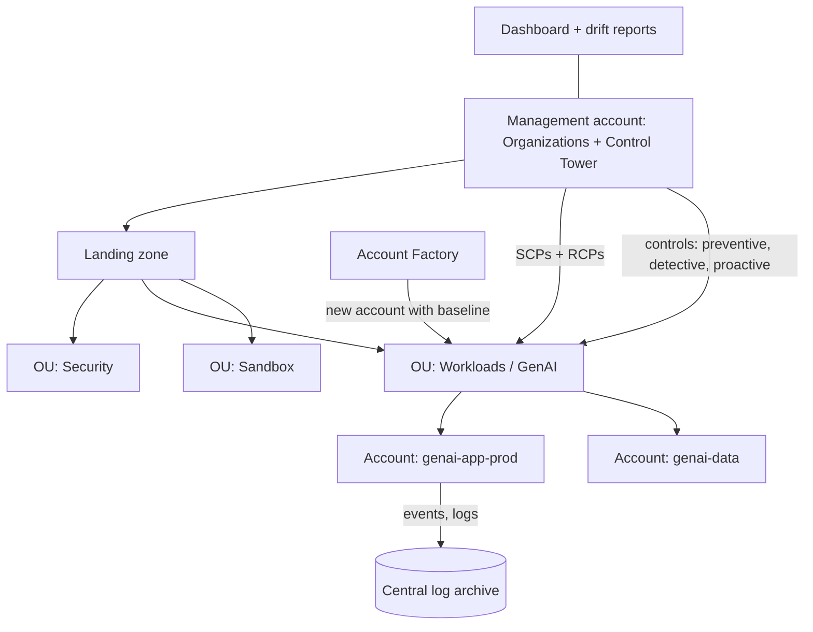

## 0. Before you start
- **Essential:** what an AWS account is; why companies use many accounts (separate production, test, security tooling, and teams).
- **Helpful:** IAM policy evaluation ([08/01 §5.2](aip:08-security/01-least-privilege-iam-identity-center-and-data-masking)); JSON policies.
- **Optional advanced:** AWS Service Catalog; AWS Config rules; CloudFormation hooks.

## 1. Simple explanation
One AWS account is easy to start but hard to govern at company scale. Large organizations use **many accounts** under **AWS Organizations**, grouped into **organizational units (OUs)**, and attach **service control policies (SCPs)** to say what is *never* allowed (for example "no Bedrock outside two approved Regions"). **AWS Control Tower** automates that set-up: it builds a ready-made, well-architected **landing zone** (the multi-account base), adds **controls** (rules that prevent, detect or pre-check risky changes), lets teams order new accounts from a template (**Account Factory**), and shows a **dashboard** of what is compliant. For GenAI governance it gives one place to say "every account must keep CloudTrail on, may only use approved models and Regions, and must apply the central guardrail".


```figure
flow org-governance
```

## 2. Structured explanation
1. **Organizations** ✅: a management account, OUs and member accounts; **SCPs** (control principals) and **RCPs** (control resources) set the maximum permissions; they **grant nothing** and apply to the account, OU or organization level ([08/01](aip:08-security/01-least-privilege-iam-identity-center-and-data-masking)).
2. **Control Tower** ✅: orchestrates AWS Organizations, AWS Service Catalog and IAM Identity Center to create a landing zone in under an hour; applies **controls** (also called guardrails) to prevent *drift*; provides **Account Factory** and a **dashboard**.
3. **Three kinds of control** ✅ (names as on the page): *preventive*, *detective*, *proactive*; **three categories of guidance**: *mandatory*, *strongly recommended*, *elective*. Mechanisms behind each kind (SCPs, AWS Config rules, CloudFormation hooks) are standard knowledge 🟡 and were not on the page I read.
4. **Bedrock-specific governance** ✅: **organization-level enforced guardrails** (a guardrail in the administrator account applied in member accounts; needs a guardrail resource-based policy), **account-level enforced guardrails**, SCPs on `bedrock:*` actions and on data-retention settings, CloudTrail for evidence ([07/04](aip:07-governance-qa/04-cloudtrail-and-x-ray-for-genai)).

## 3. Analogy
**A hotel chain.** The chain headquarters (management account) writes house rules (SCPs) that every hotel (account) must obey, whatever its local manager wants. Control Tower is the franchise package: standard building plans (landing zone), rule books with three enforcement styles (stop it, report it, check the plans first), and a form to open a new hotel with everything pre-installed (Account Factory). A dashboard on HQ's wall shows which hotels follow the rules.

*Where it breaks:* HQ rules only *remove* options; they never hand out keys. A hotel manager (account admin) still needs their own permissions, and a rule that is too broad can lock out even the HQ's own tools.

## 4. The seven questions

**WHAT?** The AWS multi-account governance stack: Organizations (OUs, SCPs, RCPs), Control Tower (landing zone, controls, Account Factory, dashboard), and for GenAI the enforced guardrails.

**WHY?** Consistent security and compliance across dozens of accounts, faster account creation, a drift report, and limits on risky AI usage (models, Regions, data retention).

**WHEN?** More than a handful of accounts, regulated workloads, several AI teams, or a need to prove controls to an auditor.

**WHERE?** The Control Tower **home Region** and governed Regions; Organizations management account; guardrail policies live in the guardrail's Region and, for cross-Region inference, in each destination profile ARN through the source Region ✅ ([08/01 §5.6](aip:08-security/01-least-privilege-iam-identity-center-and-data-masking)).

**HOW?** §5.

**WHAT IF?**
| Situation | Effect | Remedy |
|---|---|---|
| An SCP denies `bedrock:*` outside two Regions and a team uses cross-Region inference to a third | Calls fail | Include the destination Regions in the SCP or choose a profile within approved Regions |
| An organization-enforced guardrail is switched on but callers cannot call `ApplyGuardrail` on it | Those callers' `InvokeModel`/`Converse` calls fail with `AccessDenied` ✅ | Test `ApplyGuardrail` from every identity first; attach the resource-based policy with `aws:PrincipalOrgID` ✅ |
| A resource in a member account drifts from a control | The dashboard shows non-conformance; drift detection reports it ✅ | Re-apply or fix the resource; update the landing zone |
| Someone attaches `FullAWSAccess`-less SCP to the root | Everything is denied | Keep a default allow SCP and add narrow denies 🟡 |
| A new account is created by hand outside Account Factory | It misses the baseline | Enroll it in Control Tower (register OU/account) ✅ (extensibility note) |
| The data-retention mode is changed by a developer | Models needing retention become unavailable or retention changes | SCP with `bedrock:DataRetentionMode` condition ✅ ([08/03](aip:08-security/03-kms-secrets-manager-macie-and-bedrock-data-protection)) |

**WHY NOT?** Do not use SCPs to grant access. Do not put everything in one account. Do not apply a deny SCP to the management account expecting protection: SCPs do not restrict the management account 🟡 (standard Organizations behavior, not read ❌).

## 5. Technical depth

```figure
iam-eval {"preset": "scp"}
```


### 5.1 AWS Control Tower ✅ (`what-is-control-tower.html`)
| Feature | Meaning |
|---|---|
| **Landing zone** | A well-architected multi-account environment that holds OUs, accounts, users and resources subject to compliance; scales to any size |
| **Controls** (guardrails) | High-level rules in plain language; kinds **preventive**, **detective**, **proactive**; guidance categories **mandatory**, **strongly recommended**, **elective** |
| **Account Factory** | A configurable account template (built on AWS Service Catalog provisioned products) that standardizes provisioning; can create and enroll accounts and apply controls |
| **Dashboard** | Continuous oversight: provisioned accounts, enabled controls (enforcement and detection), non-compliant resources by account and OU |
| **Drift** | Divergence from best practices; Control Tower applies controls to prevent it and has pages on detecting and resolving drift |
| **Built on** | AWS Organizations (SCPs, RCPs, account creation), AWS Service Catalog, AWS IAM Identity Center |
| **Extensibility** | Work directly in Organizations, then register existing organizations and enroll accounts; update the landing zone to reflect changes |


*Reading the arrows:* the management account owns the landing zone and attaches guardrails to OUs; Account Factory creates new accounts that start with the OU's baseline; accounts send logs to a central archive; the dashboard reports compliance and drift. (Naming of the shared security accounts was not on the page read ❌.)

### 5.2 SCPs and RCPs in the evaluation ✅
- For a principal in a member account, effective permissions are the **intersection** of identity-based policies, SCPs and, for resources without a resource-based policy, RCPs; an explicit deny in any of them wins ✅ ([08/01 §5.2](aip:08-security/01-least-privilege-iam-identity-center-and-data-masking)).
- SCPs and RCPs apply at **organization, OU or account** level ✅; they **grant no permissions** ✅.
- **Hierarchy effect** 🟡: a permission must be allowed at **every level** from the root to the account (standard Organizations behavior: the page read states the intersection, not the per-level detail ❌).
- **Resource control policies** ✅ do not apply to AWS managed KMS keys ([08/03](aip:08-security/03-kms-secrets-manager-macie-and-bedrock-data-protection)).

### 5.3 Governing Bedrock across accounts ✅
| Control | How |
|---|---|
| Limit models or APIs | SCP denying `bedrock:*` or specific actions, optionally conditioned on resources or Region (the global key `aws:RequestedRegion` is standard 🟡 ❌ not fetched) |
| **Enforced guardrails** | **Account-level** and **organization-level**: member accounts apply a guardrail owned by the organization administrator account; **resource-based policies are required** for organization enforcement and recommended for account enforcement; callers lacking `ApplyGuardrail` permission start failing ✅ ([guardrail RBP page](https://docs.aws.amazon.com/bedrock/latest/userguide/guardrails-resource-based-policies.html)) |
| Guardrail sharing | Only **within the organization**; RBP conditions only `aws:PrincipalOrgID` or `aws:PrincipalOrgPaths` (for OUs); actions `bedrock:ApplyGuardrail`, `bedrock:GetGuardrail` ✅ |
| Evidence | CloudTrail `ApplyGuardrail` data events show `ENFORCED` identifiers and the guardrail owner's account ✅ ([07/04](aip:07-governance-qa/04-cloudtrail-and-x-ray-for-genai)) |
| Data retention | SCP denying `PutAccountDataRetention`/project updates unless `DataRetentionMode` is `none` (example on the retention page) ✅ |
| Opt-out of AI service data use | **AI services opt-out policies** exist in Organizations (linked from the CloudWatch and agents pages) 🟡; details not read ❌ |
| Logging | Organization trail, CloudTrail Lake across the org ✅ |

### 5.4 Operating model
1. Define OUs by risk (Security, Infrastructure, Workloads-Prod, Workloads-Dev, Sandbox).
2. Turn on **mandatory** controls, then **strongly recommended** ones, then electives as needed ✅.
3. Use Account Factory for every new account; keep an account-baseline for logging, IAM Identity Center assignments and networking ([08/05](aip:08-security/05-vpc-privatelink-and-network-security)).
4. For GenAI: central guardrail account, approved-model SCPs, retention SCP, org trail, a Macie/GuardDuty plan, evaluation reports archived ([07/01](aip:07-governance-qa/01-agent-tracing-evaluation-metrics-and-bedrock-model-evaluations)).
5. Review dashboard and drift weekly; handle exceptions with a documented process.

## 6. Worked example
*Problem:* a retailer has 40 accounts and four AI teams. Security wants: only two Regions; only approved models; every call passes the central guardrail; retention set to none; central evidence.

| Need | Design | Why |
|---|---|---|
| Account vending | Control Tower Account Factory with a GenAI template | Consistent baseline ✅ |
| Region limit | Preventive control or SCP at the Workloads OU | Maximum permissions ✅ |
| Approved models | SCP denying invocation of models not on the list (resource ARN condition) | Org-wide limit |
| Central guardrail | Guardrail in the security account; RBP with `aws:PrincipalOrgPaths` for the Workloads OU; enable organization-level enforcement after testing `ApplyGuardrail` from each team role | Required RBP ✅ |
| No retention | SCP on the retention write actions with `StringNotEquals none` | Page example ✅ |
| Evidence | Organization trail + Lake; `ApplyGuardrail` data events | Audit ✅ |
| Drift | Dashboard review; alarms on control non-conformance | Continuous governance ✅ |

## 7. Knowledge checkpoints
1. Name Control Tower's three kinds of controls.
2. Do SCPs grant permissions?
3. What must be attached to a guardrail for organization-level enforcement?
4. Which services does Control Tower build on?
5. What happens to callers who cannot call `ApplyGuardrail` when an enforced guardrail is switched on?

## 7b. Practice questions (exam-style, original) — answers in §14

**Q1.** A company needs a repeatable way to create new governed AWS accounts with security baselines. Which service?
A. AWS Control Tower (Account Factory)
B. Amazon Macie
C. AWS WAF
D. Amazon Cognito

**Q2.** (Select TWO) Which statements about SCPs and RCPs are correct?
A. They do not grant permissions by themselves
B. They can be attached at the organization, OU or account level
C. They replace IAM policies
D. They only affect the root user
E. They can only allow, never deny

**Q3.** Which kinds of controls does Control Tower describe?
A. Preventive, detective and proactive
B. Static, dynamic and hybrid
C. Gateway, interface and resource
D. Mandatory only

**Q4.** An organization wants every member account to apply one central guardrail. What is required for organization-level enforcement?
A. A resource-based policy on the guardrail (and its profiles) that allows `ApplyGuardrail` for the organization or OUs
B. An S3 bucket policy
C. A CloudFront distribution
D. A VPC peering connection

**Q5.** (Select TWO) After enabling an enforced guardrail, a team's `Converse` calls start failing with `AccessDenied`. What are likely causes?
A. Their role has no permission via the guardrail's resource-based policy to call `ApplyGuardrail`
B. The guardrail owner account is outside the organization
C. The model's context window is too small
D. CloudWatch retention is too short
E. S3 versioning is off

**Q6.** An auditor asks for evidence that an organization guardrail evaluated calls in member accounts. Which source?
A. CloudTrail `ApplyGuardrail` data events (guardrail data event selector)
B. VPC Flow Logs
C. Amazon RUM
D. Route 53 query logs

**Q7.** A security team wants to prevent anyone from changing Bedrock data-retention to a mode other than none. What do they use?
A. An SCP with a `Deny` on the write actions when the retention-mode condition key is not `none`
B. A WAF rate rule
C. A longer IAM password policy
D. Cognito groups

**Q8.** What does a Control Tower dashboard show?
A. Provisioned accounts, enabled controls and non-compliant resources by account and OU
B. Token counts by model
C. Vector index sizes
D. Prompt versions

## 8. Hands-on lab: SCPs across an OU tree, controls, drift and a guardrail resource-policy validator

### 8.1 Objective
Offline: compute whether requests are allowed by SCPs along an OU path; model preventive, detective and proactive checks; report drift between desired and actual controls; and validate guardrail resource-policy statements against the documented rules.

### 8.2 Prerequisites
Python 3 (standard library). Optional AWS part: an AWS Organizations environment (a sandbox organization).

### 8.3 AWS services
Offline: none. Optional: Organizations, Control Tower, Config, CloudTrail, Bedrock Guardrails.

### 8.4 IAM permissions
Offline: none. Real: management-account administrator for Organizations and Control Tower; guardrail owner needs permission to attach resource policies (`bedrock:PutResourcePolicy`, as in the page's CLI example ✅).

### 8.5 Region notes
Control Tower has a home Region and governed Regions; guardrail policies for cross-Region profiles are attached through the source Region ✅.

### 8.6 Architecture
§5.1 diagram.

### 8.7 Cost
Offline: none. Real: Control Tower itself, Config, Service Catalog, CloudTrail and logging storage; prices ❌ not read.

### 8.8 Code
Everything is made up. The mapping of control kinds to mechanisms (SCP, Config rule, template check) is standard knowledge 🟡, and the SCP evaluation is the simplified model from [08/01](aip:08-security/01-least-privilege-iam-identity-center-and-data-masking): a permission needs an allow at every level and no deny anywhere. The SCP dictionaries use simplified keys (`UnlessRegionIn`, `UnlessModeIs`), not real IAM condition syntax.

```python lab-run
import fnmatch, json

def like(pat, val):
    pats = pat if isinstance(pat, list) else [pat]
    return any(fnmatch.fnmatchcase(val, p) for p in pats)

# ---------- 1. SCPs along the path root -> OU -> OU -> account ----------
FULL = {"Name": "FullAWSAccess", "Statements": [{"Effect": "Allow", "Action": "*"}]}
SCPS = {
    "DenyUnapprovedRegions": {"Statements": [{"Effect": "Deny", "Action": "*", "UnlessRegionIn": ["us-east-1", "eu-west-1"]}]},
    "DenyDeleteGuardrail": {"Statements": [{"Effect": "Deny", "Action": "bedrock:DeleteGuardrail"}]},
    "RequireZeroRetention": {"Statements": [{"Effect": "Deny", "Action": ["bedrock:PutAccountDataRetention"], "UnlessModeIs": "none"}]},
}
TREE = {"root": ("", [FULL]), "Prod": ("root", [FULL, SCPS["DenyUnapprovedRegions"], SCPS["RequireZeroRetention"]]),
        "GenAI": ("Prod", [FULL, SCPS["DenyDeleteGuardrail"]]), "Sandbox": ("root", [FULL]),
        "acct-genai-app": ("GenAI", []), "acct-sandbox": ("Sandbox", [])}
def path(node):
    out = []
    while node:
        out.append(node)
        node = TREE[node][0]
    return out[::-1]
def scp_decision(account, action, region, mode=None):
    for node in path(account):
        policies = TREE[node][1]
        for pol in policies:
            for st in pol["Statements"]:
                if st["Effect"] != "Deny" or not like(st["Action"], action):
                    continue
                if "UnlessRegionIn" in st and region not in st["UnlessRegionIn"]:
                    return f"DENY by an SCP at {node}"
                if "UnlessModeIs" in st and mode != st["UnlessModeIs"]:
                    return f"DENY by an SCP at {node}"
                if "UnlessRegionIn" not in st and "UnlessModeIs" not in st:
                    return f"DENY by an SCP at {node}"
        if policies and not any(st["Effect"] == "Allow" for pol in policies for st in pol["Statements"] if like(st["Action"], action)):
            return f"DENY (no allow at {node})"
    return "allowed by the SCPs (identity policy must still grant it)"
print("1) SCP evaluation along the OU path")
for account, action, region, mode in [
    ("acct-genai-app", "bedrock:InvokeModel", "us-east-1", None), ("acct-genai-app", "bedrock:InvokeModel", "ap-south-2", None),
    ("acct-genai-app", "bedrock:DeleteGuardrail", "us-east-1", None), ("acct-sandbox", "bedrock:DeleteGuardrail", "us-east-1", None),
    ("acct-genai-app", "bedrock:PutAccountDataRetention", "us-east-1", "aws_review"), ("acct-genai-app", "bedrock:PutAccountDataRetention", "us-east-1", "none")]:
    print(f"   {account:<15}{action:<34}{region:<11}{str(mode):<11}{scp_decision(account, action, region, mode)}")

# ---------- 2. Control kinds (mechanisms are standard knowledge) ----------
RESOURCES = [{"id": "bucket-a", "type": "s3", "encrypted": True}, {"id": "bucket-b", "type": "s3", "encrypted": False}, {"id": "trail-main", "type": "trail", "enabled": True}]
def detective(resources):                      # evaluates existing resources and reports
    return [r["id"] for r in resources if r["type"] == "s3" and not r["encrypted"]]
def proactive(template):                       # checks a template before it is deployed
    return "REJECT: bucket without encryption" if template.get("Encryption") is None else "ALLOW"
def preventive(action):                        # blocks the API call itself
    return "BLOCK" if action == "cloudtrail:StopLogging" else "pass"
print("2) controls")
print("   detective, non-compliant resources:", detective(RESOURCES))
print("   proactive, template without encryption:", proactive({"Type": "bucket"}), "| with encryption:", proactive({"Type": "bucket", "Encryption": "aws:kms"}))
print("   preventive, cloudtrail:StopLogging:", preventive("cloudtrail:StopLogging"), "| s3:GetObject:", preventive("s3:GetObject"))

# ---------- 3. Drift: desired controls per OU vs what each account actually has ----------
DESIRED = {"GenAI": {"trail-enabled", "no-public-buckets", "approved-regions", "central-guardrail"}}
ACTUAL = {"acct-genai-app": {"trail-enabled", "no-public-buckets", "approved-regions", "central-guardrail"},
          "acct-genai-data": {"trail-enabled", "no-public-buckets"}, "acct-genai-labs": {"trail-enabled", "approved-regions", "central-guardrail", "legacy-open-sg"}}
print("3) drift report for OU GenAI")
for acct, have in ACTUAL.items():
    missing, extra = sorted(DESIRED["GenAI"] - have), sorted(have - DESIRED["GenAI"])
    print(f"   {acct:<16}", "in line" if not missing and not extra else f"missing {missing} unexpected {extra}")

# ---------- 4. Guardrail resource-based policy validator (rules from the documented limits) ----------
def validate_rbp(policy, is_profile=False):
    problems = []
    allowed_actions = {"bedrock:ApplyGuardrail"} if is_profile else {"bedrock:ApplyGuardrail", "bedrock:GetGuardrail"}
    for st in policy["Statement"]:
        acts = set(st["Action"] if isinstance(st["Action"], list) else [st["Action"]])
        if not acts <= allowed_actions:
            problems.append(f"unsupported actions {sorted(acts - allowed_actions)}")
        cond = st.get("Condition", {})
        keys = {k for op in cond.values() for k in op}
        if not keys <= {"aws:PrincipalOrgID", "aws:PrincipalOrgPaths"}:
            problems.append(f"unsupported condition keys {sorted(keys - {'aws:PrincipalOrgID', 'aws:PrincipalOrgPaths'})}")
        if st.get("Principal") == "*" and not keys:
            problems.append("wildcard principal without an organization or OU condition")
    return problems or ["supported statement pattern"]
GOOD = {"Statement": [{"Effect": "Allow", "Principal": "*", "Action": ["bedrock:GetGuardrail", "bedrock:ApplyGuardrail"], "Resource": "arn:aws:bedrock:us-east-1:111122223333:guardrail/g1",
                       "Condition": {"StringEquals": {"aws:PrincipalOrgID": "o-example"}}}]}
BAD = {"Statement": [{"Effect": "Allow", "Principal": "*", "Action": ["bedrock:DeleteGuardrail"], "Resource": "*"},
                     {"Effect": "Allow", "Principal": "*", "Action": "bedrock:ApplyGuardrail", "Resource": "*", "Condition": {"IpAddress": {"aws:SourceIp": "10.0.0.0/8"}}}]}
print("4) guardrail resource policy validator")
print("   good:", validate_rbp(GOOD), "| as a profile policy:", validate_rbp(GOOD, True))
print("   bad: ", validate_rbp(BAD))
```

### 8.9 Captured output
Generated on 2026-10-26 by extracting the block above from this file and running it (Python 3). It models documented behavior with made-up data; it is **not** Organizations or Control Tower output.
```text lab-out
1) SCP evaluation along the OU path
   acct-genai-app bedrock:InvokeModel               us-east-1  None       allowed by the SCPs (identity policy must still grant it)
   acct-genai-app bedrock:InvokeModel               ap-south-2 None       DENY by an SCP at Prod
   acct-genai-app bedrock:DeleteGuardrail           us-east-1  None       DENY by an SCP at GenAI
   acct-sandbox   bedrock:DeleteGuardrail           us-east-1  None       allowed by the SCPs (identity policy must still grant it)
   acct-genai-app bedrock:PutAccountDataRetention   us-east-1  aws_review DENY by an SCP at Prod
   acct-genai-app bedrock:PutAccountDataRetention   us-east-1  none       allowed by the SCPs (identity policy must still grant it)
2) controls
   detective, non-compliant resources: ['bucket-b']
   proactive, template without encryption: REJECT: bucket without encryption | with encryption: ALLOW
   preventive, cloudtrail:StopLogging: BLOCK | s3:GetObject: pass
3) drift report for OU GenAI
   acct-genai-app   in line
   acct-genai-data  missing ['approved-regions', 'central-guardrail'] unexpected []
   acct-genai-labs  missing ['no-public-buckets'] unexpected ['legacy-open-sg']
4) guardrail resource policy validator
   good: ['supported statement pattern'] | as a profile policy: ["unsupported actions ['bedrock:GetGuardrail']"]
   bad:  ["unsupported actions ['bedrock:DeleteGuardrail']", 'wildcard principal without an organization or OU condition', "unsupported condition keys ['aws:SourceIp']"]
```

### 8.10 Explanation
- Part 1: Region and retention denies live at the Prod OU, the guardrail-deletion deny at the GenAI OU; the sandbox account is outside those paths. The result says "allowed by the SCPs" because an SCP alone never grants.
- Part 2: three kinds of controls act at different times: before the API call (preventive), on existing resources (detective), before deployment (proactive).
- Part 3: drift is a set difference between desired and actual controls.
- Part 4: the validator enforces the documented limits (actions, condition keys, no bare wildcard principal).

### 8.11 Optional AWS lab (shown, not run against AWS ❌)
1. In a **sandbox** management account, open **Control Tower** and read the landing-zone setup choices (do not enable if you are not ready for the cost and Region commitments).
2. In **Organizations**, create an OU `GenAI-Sandbox`, create an SCP that denies `bedrock:DeleteGuardrail`, attach it to the OU, and confirm a test role in a member account cannot delete a guardrail.
3. In Bedrock, create a guardrail in the administrator account, attach the organization-share resource policy from [the page](https://docs.aws.amazon.com/bedrock/latest/userguide/guardrails-resource-based-policies.html) ✅, then call `ApplyGuardrail` from a member account role.
4. Look for the `ApplyGuardrail` events in CloudTrail (data events must be enabled).
5. Detach the SCP and delete the OU and guardrail.

### 8.12 Common errors
| Error | Cause | Fix |
|---|---|---|
| Everything denied in a member account | An SCP without an allow path | Keep the default allow SCP and add narrow denies 🟡 |
| `AccessDeniedException` on `ApplyGuardrail` cross-account | No resource policy, or the principal is outside the organization ✅ | Attach the RBP; keep both accounts in one organization |
| Policy on a destination profile has no effect | Attached via the destination Region's endpoint ✅ | Attach through the source Region |
| `ResourceNotFoundException: not a valid destination region` | Region not a destination for that source ✅ | Remove it from the loop |
| New account lacks controls | Created outside Account Factory | Enroll the account |
| Dashboard shows non-compliant resource | Drift | Remediate or document an exception |

### 8.13 Security recommendations
Protect the management account (MFA, few users, no workloads); keep SCPs simple and tested in a sandbox OU first; use an organization trail with log-file validation ([07/04](aip:07-governance-qa/04-cloudtrail-and-x-ray-for-genai)); separate security tooling accounts; enforce guardrails only after testing every caller ✅; restrict who can attach SCPs; alarm on SCP and Control Tower configuration changes.

## 9. What can go wrong?
| Failure | Why | Symptoms | Investigate | Fix | Prevent |
|---|---|---|---|---|---|
| **Lock-out by SCP** | Over-broad deny | Admin cannot act | CloudTrail error text | Detach/adjust SCP | Test in sandbox OU |
| **Enforced guardrail outage** | Callers lack `ApplyGuardrail` ✅ | Widespread `AccessDenied` | RBP and role policies | Fix RBP; roll back enforcement | Pre-flight test ✅ |
| **Drift** | Manual changes | Dashboard non-compliance | Control state | Remediate | Account Factory only |
| **Shadow accounts** | Accounts outside the org | No baseline | Org account list | Enroll or close | Account-creation policy |
| **Region leakage** | Cross-Region inference to unapproved Region | Calls fail or data moves | CloudTrail `inferenceRegion` ✅ | Align SCP and profiles | Review profile Regions |
| **Weak evidence** | Data events off | Cannot prove enforcement | Trail selectors | Enable data events | Audit checklist |

## 10. Common misconceptions
1. **"SCPs give permissions."** They only restrict ✅.
2. **"Control Tower replaces Organizations."** It orchestrates it ✅.
3. **"A detective control blocks the action."** It detects and reports 🟡; preventive controls block.
4. **"An enforced guardrail needs no IAM work."** Callers need access through the resource-based policy ✅.
5. **"One account is enough."** Multi-account limits blast radius and eases governance 🟡.

## 11. Exam notes
- **Patterns:** "set up and govern many accounts with best practices" → Control Tower; "limit what accounts can do" → SCP; "apply one guardrail to every account" → organization-enforced guardrail + RBP; "prove org-wide enforcement" → CloudTrail data events.
- **Keywords:** landing zone, Account Factory, control, drift, OU, SCP, RCP, `aws:PrincipalOrgID`, `aws:PrincipalOrgPaths`, enforced guardrail.
- **Traps:** SCP grants; forgetting RBP for org-level guardrails; enforcing before testing; confusing Control Tower controls with Guardrails for Bedrock (different things with the same word).
- **Compare:** Control Tower vs Organizations vs Config vs Service Catalog; account-level vs organization-level enforced guardrails; SCP vs permissions boundary.

## 12. Summary and revision cards
- Control Tower = landing zone + controls (preventive, detective, proactive) + Account Factory + dashboard, on Organizations/Service Catalog/Identity Center.
- SCP/RCP limit, never grant. Org-enforced Bedrock guardrails need a resource policy; test `ApplyGuardrail` first.

**Cards.** Q: Three control kinds? A: preventive, detective, proactive. · Q: Where is a guardrail RBP condition limited? A: `aws:PrincipalOrgID` / `aws:PrincipalOrgPaths`. · Q: Do control "guardrails" equal Bedrock Guardrails? A: No.

## 13. References
| Source | URL | Verified |
|---|---|---|
| What is Control Tower | https://docs.aws.amazon.com/controltower/latest/userguide/what-is-control-tower.html | 2026-10-26 |
| Policy evaluation (SCP/RCP) | https://docs.aws.amazon.com/IAM/latest/UserGuide/reference_policies_evaluation-logic.html | 2026-10-26 |
| IAM best practices (guardrails across accounts) | https://docs.aws.amazon.com/IAM/latest/UserGuide/best-practices.html | 2026-10-26 |
| Guardrail resource-based policies | https://docs.aws.amazon.com/bedrock/latest/userguide/guardrails-resource-based-policies.html | 2026-10-26 |
| Bedrock data retention (SCP examples) | https://docs.aws.amazon.com/bedrock/latest/userguide/data-retention.html | 2026-10-26 |

**Unverified here:** how Control Tower implements each control kind; names of shared accounts; supported Regions and quotas; Organizations behavior for the management account and per-level SCP evaluation; `aws:RequestedRegion`; AI services opt-out policy details; Control Tower and Config prices.

## 14. Answers to checkpoints and practice questions
**Checkpoints.** 1) Preventive, detective, proactive ✅. 2) No ✅. 3) A resource-based policy on the guardrail (and its profiles) permitting the member accounts ✅. 4) AWS Organizations, AWS Service Catalog, AWS IAM Identity Center ✅. 5) Their invoke or converse calls fail with an access-denied exception ✅.

**Practice questions.**
- **Q1 → A.** Account Factory ✅. B, C, D are unrelated.
- **Q2 → A, B.** C, D, E are false ✅.
- **Q3 → A.** ✅
- **Q4 → A.** RBP required for organization-level enforcement ✅.
- **Q5 → A, B.** Missing RBP permission or cross-organization ownership; C, D, E are unrelated ✅.
- **Q6 → A.** Guardrail data events ✅.
- **Q7 → A.** SCP with the condition-key pattern ✅.
- **Q8 → A.** ✅
