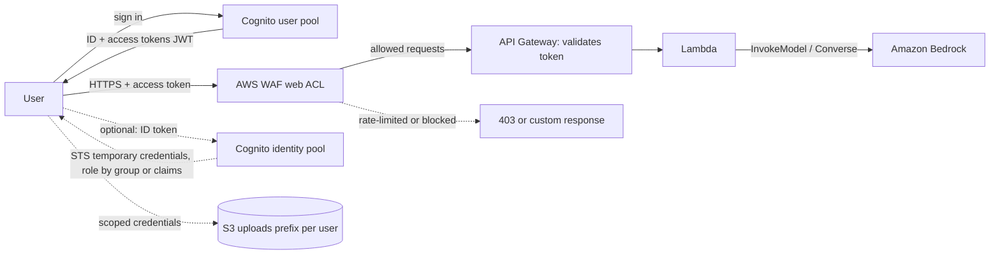

## 0. Before you start
- **Essential:** the difference between **authentication** (who are you?) and **authorization** (what may you do?); what an HTTP request is.
- **Helpful:** JSON Web Tokens (JWT); OAuth 2.0 and OpenID Connect (OIDC) at a glance; API Gateway authorizers.
- **Optional advanced:** SAML; STS; HTTP request inspection and regular expressions.

## 1. Simple explanation
A chat application on the internet needs two guards. **Amazon Cognito** is the *receptionist*: it signs users up and in (with passwords, MFA, or "Sign in with Google or your company directory") and hands each user a signed **token** that says who they are. Your API checks that token before calling the model. **AWS WAF** is the *bouncer at the street door*: it looks at every web request before your application sees it and blocks bad ones (too many requests from one address, known attack patterns, unwanted bots). For a GenAI application both matter because a model call costs money: anonymous traffic must be refused, and one user must not be able to send a million requests.


```figure
flow cognito-waf
```

## 2. Structured explanation
1. **Cognito user pools** ✅: a user directory and OIDC identity provider; issues **JWTs** (ID, access, refresh tokens) to your app or API; sign-in via managed login, your own UI with the API, social providers, SAML and OIDC providers; MFA (TOTP and SMS); groups; token customization; security monitoring for local users; machine-to-machine access with the `client_credentials` grant.
2. **Cognito identity pools** ✅: exchange a trusted token (from a user pool, social, SAML or OIDC) for **temporary AWS credentials** from STS; role-based and attribute-based access; optional guest (unauthenticated) credentials.
3. **Together** ✅: user pool authenticates, identity pool authorizes access to AWS resources such as S3 or DynamoDB.
4. **AWS WAF** ✅: web application firewall for HTTP(S) requests to supported resources; **web ACLs** hold **rules** and **rule groups**; rule actions decide what happens; **rate-based rules** limit request rates; **managed protections** such as Bot Control; logging.
5. **Where WAF attaches** ✅: CloudFront, API Gateway REST API, Application Load Balancer, AppSync GraphQL API, Cognito user pool, App Runner, **Amazon Bedrock AgentCore Gateway**, Verified Access, Amplify.

## 3. Analogy
**A concert venue.** Cognito is the ticket office: you prove who you are once and get a wristband (token) that staff can verify without calling the office each time. Cognito's identity pool is the cloakroom exchange: show the wristband and receive a temporary pass for certain rooms (AWS credentials). WAF is the security line outside: bag checks, a limit on how often one person can re-enter, and a list of banned people.

*Where it breaks:* a wristband can be forged or stolen, so staff must check the signature, expiry and who issued it; and WAF only sees the *HTTP envelope and body*, it does not understand what a prompt *means*, so it cannot replace Guardrails.

## 4. The seven questions

**WHAT?** Cognito: user sign-up/sign-in and token-based access, plus AWS credential brokering. WAF: HTTP request filtering and rate limiting at the edge.

**WHY?** Identity for per-user quotas, personalization and audit; protection against abuse, bots, scraping and cost attacks on expensive endpoints.

**WHEN?** Public or partner-facing chat APIs, mobile apps, agent gateways; any endpoint where one bad client could drain your Bedrock quota ([04/04](aip:04-operational-efficiency/04-backoff-connection-pooling-and-cross-region-inference)).

**WHERE?** Cognito is Regional (user pools can be fronted by WAF ✅); WAF web ACLs are attached to a resource in a Region, or to CloudFront (global) ✅.

**HOW?** §5.

**WHAT IF?**
| Situation | Effect | Remedy |
|---|---|---|
| API accepts any bearer string | Anyone can call and spend money | Validate the token (Cognito authorizer or JWT check): signature, issuer, audience/client, expiry, token type |
| An ID token is used where an access token is expected | Wrong claims and scopes | Check the token type claim; use access tokens for APIs ✅ (ID token authenticates, access token authorizes) |
| A federated user expects an MFA setting from your pool | Not available: MFA and security monitoring apply to local users ✅ | Enforce MFA at the identity provider |
| Rate-based rule limit is 100 per 5 minutes and one NAT address hides many users | The whole office is blocked | Aggregate on a header or a custom key (WCU cost) ✅ |
| A rate rule is copied into two web ACLs | Two separate counters ✅ | Share a rule group only if you want one design, not one counter |
| Attack is a semantic prompt injection | WAF sees normal HTTP | Guardrails, input validation, least privilege ([01/07](aip:01-bedrock-genai-fundamentals/07-bedrock-guardrails)) |
| Unauthenticated identity-pool access is on | Guests get AWS credentials ✅ | Disable it unless required; restrict the role heavily |

**WHY NOT?** Do not issue AWS credentials directly to browsers to call Bedrock unless you have limited the role tightly and added throttling 🟡 (prefer a backend). Do not put secrets in tokens. Do not treat WAF as authentication.

## 5. Technical depth

```figure
waf-rate
```


### 5.1 Cognito user pools and identity pools ✅ (`what-is-amazon-cognito.html`)
| Question | Use |
|---|---|
| **Who is this user?** (authentication) | **User pool** |
| **What AWS resources may they reach?** (authorization) | **Identity pool** |

| Feature | User pool | Identity pool |
|---|---|---|
| User directory and sign-up/sign-in | ✓ | |
| Issue OIDC ID tokens, OAuth 2.0 access tokens (JWT) | ✓ | |
| Federation with Google, Apple, Facebook, Amazon, SAML 2.0, OIDC | ✓ (relying party / service provider, then issues its own tokens) | ✓ (exchanges external tokens for AWS credentials) |
| MFA (TOTP, SMS), security monitoring, custom auth flows (local users) | ✓ | |
| Groups (and IAM role claims for identity pools) | ✓ | |
| Customize tokens and attributes | ✓ | |
| AWS WAF protection of the authentication front end | ✓ | |
| Temporary AWS credentials through STS | | ✓ |
| Role-based access (choose an IAM role from claims, rules or group) | | ✓ |
| Attribute-based access (claims become **principal tags** such as `Department: marketing`, used with `aws:PrincipalTag`) | | ✓ |
| Guest (unauthenticated) credentials | | ✓ |

- Neither requires the other: a user pool can issue tokens to your own backend without an identity pool; an identity pool can broker credentials for a provider you already have ✅.
- **Common scenarios** ✅: sign users in; **protect your own API** with the user-pool access token, or let **API Gateway validate the token** and gate a Lambda function; give users temporary AWS access via an identity pool; sign in with Google, Apple or an enterprise directory; **machine-to-machine** authorization with the `client_credentials` grant (no human).
- **Tokens** ✅/🟡: ID token (who the user is), access token (what they may call, with OAuth scopes), refresh token (get new tokens). JWT structure (`header.payload.signature`), signing algorithm (RS256 with published keys) and Cognito-specific claims such as `token_use`, `cognito:groups` are standard Cognito behavior 🟡 not on the page I read ❌.
- **Compliance note** ✅: Cognito is SOC 1–3, PCI DSS (service security), ISO 27001, HIPAA-BAA eligible; your own design can meet SOC, ISO and HIPAA-BAA but not PCI DSS per the page.
- **Pricing** ❌ not read. **Regional data considerations** page exists ✅ not read ❌.


*Reading the arrows:* the user signs in to the user pool and receives tokens; each API call carries the access token and first meets WAF, which blocks or counts abusive traffic; API Gateway then validates the token and calls Lambda, which calls Bedrock. In the optional dotted path an identity pool swaps a token for temporary AWS credentials limited to the user's own S3 prefix.

### 5.2 AWS WAF ✅ (`waf-chapter.html`, `waf-rule-statement-type-rate-based*.html`)
- **What it does:** monitors HTTP(S) requests forwarded to protected resources; the protected service answers with the content, an **HTTP 403 (Forbidden)** or a **custom response**; criteria include IP addresses and query-string values.
- **Protected resource types** ✅: CloudFront distribution, API Gateway REST API, Application Load Balancer, AppSync GraphQL API, Cognito user pool, App Runner service, **Amazon Bedrock AgentCore Gateway**, Verified Access instance, Amplify. (ECS tasks are protected through an ALB.) HTTP APIs in API Gateway do not support WAF ([06/02](aip:06-app-building-tools/02-api-gateway-and-genai-applications)).
- **Building blocks** ✅ (chapter topics): web ACLs (also called protection packs in the new console), rules, rule groups, **web ACL capacity units (WCUs)**, oversize request components, regular expression and IP/regex pattern sets, customized requests and responses, **labels**, intelligent threat mitigation (**Bot Control** and others), data protection and logging, testing and tuning, CloudFront features, quotas.
- **Rule evaluation** 🟡: rules run in **priority order**; an `Allow` or `Block` ends evaluation, a `Count` records and continues, and the web ACL's **default action** applies if nothing terminates (standard behavior; the rule-action page was not read ❌).
- **Rate-based rules** ✅:
  - Count requests per **aggregation instance** within an **evaluation window** of **60, 120, 300 (default) or 600 seconds** looking back from now; the **lowest rate limit is 10**; exceeding it applies the rule **action** to additional matching requests (any action **except Allow**).
  - **Aggregation:** by IP, by IP in a header such as `X-Forwarded-For` (forwarded IP configuration), by custom keys (for example header or URI), or **Count all** (then a scope-down statement is required).
  - **Scope-down statement** narrows which requests are tracked; **WCUs:** 2 base, plus **30 per custom aggregation key**, plus the scope-down cost.
  - **Not nestable** inside other statements; **each use of a rate-based rule is a separate instance** with its own counters (two web ACLs or two uses of a rule group do not share counts).
  - AWS WAF limits **near** the setting but **does not guarantee an exact limit** (caveats page ✅ not read in full ❌).
  - Rate limiting is also available through the **targeted** level of the **Bot Control** managed rule group, which has additional fees ✅.
- **Not read** ❌: managed rule groups catalog, CAPTCHA and Challenge actions, body-inspection size limits, logging destinations, pricing, AI traffic monetization page.

### 5.3 GenAI patterns
| Need | Mechanism |
|---|---|
| Only signed-in users call the API | Cognito user pool + API Gateway authorizer ([06/02](aip:06-app-building-tools/02-api-gateway-and-genai-applications)) |
| Per-user or per-tenant quota | Claims (`custom:tenant`, groups) → usage plans or your own counter (DynamoDB, [02/08](aip:02-data-management/08-amazon-dynamodb-for-genai)); usage plans are not authorization ([06/02](aip:06-app-building-tools/02-api-gateway-and-genai-applications)) |
| Stop floods and scrapers | WAF rate-based rule on IP or forwarded IP; managed bot protections |
| Protect an agent gateway | WAF on AgentCore Gateway ✅; identity per [03/04](aip:03-agentic-ai/04-agentcore-runtime-memory-gateway-identity-policy-evaluations) |
| Staff vs customers | Identity Center for staff ([08/01](aip:08-security/01-least-privilege-iam-identity-center-and-data-masking)), Cognito for customers |
| Let a browser upload a document | Identity pool role limited to `s3:PutObject` on `uploads/${aws:PrincipalTag/tenant}/*` (ABAC) ✅ pattern |
| Prompt attacks | Guardrails and application validation, not WAF ([01/09](aip:01-bedrock-genai-fundamentals/09-prompt-engineering-misuse-and-bias)) |

## 6. Worked example
*Problem:* a public insurance chatbot uses API Gateway (REST), Lambda and Bedrock. Customers sign in with email or Google; employees test with their company login. Costs spiked last month when a script hit the API.

| Step | Design | Why |
|---|---|---|
| 1 | Cognito user pool for customers: email + Google federation, MFA optional for customers | Authentication ✅ |
| 2 | Employees use Identity Center and an internal API ([08/01](aip:08-security/01-least-privilege-iam-identity-center-and-data-masking)) | Different populations |
| 3 | API Gateway Cognito authorizer on `POST /chat`; reject missing or wrong-type tokens | Authorization ✅ |
| 4 | Web ACL on the REST API stage: rate-based rule 100 requests per 5 minutes per IP; second rule keyed by `X-Forwarded-For` if behind a proxy; action Block (custom 429 body) | Flood and cost control ✅ |
| 5 | Per-user monthly token budget: claims → DynamoDB counter; deny when exhausted | Business-level limit |
| 6 | Bedrock call role with guardrail enforcement ([08/01](aip:08-security/01-least-privilege-iam-identity-center-and-data-masking)) | Content safety |
| 7 | Count-mode first for new WAF rules, review logs, then switch to Block | Safe tuning ✅ (testing and tuning topic) |
| 8 | Alarms on 4xx/429 rates and WAF blocked requests ([07/03](aip:07-governance-qa/03-cloudwatch-logs-alarms-rum-and-genai-observability)) | Visibility |

## 7. Knowledge checkpoints
1. Which Cognito component authenticates users and which one gives temporary AWS credentials?
2. Which token types does a user pool issue?
3. What are the allowed evaluation windows for a WAF rate-based rule?
4. Can a rate-based rule use the Allow action?
5. Name three resource types WAF can protect.

## 7b. Practice questions (exam-style, original) — answers in §14

**Q1.** A web app must let users sign up, sign in with Google, and call a backend API with a verifiable token. Which Cognito component?
A. A user pool
B. An identity pool only
C. IAM Identity Center only
D. KMS

**Q2.** (Select TWO) Which are true of Cognito identity pools?
A. They exchange trusted tokens for temporary AWS credentials
B. They support role-based and attribute-based access control
C. They are the user directory that stores passwords
D. They issue OIDC ID tokens for sign-in
E. They cannot issue guest credentials

**Q3.** A rate-based rule is set to 200 requests with the default evaluation window. What is the window?
A. 300 seconds (5 minutes)
B. 1 second
C. 24 hours
D. 10 seconds

**Q4.** (Select TWO) Which statements about AWS WAF rate-based rules are correct?
A. The action can be any action except Allow
B. Two uses of the same rate-based rule each keep their own counters
C. They can be nested inside an AND statement
D. The minimum rate limit is 1
E. They enforce the limit with exact precision

**Q5.** A backend must authorize requests with a token that proves the user signed in and carries OAuth scopes. Which token should the API use?
A. The access token from the user pool
B. The refresh token
C. The user's password
D. The KMS key ID

**Q6.** Which of these can AWS WAF protect directly?
A. An API Gateway REST API, an Application Load Balancer, or a CloudFront distribution
B. An S3 bucket's object-level ACL
C. A KMS key policy
D. An EC2 security group

**Q7.** Traffic from a corporate network appears from one IP address, and a rate rule blocks the whole company. What is the best fix?
A. Aggregate on a custom key such as a header that identifies the user or API key, accepting extra WCU cost
B. Remove all WAF rules
C. Increase KMS rotation
D. Use Macie

**Q8.** A prompt-injection phrase is hidden in a normal-looking JSON field. Which layer addresses it?
A. Bedrock Guardrails and application checks; WAF alone is not designed to understand prompt meaning
B. Route 53
C. VPC peering
D. CloudWatch RUM

## 8. Hands-on lab: JWT validation, identity-pool role mapping, a rate-based rule and a web ACL

### 8.1 Objective
Offline: build and verify a signed token (with a symmetric stand-in), reject tampered, expired and wrongly targeted tokens; map claims to roles and principal tags; simulate a rate-based rule with different aggregation choices and compute WCUs; evaluate a small web ACL by priority.

### 8.2 Prerequisites
Python 3 (standard library). Optional AWS part: Cognito, API Gateway, WAF, Lambda.

### 8.3 AWS services
Offline: none. Optional: Cognito, API Gateway, WAF, Lambda, CloudWatch.

### 8.4 IAM permissions
Offline: none. Real: permission to create user pools and identity pools, attach web ACLs and associate them with a resource (action names ❌ not read); identity-pool roles with trust limited to the pool.

### 8.5 Region notes
Create the user pool, API and web ACL in the same Region (CloudFront web ACLs are global, created in us-east-1 🟡 ❌ not verified).

### 8.6 Architecture
§5.1 diagram.

### 8.7 Cost
Offline: none. Real: Cognito monthly active users, WAF web ACLs/rules/requests, API Gateway; prices ❌ not read.

### 8.8 Code
**Simplification:** real Cognito tokens are signed with an asymmetric key (RS256) and verified with a published public key. This demo uses a shared-secret HMAC (HS256) because the standard library has no RSA. Never use a shared secret like this for end-user tokens in production. All claims and keys are made up. The web ACL evaluation order is the standard behavior 🟡.

```python lab-run
import base64, hashlib, hmac, json

def b64(data):
    return base64.urlsafe_b64encode(data).rstrip(b"=").decode()
def unb64(text):
    return base64.urlsafe_b64decode(text + "=" * (-len(text) % 4))
SECRET = b"demo-signing-secret"
NOW = 1_700_000_000
def make_token(claims, alg="HS256", secret=SECRET):
    head = b64(json.dumps({"alg": alg, "typ": "JWT"}).encode())
    body = b64(json.dumps(claims).encode())
    sig = b64(hmac.new(secret, f"{head}.{body}".encode(), hashlib.sha256).digest()) if alg == "HS256" else ""
    return f"{head}.{body}.{sig}"

# ---------- 1. Token validation: signature, algorithm, issuer, audience, expiry, token type ----------
def validate(token, issuer, client_id, expected_use="access"):
    try:
        head_b64, body_b64, sig = token.split(".")
        head, claims = json.loads(unb64(head_b64)), json.loads(unb64(body_b64))
    except Exception:
        return "REJECT: malformed token"
    if head.get("alg") != "HS256":
        return f"REJECT: unexpected algorithm {head.get('alg')!r}"
    good = b64(hmac.new(SECRET, f"{head_b64}.{body_b64}".encode(), hashlib.sha256).digest())
    if not hmac.compare_digest(good, sig):
        return "REJECT: bad signature"
    if claims.get("iss") != issuer:
        return "REJECT: wrong issuer"
    if claims.get("exp", 0) <= NOW:
        return "REJECT: expired"
    if claims.get("token_use") != expected_use:
        return f"REJECT: token_use is {claims.get('token_use')!r}, expected {expected_use!r}"
    if claims.get("client_id", claims.get("aud")) != client_id:
        return "REJECT: issued for another app client"
    return "ACCEPT: " + claims["sub"]
ISS, CLIENT = "https://idp.example/pool-1", "app-client-1"
base = {"iss": ISS, "sub": "user-42", "client_id": CLIENT, "aud": CLIENT, "exp": NOW + 3600, "token_use": "access", "cognito:groups": ["premium"], "custom:tenant": "acme"}
good = make_token(base)
forged_body = b64(json.dumps({**base, "cognito:groups": ["admin"]}).encode())
print("1) token validation")
for name, tok in [("valid access token", good), ("expired", make_token({**base, "exp": NOW - 5})), ("wrong issuer", make_token({**base, "iss": "https://evil.example"})),
                  ("ID token sent to the API", make_token({**base, "token_use": "id"})), ("other app client", make_token({**base, "client_id": "other", "aud": "other"})),
                  ("payload edited, old signature", good.split(".")[0] + "." + forged_body + "." + good.split(".")[2]), ('alg "none"', make_token(base, alg="none")), ("garbage", "abc")]:
    print(f"   {name:<30}{validate(tok, ISS, CLIENT)}")

# ---------- 2. Identity-pool style mapping: group -> role, claims -> principal tags, an ABAC check ----------
ROLE_BY_GROUP = {"premium": "role-premium-uploads", "staff": "role-staff-tools"}
def pick_role(claims):
    for g in claims.get("cognito:groups", []):
        if g in ROLE_BY_GROUP:
            return ROLE_BY_GROUP[g]
    return "role-default-readonly"
def principal_tags(claims):
    return {"tenant": claims.get("custom:tenant", "none")}
def s3_put_allowed(key, tags):
    return key.startswith(f"uploads/{tags['tenant']}/")
claims = json.loads(unb64(good.split(".")[1]))
tags = principal_tags(claims)
print("2) role and tags:", pick_role(claims), tags, "| default role for a user with no group:", pick_role({}))
for key in ["uploads/acme/report.pdf", "uploads/other-co/report.pdf"]:
    print(f"   s3:PutObject {key:<32}{'ALLOW' if s3_put_allowed(key, tags) else 'DENY'}")

# ---------- 3. A rate-based rule: count per aggregation key in a look-back window ----------
def rate_rule(requests, window, limit, key_fn):
    blocked, seen = [], {}
    for t, ip, header_user in requests:
        k = key_fn(ip, header_user)
        recent = [x for x in seen.get(k, []) if t - x < window]
        recent.append(t)
        seen[k] = recent
        if len(recent) > limit:
            blocked.append((t, ip, header_user))
    return blocked
OFFICE_IP = "203.0.113.7"
requests = [(t, OFFICE_IP, f"user-{t % 4}") for t in range(0, 40)] + [(t, "198.51.100.9", "bot") for t in range(0, 40)]
by_ip = rate_rule(requests, 60, 10, lambda ip, user: ip)
by_user = rate_rule(requests, 60, 10, lambda ip, user: user)
print("3) rate-based rule (limit 10 per 60 s window)")
print("   aggregate by IP:   blocked", len(by_ip), "requests; office users affected:", sorted({u for _, ip, u in by_ip if ip == OFFICE_IP}))
print("   aggregate by user: blocked", len(by_user), "requests; office users affected:", sorted({u for _, ip, u in by_user if ip == OFFICE_IP}))
def wcu(custom_keys, scope_down=0):
    return 2 + 30 * custom_keys + scope_down
print("   WCUs: IP-only rule", wcu(0), "| one custom key", wcu(1), "| two custom keys", wcu(2))

# ---------- 4. A web ACL: rules by priority, Allow/Block end evaluation, Count continues, default action ----------
RULES = [(10, "allow-health-check", lambda r: r["path"] == "/health", "ALLOW"), (20, "block-bad-ip", lambda r: r["ip"] == "198.51.100.9", "BLOCK"),
         (30, "count-large-body", lambda r: r["body_kb"] > 64, "COUNT"), (40, "block-no-auth", lambda r: r["path"].startswith("/chat") and not r["has_token"], "BLOCK")]
def web_acl(req, default="ALLOW"):
    counted = []
    for _, name, pred, action in sorted(RULES, key=lambda x: x[0]):
        if pred(req):
            if action == "COUNT":
                counted.append(name)
                continue
            return f"{action} by {name}" + (f" (also counted: {counted})" if counted else "")
    return f"{default} by default action" + (f" (counted: {counted})" if counted else "")
print("4) web ACL")
for req in [{"path": "/health", "ip": "203.0.113.7", "body_kb": 0, "has_token": False}, {"path": "/chat", "ip": "198.51.100.9", "body_kb": 1, "has_token": True},
            {"path": "/chat", "ip": "203.0.113.7", "body_kb": 80, "has_token": False}, {"path": "/chat", "ip": "203.0.113.7", "body_kb": 80, "has_token": True}]:
    print(f"   {req['path']:<8}{req['ip']:<15}body {req['body_kb']:>2} KB token {str(req['has_token']):<6}-> {web_acl(req)}")
```

### 8.9 Captured output
Generated on 2026-10-26 by extracting the block above from this file and running it (Python 3). It models documented behavior with made-up data and a symmetric token stand-in; it is **not** Cognito or WAF output.
```text lab-out
1) token validation
   valid access token            ACCEPT: user-42
   expired                       REJECT: expired
   wrong issuer                  REJECT: wrong issuer
   ID token sent to the API      REJECT: token_use is 'id', expected 'access'
   other app client              REJECT: issued for another app client
   payload edited, old signature REJECT: bad signature
   alg "none"                    REJECT: unexpected algorithm 'none'
   garbage                       REJECT: malformed token
2) role and tags: role-premium-uploads {'tenant': 'acme'} | default role for a user with no group: role-default-readonly
   s3:PutObject uploads/acme/report.pdf         ALLOW
   s3:PutObject uploads/other-co/report.pdf     DENY
3) rate-based rule (limit 10 per 60 s window)
   aggregate by IP:   blocked 60 requests; office users affected: ['user-0', 'user-1', 'user-2', 'user-3']
   aggregate by user: blocked 30 requests; office users affected: []
   WCUs: IP-only rule 2 | one custom key 32 | two custom keys 62
4) web ACL
   /health 203.0.113.7    body  0 KB token False -> ALLOW by allow-health-check
   /chat   198.51.100.9   body  1 KB token True  -> BLOCK by block-bad-ip
   /chat   203.0.113.7    body 80 KB token False -> BLOCK by block-no-auth (also counted: ['count-large-body'])
   /chat   203.0.113.7    body 80 KB token True  -> ALLOW by default action (counted: ['count-large-body'])
```

### 8.10 Explanation
- Part 1: the checks are the standard ones: algorithm allow-list (never trust `none`), signature, issuer, expiry, token type, app client. A token edited after signing fails the signature check.
- Part 2: group membership picks the role; claims become principal tags; the ABAC prefix rule keeps one tenant out of another's folder.
- Part 3: aggregating by IP blocks innocent office users behind one address, while a per-user key blocks only the bot-like pattern; the custom key costs more WCUs.
- Part 4: priority order, terminating actions, count-and-continue, and the default action.

### 8.11 Optional AWS lab (shown, not run against AWS ❌)
1. **Cognito:** create a user pool with an app client (no secret for a browser app), enable email sign-up and optional MFA, add a Google or test OIDC provider if you have one; sign up a test user; use managed login to obtain tokens ✅.
2. **API Gateway:** create a REST API with a Cognito user pool authorizer on `POST /chat` backed by a Lambda that calls Bedrock ([06/02](aip:06-app-building-tools/02-api-gateway-and-genai-applications)); call it with and without the access token.
3. **Identity pool (optional):** create one, map a group to a role limited to `uploads/${aws:PrincipalTag/tenant}/*`; exchange a token for credentials.
4. **WAF:** create a web ACL for the API stage with a rate-based rule (limit 10, window 60 s) in **Count** mode, send a burst, check the counted requests, then switch to **Block** ✅ (testing and tuning approach).
5. Review CloudWatch metrics for blocked and counted requests; clean up the web ACL association, API, user pool and function.

### 8.12 Common errors
| Error | Cause | Fix |
|---|---|---|
| `401 Unauthorized` from API Gateway | Missing or wrong-type token, wrong authorizer source | Send the access token in the configured header |
| `403` with a WAF body | Request matched a Block rule | Check rule and labels; use Count mode to tune |
| Identity pool returns no credentials | Role trust does not allow the pool or the claim mapping fails | Fix trust policy and role mapping |
| Everyone behind a proxy is blocked | Aggregating on the proxy IP | Use forwarded IP or a custom key ✅ |
| Rate rule blocks too early or late | WAF limits near, not at, the setting ✅ | Add margin; test |
| Federated users have no MFA prompt | MFA is not available to federated users ✅ | Enforce at the IdP |
| WAF cannot be associated | Unsupported resource (for example HTTP API) | Use a REST API or CloudFront |

### 8.13 Security recommendations
Validate every token on every request (signature, issuer, client, expiry, type); use short token lifetimes; keep the user pool free of unnecessary scopes; disable guest identities unless needed; scope identity-pool roles with ABAC; protect the user pool's sign-in pages with WAF ✅; use rate-based and bot rules, tuned in Count mode; log blocked requests (without logging tokens or prompts); do not trust client-supplied headers such as `X-Forwarded-For` without a trusted proxy ✅ (page warns about forwarded headers in X-Ray; same principle applies).

## 9. What can go wrong?
| Failure | Why | Symptoms | Investigate | Fix | Prevent |
|---|---|---|---|---|---|
| **Token not validated** | Trusting decoded claims | Fake users | Code review | Verify signature | Use the platform authorizer |
| **Over-broad guest role** | Unauthenticated identities enabled | Anonymous access to AWS | Identity pool settings | Disable or restrict | Review quarterly |
| **WAF false positives** | Aggressive rule | Legitimate users blocked | WAF logs, Count mode | Tune or exclude | Start in Count mode ✅ |
| **Shared-IP blocking** | IP aggregation | Whole offices blocked | Blocked IP lists | Custom keys | Know your client base |
| **Cost attack** | No rate limit on `/chat` | Bedrock spend spike | Metrics, billing | Rate rule, per-user budget | Defense in depth |
| **Wrong token used** | ID token vs access token | Missing scopes | Claims | Use access token | Document the contract |
| **Rule counters not shared** | Separate rule instances ✅ | Limits looser than planned | Rule design | One ACL or a combined key | Test counters |

## 10. Common misconceptions
1. **"WAF authenticates users."** It filters requests; use Cognito or another IdP for identity.
2. **"An ID token is fine for API authorization."** Access tokens authorize; ID tokens authenticate ✅.
3. **"Identity pools store users."** User pools store users ✅.
4. **"WAF stops prompt injection."** It does not understand prompt meaning; use Guardrails and design.
5. **"Cognito MFA covers federated users."** It does not ✅.
6. **"Rate limits are exact."** They are near the setting ✅.
7. **"WAF protects every API type."** Not HTTP APIs ([06/02](aip:06-app-building-tools/02-api-gateway-and-genai-applications)).

## 11. Exam notes
- **Patterns:** "sign-up and sign-in for app users" → user pool; "temporary AWS credentials for app users" → identity pool; "block floods/bots/SQLi at the edge" → WAF; "limit requests per IP" → rate-based rule; "validate token at API Gateway" → Cognito authorizer; "per-tenant access to S3 prefix" → identity pool ABAC.
- **Keywords:** user pool, identity pool, JWT, access token, `client_credentials`, web ACL, rate-based rule, WCU, scope-down, Bot Control, Count mode.
- **Traps:** confusing the two pools; using WAF for authentication; forgetting WAF is not available for HTTP APIs; expecting exact rate limits; trusting `X-Forwarded-For`.
- **Compare:** Cognito vs IAM Identity Center vs IAM; WAF vs Shield (not read ❌) vs Network Firewall vs security groups; API Gateway usage plans vs WAF rate limits vs Lambda concurrency.

## 12. Summary and revision cards
- Cognito user pool = directory + JWTs; identity pool = STS credentials; together for authenticate-then-authorize.
- WAF = web ACL of rules at CloudFront/API GW REST/ALB/AppSync/Cognito/AgentCore Gateway etc.; rate-based windows 60/120/300/600 s, min 10, not Allow.
- Use both in front of Bedrock endpoints; Guardrails for content.

**Cards.** Q: Rate rule default window? A: 300 s. · Q: WCUs for a custom aggregation key? A: 30 each. · Q: MFA for federated users in a user pool? A: Not available.

## 13. References
| Source | URL | Verified |
|---|---|---|
| What is Amazon Cognito | https://docs.aws.amazon.com/cognito/latest/developerguide/what-is-amazon-cognito.html | 2026-10-26 |
| AWS WAF overview | https://docs.aws.amazon.com/waf/latest/developerguide/waf-chapter.html | 2026-10-26 |
| Rate-based rule statements and settings | https://docs.aws.amazon.com/waf/latest/developerguide/waf-rule-statement-type-rate-based.html · .../waf-rule-statement-type-rate-based-high-level-settings.html | 2026-10-26 |

**Unverified here:** JWT and Cognito token claim details; Cognito and WAF quotas and prices; WAF rule actions page (CAPTCHA, Challenge), managed rule group catalog, body inspection limits, logging destinations; Shield and Network Firewall details; Cognito Regional data considerations; CloudFront web ACL Region.

## 14. Answers to checkpoints and practice questions
**Checkpoints.** 1) User pool authenticates; identity pool issues temporary AWS credentials ✅. 2) ID, access and refresh tokens 🟡 (JWTs for ID and access are on the page; the refresh token is standard). 3) 60, 120, 300 (default) and 600 seconds ✅. 4) No: any action except Allow ✅. 5) Any three of CloudFront, API Gateway REST API, ALB, AppSync, Cognito user pool, App Runner, AgentCore Gateway, Verified Access, Amplify ✅.

**Practice questions.**
- **Q1 → A.** Directory, federation and tokens ✅.
- **Q2 → A, B.** C and D describe user pools; E is false (guest access is optional) ✅.
- **Q3 → A.** Default 300 s ✅.
- **Q4 → A, B.** C false (not nestable); D false (minimum 10); E false ✅.
- **Q5 → A.** Access token ✅ (🟡 for the OAuth-scope detail).
- **Q6 → A.** ✅
- **Q7 → A.** ✅
- **Q8 → A.** ✅
