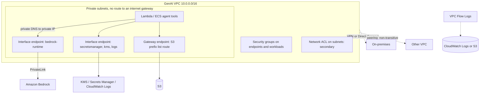

## 0. Before you start
- **Essential:** what an IP address is; what a CIDR block such as `10.0.0.0/16` means (a range of addresses); what a firewall does.
- **Helpful:** DNS; TCP ports (443 is HTTPS); routing tables ("to reach this range, go there").
- **Optional advanced:** BGP; IPsec; Route 53 Resolver.

## 1. Simple explanation
A **VPC (Virtual Private Cloud)** is your own private network inside AWS. You cut it into **subnets**. A subnet whose routing table has a route to an **internet gateway** is *public*; one without is *private*. Machines in a private subnet can still call the internet through a **NAT gateway** (outbound only), but the better way to reach AWS services is a **VPC endpoint** powered by **AWS PrivateLink**: your Lambda function then talks to Bedrock, KMS or Secrets Manager over private addresses and the traffic never touches the internet. Two kinds of firewall protect the machines: **security groups** (per resource, remember conversations) and **network ACLs** (per subnet, rule by rule). **VPC Flow Logs** record who talked to whom, so you can see accepted and rejected connections. To join other networks you can **peer** VPCs, use a **VPN**, or lay a **Direct Connect** fibre line.


```figure
flow private-bedrock
```

## 2. Structured explanation
1. **Building blocks** ✅: VPC, subnets, route tables, internet gateway, NAT gateway, egress-only internet gateway (IPv6).
2. **Traffic control** ✅: security groups (primary, stateful), network ACLs (secondary, stateless), AWS Network Firewall, Security Hub checks.
3. **Visibility** ✅: VPC Flow Logs to CloudWatch Logs, S3 or Data Firehose.
4. **Private access to services** ✅: **gateway endpoints** (S3, DynamoDB; not PrivateLink; free) and **interface endpoints** (PrivateLink; most services including Bedrock); resource and service-network endpoints; endpoint services.
5. **VPC-to-VPC and hybrid** ✅: peering (non-transitive), Site-to-Site VPN (two IPsec tunnels), Direct Connect (private, public, transit virtual interfaces), transit gateway.
6. **Bedrock endpoints** ✅: `bedrock`, `bedrock-runtime`, `bedrock-mantle`, `bedrock-agent`, `bedrock-agent-runtime`, plus FIPS variants; private DNS; endpoint policies.

## 3. Analogy
**An office campus.** The VPC is the fenced campus; subnets are buildings; the routing table is the signage ("to reach the street, use gate 3"). The **internet gateway** is the public front gate. The **NAT gateway** is the mailroom that sends staff mail out and lets only replies come back. A **PrivateLink endpoint** is a private tunnel to the bank next door: you never leave the campus. A **security group** is the receptionist who knows each guest and lets the guest's reply through automatically; a **network ACL** is the guard at the building entrance reading a numbered list for every person in and out, with no memory of who came in. **Flow Logs** are the visitor log. **Peering** is a footbridge between two campuses: you can cross to the neighbour, not to the neighbour's neighbour.

*Where it breaks:* a footbridge does not let you use the neighbour's front gate or mailroom (peering has no edge-to-edge routing), and the visitor log records *who connected*, not *what they said*.

## 4. The seven questions

**WHAT?** AWS's virtual network, firewalls, private service access and hybrid connectivity.

**WHY?** Keep GenAI data and API calls off the public internet, limit which services and models a subnet can reach, prove network behavior, and meet compliance rules for isolation.

**WHEN?** Any workload with sensitive data (RAG over private documents, agents with internal tools), on-premises integration, or a "no internet egress" policy.

**WHERE?** A VPC is Regional and spans Availability Zones; subnets live in one AZ ✅ (subnets isolate tiers); endpoints create network interfaces in each enabled subnet ✅.

**HOW?** §5.

**WHAT IF?**
| Situation | Effect | Remedy |
|---|---|---|
| A Lambda in a private subnet with no NAT and no endpoint calls Bedrock | The call times out | Add an interface endpoint for `bedrock-runtime` (or a NAT gateway) |
| Private DNS is off on the endpoint | SDK still resolves the public name | Enable private DNS, or pass the endpoint URL ✅ |
| Network ACL allows inbound 443 but has no outbound rule for the reply | Connections hang (stateless) ✅ | Allow ephemeral return ports or use security groups as the primary control |
| Peered VPC B tries to use VPC A's NAT gateway or VPN | Not supported ✅ | Give B its own path or use a transit gateway |
| Both VPCs use `10.0.0.0/16` | Peering cannot be created ✅ | Re-address or use another connectivity pattern |
| A long Bedrock stream is idle for 6 minutes behind NAT | Connection dropped after 350 s ✅ | Keep-alives ([04/04](aip:04-operational-efficiency/04-backoff-connection-pooling-and-cross-region-inference)) |
| Endpoint policy allows only `InvokeModel` | `CreateGuardrail` through the endpoint is denied ✅ | Add actions deliberately or use another path for admin calls |
| A route to the S3 gateway endpoint exists and a 0.0.0.0/0 route to the IGW | Traffic to S3 in the same Region uses the endpoint (most specific route) ✅ | Intended behavior |

**WHY NOT?** Do not rely on network ACLs alone. Do not open `0.0.0.0/0` inbound for management ports. Do not expect a gateway endpoint to be reachable from on-premises or a peered VPC ✅. Do not use NAT for traffic that a free gateway endpoint (S3, DynamoDB) can carry.

## 5. Technical depth

### 5.1 VPC, subnets, gateways (lesson 230) ✅ (`infrastructure-security.html`, `VPC_Internet_Gateway.html`, `vpc-nat-gateway.html`)
- **VPC:** a logically isolated virtual network; use separate VPCs to isolate by workload or organizational unit; **subnets** isolate tiers (web, app, database); use **private subnets** for resources that must not be reachable directly from the internet.
- **Internet gateway (IGW):** horizontally scaled, redundant, highly available; no charge for the gateway itself; target for internet-routable traffic. A subnet is **public** if its route table has a route to an IGW (for example `0.0.0.0/0`), **private** otherwise; instances in a public subnet need a **public IPv4 or Elastic IP** (or an IPv6 address) to talk to the internet; the IGW does one-to-one NAT for IPv4. A **default VPC** has an IGW, a default route and auto-assigned public IPs; a **nondefault VPC** has none of these.
- **NAT gateway:** lets instances in a private subnet **initiate** connections outward, while external services **cannot** initiate connections to them. **Public** NAT gateway (default): lives in a public subnet, has an **Elastic IP**, routes to the IGW (or to a transit gateway/virtual private gateway); **private** NAT gateway: for other VPCs or on-premises through a transit gateway or virtual private gateway, no Elastic IP. IPv6 outbound-only: **egress-only internet gateway**, or NAT64/DNS64. Connections must start inside the VPC.
- **Routing:** the most specific (longest prefix) route wins ✅ (gateway-endpoint page).

### 5.2 Security groups, network ACLs, Network Firewall (lesson 231) ✅ (`infrastructure-security.html`)
| Characteristic | Security group | Network ACL |
|---|---|---|
| Level | Instance (network interface) | Subnet |
| Rules | **Allow** only | **Allow and deny** |
| Evaluation | All rules evaluated | Numbered rules in ascending order until a match |
| Return traffic | Automatically allowed (**stateful**) | Must be explicitly allowed (**stateless**) |
| Guidance | **Primary** mechanism; can reference other security groups | Secondary control, subnet guard rail, defense in depth |

Also: configure route tables with the minimum routes; use separate network interfaces or security groups for management traffic; **AWS Network Firewall** protects subnets from common network threats; **Security Hub CSPM** checks for unintended network accessibility ✅.

### 5.3 VPC Flow Logs ✅ (`flow-logs.html`, `flow-log-records.html`)
- **What:** metadata about **IP traffic** to and from network interfaces (not payloads); published to **CloudWatch Logs, S3 or Data Firehose**; collected **outside the traffic path** (no effect on throughput or latency); you pay vended-log ingestion and archival charges.
- **Uses:** diagnose overly restrictive security groups, monitor traffic reaching an instance, determine the direction of traffic.
- **Aggregation interval:** default maximum **10 minutes**, optional **1 minute** (always ≤ 1 minute for Nitro-based instances); delivery typically about **5 minutes** to CloudWatch Logs and **10 minutes** to S3, best effort.
- **Default format (version 2)**, in order: `version account-id interface-id srcaddr dstaddr srcport dstport protocol packets bytes start end action log-status`. `action` is `ACCEPT` or `REJECT` (for example blocked by a security group or network ACL, or packets after the connection closed); `log-status` is `OK`, `NODATA` or `SKIPDATA`. Custom formats can add fields: `vpc-id`, `subnet-id`, `instance-id`, `tcp-flags`, `type`, `pkt-srcaddr`, `pkt-dstaddr` (original addresses behind a NAT gateway), `region`, `az-id`, `flow-direction`, `traffic-path` (for example 2 = internet gateway or gateway endpoint, 7 = gateway endpoint), `reject-reason` (`BPA`, `EC`), `encryption-status`, and more.
- **Query:** Athena over S3 (Athena is covered in module 09); CloudWatch Logs Insights ([07/03](aip:07-governance-qa/03-cloudwatch-logs-alarms-rum-and-genai-observability)).

### 5.4 VPC endpoints and AWS PrivateLink (lessons 232, 234) ✅ (`what-is-privatelink.html`, `vpce-gateway.html`, `vpc-interface-endpoints.html`)
- **PrivateLink:** highly available, scalable technology to connect your VPC privately to services and resources **as if they were in your VPC**, without an internet gateway, NAT device, public IP, Direct Connect or VPN for that traffic; you control which endpoints, services and resources are reachable. Endpoint kinds shown on the page: **interface endpoints** to AWS services, to **endpoint services** hosted by other accounts, and to **AWS Marketplace** partner services; **resource endpoints** (for example a database); **service-network endpoints** (VPC Lattice); **Gateway Load Balancer** endpoints for virtual appliances. Create them in the console, CLI, CloudFormation or SDKs.
- **Gateway endpoints** ✅: **S3 and DynamoDB only**, **no additional charge**, do **not** use PrivateLink; a route to the service's **prefix list** is added to the route tables you associate; instances use the public service endpoint **through** the gateway; traffic to the service in **another Region** goes via the internet gateway; the endpoint route takes precedence over a `0.0.0.0/0` IGW route for that Region's service; security groups and network ACLs must still allow the traffic; S3 and DynamoDB also support interface endpoints.
- **Interface endpoints** ✅: an **endpoint network interface** per enabled subnet (requester-managed); optional **private DNS** so the normal service hostname resolves to the private address; **endpoint policies** (resource-based JSON limiting principals, actions and resources; the default allows full access); availability across multiple AZs.
- **Bedrock** ✅ (`vpc-interface-endpoints.html`): API groups and endpoint suffixes: control plane `bedrock`; runtime `bedrock-runtime`; `bedrock-mantle`; agents build-time `bedrock-agent`; agents runtime `bedrock-agent-runtime`. Service names `com.amazonaws.<region>.<suffix>`; FIPS services `bedrock-fips` and `bedrock-runtime-fips` in a limited set of Regions (us-east-1, us-east-2, us-west-2, ca-central-1, us-gov-east-1, us-gov-west-1 on the page). With **private DNS enabled** no code change is needed (`bedrock-runtime.<region>.amazonaws.com` resolves privately); without it, set the endpoint URL (`https://<vpce-id>.bedrock-runtime.<region>.vpce.amazonaws.com`) in the CLI `--endpoint-url` or the SDK client's `endpoint_url` (works in Lambda). Example **endpoint policy**: allow principal `*` actions `bedrock:InvokeModel` and `bedrock:InvokeModelWithResponseStream` on resource `*` (the mantle example allows `bedrock-mantle:CreateInference`).
- **Related endpoints for a private GenAI app** 🟡: KMS, Secrets Manager, CloudWatch Logs, STS, S3 (gateway), DynamoDB (gateway) and the model endpoints; service names and their availability should be checked per service ❌ (only the Bedrock list was read).

### 5.5 Connecting VPCs and networks (lesson 232) ✅
- **VPC peering** (`what-is-vpc-peering.html`, `vpc-peering-basics.html`): private routing between two VPCs using private IPs (same or different accounts; **inter-Region** allowed); neither gateway nor VPN; **no overlapping CIDR blocks**; both owners add **routes**; same-Region peers can reference each other's **security groups**; **no transitive peering**; **no edge-to-edge routing**: the peer cannot use your internet gateway, NAT, VPN, Direct Connect or gateway endpoint; the request expires after **7 days** if not accepted; inter-Region traffic stays on the AWS backbone and is encrypted before leaving AWS facilities; no charge to create; data transfer across AZs and Regions is charged; MTU 9001 same Region, 8500 inter-Region.
- **Site-to-Site VPN** (`VPC_VPN.html`): IPsec; each connection has **two tunnels** for high availability; customer gateway (resource) and customer gateway device; AWS side is a **virtual private gateway** (one VPC) or a **transit gateway**; IKEv2, AES-256, SHA-2; standard tunnel up to **1.25 Gbps**, **large bandwidth tunnel** up to **5 Gbps** on transit gateway/Cloud WAN; use non-overlapping CIDRs; billed per connection hour plus data transfer out.
- **Direct Connect** (`Welcome.html`): a dedicated link from your router to a Direct Connect location, bypassing internet providers; **virtual interfaces**: **private** (a VPC, or many VPCs via a Direct Connect gateway), **public** (public AWS services such as S3), **transit** (transit gateways via a Direct Connect gateway); requires BGP with MD5 authentication; speeds and locations on the product page; billed by port hours and outbound data transfer. Whether traffic is encrypted by default was not on the page: treat Direct Connect as private, **not necessarily encrypted** 🟡 (add MACsec or VPN where required ❌ not read).
- **Transit gateway** mentioned as the hub alternative to peering ✅ (peering page); details ❌ not read.


*Reading the arrows:* the function in a private subnet reaches Bedrock and other AWS APIs through interface endpoints (private IPs) and S3 through a gateway endpoint, so no NAT or internet gateway is needed; security groups and network ACLs filter traffic; Flow Logs record it; dotted lines show optional hybrid and peered connections.

### 5.6 Designing private GenAI traffic
1. **No internet path:** private subnets with no IGW/NAT route for the workload; endpoints for each AWS API used.
2. **Endpoint policies:** restrict principals, actions and (where supported) resources, for example only `InvokeModel`/`InvokeModelWithResponseStream`, to stop data exfiltration through unexpected APIs.
3. **Security groups on endpoints** 🟡: allow inbound 443 only from the workload security groups.
4. **DNS:** enable private DNS; for on-premises or other VPCs you need resolution to the endpoint (Route 53 Resolver ❌ not read).
5. **Egress control:** if some internet access is unavoidable use NAT plus Network Firewall rules ✅ and Flow Logs.
6. **Compliance:** FIPS endpoints where required ✅; TLS 1.2 minimum ✅; VPC encryption controls and flow-log `encryption-status` exist ✅ (fields only).
7. **Hybrid:** VPN for quick encrypted access; Direct Connect for steady bandwidth; peering/transit gateway to share services.
8. **Observe:** Flow Logs plus CloudTrail ([07/04](aip:07-governance-qa/04-cloudtrail-and-x-ray-for-genai)); CloudWatch alarms on rejects.

## 6. Worked example
*Problem:* a hospital runs a clinical-notes summarizer. Lambda reads notes from S3, calls Bedrock, writes results to DynamoDB. Policy: no internet egress; keys in KMS; a data-science VPC must reuse the summarizer; on-premises systems submit notes over a private link.

| Need | Design | Why |
|---|---|---|
| No internet | Private subnets, no IGW/NAT route; Lambda in the VPC | Isolation ✅ |
| Bedrock access | Interface endpoint `bedrock-runtime` (private DNS on); endpoint policy: `InvokeModel` and `InvokeModelWithResponseStream` only | Private path, limited API surface ✅ |
| S3 and DynamoDB | Gateway endpoints on the private route tables | Free, private ✅ |
| KMS and secrets | Interface endpoints for KMS and Secrets Manager | Private calls |
| Firewalling | Security groups: endpoints accept 443 from the function SG; NACL as coarse guard rail | Stateful primary, stateless secondary ✅ |
| Data-science VPC | **Not** a peering shortcut to the NAT/endpoints (no edge-to-edge routing); give it its own endpoints, or use a transit gateway for shared services | Peering is non-transitive ✅ |
| On-premises | Site-to-Site VPN now (two tunnels); Direct Connect later with a private VIF; BGP | Hybrid ✅ |
| Evidence | Flow Logs to S3 (queried with Athena), CloudTrail trail | Audit ✅ |

## 7. Knowledge checkpoints
1. What makes a subnet "public"?
2. Which two services have gateway endpoints?
3. Which of security groups and network ACLs is stateless?
4. Why can't VPC B use VPC A's NAT gateway through a peering connection?
5. What does a Flow Log record contain, and does it include packet contents?

## 7b. Practice questions (exam-style, original) — answers in §14

**Q1.** A Lambda function in a private subnet must call Bedrock with no internet access. What is the best solution?
A. An interface VPC endpoint (PrivateLink) for `bedrock-runtime`
B. An internet gateway attached to the private subnet
C. A VPC peering connection to the Bedrock service
D. A gateway endpoint for Bedrock

**Q2.** (Select TWO) Which statements about gateway VPC endpoints are correct?
A. They are available for Amazon S3 and Amazon DynamoDB
B. They have no additional charge
C. They use PrivateLink interface network interfaces
D. They can be used from on-premises over a VPN
E. They work for any AWS service

**Q3.** An application's connections hang. The security group allows inbound 443; the subnet's network ACL allows inbound 443 but has no matching outbound rule for the reply. Why?
A. Network ACLs are stateless, so return traffic must be allowed explicitly
B. Security groups are stateless
C. NAT gateways block all replies
D. Flow Logs interfere

**Q4.** (Select TWO) Which statements about VPC peering are correct?
A. It does not support transitive peering
B. The two VPCs cannot have overlapping CIDR blocks
C. A peer can use your NAT gateway for internet access
D. A peer can use your Direct Connect connection
E. It requires a VPN

**Q5.** A team needs to see which connections were rejected by security groups and network ACLs on a network interface. Which feature?
A. VPC Flow Logs (`action` = `REJECT`)
B. AWS KMS
C. Amazon Macie
D. CloudFront access logs

**Q6.** An endpoint policy for the Bedrock runtime interface endpoint allows only `bedrock:InvokeModel` and `bedrock:InvokeModelWithResponseStream`. What happens to a `bedrock:CreateGuardrail` call through that endpoint?
A. It is denied by the endpoint policy
B. It is allowed because the principal is `*`
C. It is routed to the internet
D. It creates a peering connection

**Q7.** On-premises systems need a dedicated, consistent private connection to a VPC with high bandwidth. Which option?
A. AWS Direct Connect with a private virtual interface
B. Internet gateway
C. VPC peering
D. AWS WAF

**Q8.** Which statement about NAT gateways is correct?
A. Instances in private subnets can start outbound connections, but external hosts cannot start connections to them
B. A NAT gateway allows unsolicited inbound connections from the internet
C. A NAT gateway replaces security groups
D. A NAT gateway is needed to reach an S3 gateway endpoint

## 7c. Mixed review for Quiz 8 (security, identity and compliance)
**R1.** Does an SCP grant permissions? A. Yes B. No C. Only to the root user D. Only for Bedrock
**R2.** Which KMS key type lets you control the key policy, rotation and deletion? A. Customer managed B. AWS managed C. AWS owned D. None
**R3.** Which Secrets Manager rotation steps does a Lambda rotation function perform? A. create, set, test, finish B. start, stop C. encrypt, decrypt D. scan, report
**R4.** Which service discovers sensitive data in S3? A. Macie B. WAF C. Cognito D. Flow Logs
**R5.** Which Cognito component exchanges a trusted token for temporary AWS credentials? A. Identity pool B. User pool C. Hosted UI D. App client secret
**R6.** What is the default evaluation window of a WAF rate-based rule? A. 300 seconds B. 60 seconds C. 1 second D. 1 hour
**R7.** Which condition-key pattern forces a specific guardrail? A. Allow with StringEquals plus Deny with StringNotEquals on `bedrock:GuardrailIdentifier` B. A system prompt C. A WAF rule D. An S3 policy
**R8.** Which connectivity is non-transitive? A. VPC peering B. Transit gateway C. Direct Connect gateway D. Site-to-Site VPN with BGP

**Answers (7c).** R1 → B ([08/01](aip:08-security/01-least-privilege-iam-identity-center-and-data-masking), [08/02](aip:08-security/02-control-tower-organizations-and-governance-guardrails)). R2 → A ([08/03](aip:08-security/03-kms-secrets-manager-macie-and-bedrock-data-protection)). R3 → A (08/03). R4 → A (08/03). R5 → A ([08/04](aip:08-security/04-cognito-and-aws-waf)). R6 → A (08/04). R7 → A (08/01). R8 → A (this file).

## 8. Hands-on lab: CIDR and peering rules, route selection, SG vs NACL, Flow Log analysis, endpoint policies

### 8.1 Objective
Offline: check CIDR overlap and non-transitive reachability; choose routes by longest prefix; compare stateful and stateless filtering; analyze default-format Flow Log records; evaluate a Bedrock endpoint policy together with an identity policy.

### 8.2 Prerequisites
Python 3 (standard library, `ipaddress`). Optional AWS part: an AWS account with VPC, Lambda and Bedrock access.

### 8.3 AWS services
Offline: none. Optional: VPC, PrivateLink, Lambda, Bedrock, CloudWatch Logs, S3, Athena.

### 8.4 IAM permissions
Offline: none. Real: EC2/VPC permissions to create endpoints, route tables, security groups and flow logs (action names ❌ not read); `bedrock:InvokeModel` for the test; the Flow Logs delivery role or bucket policy.

### 8.5 Region notes
Create the VPC, endpoints and Bedrock model access in the same Region; gateway endpoints reach S3 in the same Region only ✅.

### 8.6 Architecture
§5.5 diagram.

### 8.7 Cost
Offline: none. Real: interface endpoints (hourly per AZ plus data), NAT gateways (hourly plus data), flow-log ingestion, VPN connection hours; gateway endpoints and IGWs have no charge themselves ✅; prices ❌ not read. Delete endpoints, NAT gateways and flow logs after the lab.

### 8.8 Code
All addresses use documentation or private ranges and made-up resources. The "S3 prefix list" is a made-up range. The security-group and network ACL models follow the documented differences (stateful vs stateless, rule order) and standard ephemeral-port practice 🟡.

```python lab-run
import ipaddress
from collections import Counter, defaultdict

# ---------- 1. CIDR overlap and the non-transitive peering rule ----------
VPCS = {"A": "10.0.0.0/16", "B": "10.1.0.0/16", "C": "10.2.0.0/16", "D": "10.0.5.0/24"}
def can_peer(x, y):
    return not ipaddress.ip_network(VPCS[x]).overlaps(ipaddress.ip_network(VPCS[y]))
print("1) peering requests")
for x, y in [("A", "B"), ("A", "C"), ("B", "C"), ("A", "D")]:
    print(f"   {x}-{y}: {'possible' if can_peer(x, y) else 'rejected (overlapping CIDR blocks)'}")
PEERED = {frozenset("AB"), frozenset("AC")}
def reachable(x, y):
    return frozenset((x, y)) in PEERED
print("   B can reach A:", reachable("B", "A"), "| B can reach C through A:", reachable("B", "C"), "(peering is not transitive)")

# ---------- 2. Route selection: most specific route wins ----------
ROUTES = [("10.0.0.0/16", "local"), ("0.0.0.0/0", "igw-1"), ("198.51.100.0/24", "vpce-s3 (gateway endpoint, prefix list)")]
def route(dest):
    ip = ipaddress.ip_address(dest)
    matches = [(ipaddress.ip_network(c).prefixlen, t) for c, t in ROUTES if ip in ipaddress.ip_network(c)]
    return max(matches)[1]
print("2) routes")
for d in ["10.0.3.7", "198.51.100.20", "203.0.113.50"]:
    print(f"   to {d:<15} -> {route(d)}")
def subnet_kind(routes):
    return "public" if any(t.startswith("igw") for _, t in routes) else "private"
print("   subnet with the table above:", subnet_kind(ROUTES), "| table without the 0.0.0.0/0 igw route:", subnet_kind([r for r in ROUTES if not r[1].startswith("igw")]))

# ---------- 3. Security group (stateful, allow-only) vs network ACL (stateless, numbered, allow and deny) ----------
SG_INBOUND = [("tcp", 443, "0.0.0.0/0")]
NACL_IN = [(100, "tcp", (443, 443), "0.0.0.0/0", "allow"), (200, "tcp", (0, 65535), "198.51.100.9/32", "deny")]        # the deny is numbered AFTER the allow
NACL_IN_FIXED = [(50, "tcp", (0, 65535), "198.51.100.9/32", "deny"), (100, "tcp", (443, 443), "0.0.0.0/0", "allow")]   # deny first
NACL_OUT_BAD = [(100, "tcp", (443, 443), "0.0.0.0/0", "allow")]
NACL_OUT_OK = [(100, "tcp", (1024, 65535), "0.0.0.0/0", "allow")]
def match_nacl(rules, proto, port, peer):
    for _, p, (lo, hi), cidr, act in sorted(rules):
        if p == proto and lo <= port <= hi and ipaddress.ip_address(peer) in ipaddress.ip_network(cidr):
            return act
    return "deny"                                   # the implicit final rule
def web_request(client, nacl_out, nacl_in_rules=NACL_IN):
    sg = any(p == "tcp" and port == 443 and ipaddress.ip_address(client) in ipaddress.ip_network(c) for p, port, c in SG_INBOUND)
    nacl_in = match_nacl(nacl_in_rules, "tcp", 443, client) == "allow"
    reply = match_nacl(nacl_out, "tcp", 51000, client) == "allow"      # reply to a client ephemeral port
    return "OK" if sg and nacl_in and reply else f"FAILS (sg {sg}, nacl inbound {nacl_in}, nacl reply {reply})"
print("3) HTTPS request to the app")
print("   normal client, NACL outbound allows 443 only:      ", web_request("203.0.113.5", NACL_OUT_BAD))
print("   normal client, NACL outbound allows 1024-65535:    ", web_request("203.0.113.5", NACL_OUT_OK))
print("   bad address, deny rule 200 comes after allow 100:  ", web_request("198.51.100.9", NACL_OUT_OK))
print("   bad address, deny rule 50 comes before allow 100:  ", web_request("198.51.100.9", NACL_OUT_OK, NACL_IN_FIXED))

# ---------- 4. Flow Logs: default v2 fields: version account-id interface-id srcaddr dstaddr srcport dstport protocol packets bytes start end action log-status ----------
FIELDS = "version account-id interface-id srcaddr dstaddr srcport dstport protocol packets bytes start end action log-status".split()
RAW = """2 111122223333 eni-0a1 203.0.113.5 10.0.1.10 51000 443 6 12 4800 1700000000 1700000060 ACCEPT OK
2 111122223333 eni-0a1 198.51.100.77 10.0.1.10 40100 22 6 3 180 1700000000 1700000060 REJECT OK
2 111122223333 eni-0a1 198.51.100.77 10.0.1.10 40101 22 6 3 180 1700000060 1700000120 REJECT OK
2 111122223333 eni-0a1 10.0.1.10 52.0.2.4 38000 443 6 400 900000 1700000000 1700000060 ACCEPT OK
2 111122223333 eni-0b2 - - - - - - - 1700000000 1700000600 - NODATA
2 111122223333 eni-0a1 10.0.1.10 52.0.2.4 38001 443 6 90 120000 1700000060 1700000120 ACCEPT OK"""
records = [dict(zip(FIELDS, line.split())) for line in RAW.splitlines()]
print("4) flow log analysis")
print("   records:", len(records), "| NODATA intervals:", sum(r["log-status"] == "NODATA" for r in records))
rejects = [r for r in records if r["action"] == "REJECT"]
print("   rejected flows:", len(rejects), "| sources:", dict(Counter(r["srcaddr"] for r in rejects)), "| destination ports:", dict(Counter(r["dstport"] for r in rejects)))
egress = defaultdict(int)
for r in records:
    if r["action"] == "ACCEPT" and r["srcaddr"].startswith("10."):
        egress[r["dstaddr"]] += int(r["bytes"])
print("   bytes sent from the private subnet by destination:", dict(egress))

# ---------- 5. Endpoint policy AND identity policy must both allow (a VPC endpoint policy never grants on its own) ----------
ENDPOINT_POLICY = {"bedrock:InvokeModel", "bedrock:InvokeModelWithResponseStream"}
IDENTITY_POLICY = {"bedrock:InvokeModel", "bedrock:InvokeModelWithResponseStream", "bedrock:CreateGuardrail"}
def through_endpoint(action):
    return "ALLOW" if action in ENDPOINT_POLICY and action in IDENTITY_POLICY else f"DENY (endpoint policy: {action in ENDPOINT_POLICY}, identity policy: {action in IDENTITY_POLICY})"
print("5) calls through the bedrock-runtime interface endpoint")
for a in ["bedrock:InvokeModel", "bedrock:InvokeModelWithResponseStream", "bedrock:CreateGuardrail"]:
    print(f"   {a:<42}{through_endpoint(a)}")
```

### 8.9 Captured output
Generated on 2026-10-26 by extracting the block above from this file and running it (Python 3). It models documented behavior with made-up addresses and records; it is **not** AWS output.
```text lab-out
1) peering requests
   A-B: possible
   A-C: possible
   B-C: possible
   A-D: rejected (overlapping CIDR blocks)
   B can reach A: True | B can reach C through A: False (peering is not transitive)
2) routes
   to 10.0.3.7        -> local
   to 198.51.100.20   -> vpce-s3 (gateway endpoint, prefix list)
   to 203.0.113.50    -> igw-1
   subnet with the table above: public | table without the 0.0.0.0/0 igw route: private
3) HTTPS request to the app
   normal client, NACL outbound allows 443 only:       FAILS (sg True, nacl inbound True, nacl reply False)
   normal client, NACL outbound allows 1024-65535:     OK
   bad address, deny rule 200 comes after allow 100:   OK
   bad address, deny rule 50 comes before allow 100:   FAILS (sg True, nacl inbound False, nacl reply True)
4) flow log analysis
   records: 6 | NODATA intervals: 1
   rejected flows: 2 | sources: {'198.51.100.77': 2} | destination ports: {'22': 2}
   bytes sent from the private subnet by destination: {'52.0.2.4': 1020000}
5) calls through the bedrock-runtime interface endpoint
   bedrock:InvokeModel                       ALLOW
   bedrock:InvokeModelWithResponseStream     ALLOW
   bedrock:CreateGuardrail                   DENY (endpoint policy: False, identity policy: True)
```

### 8.10 Explanation
- Part 1: `A` and `D` overlap, so peering is refused; peering `A-B` and `A-C` does not give `B-C`.
- Part 2: the gateway-endpoint route (a /24 here) beats the default route for the S3 range; a subnet is public only because of the IGW route.
- Part 3: the stateful security group handles the reply automatically; the stateless network ACL needs an outbound rule for the client's ephemeral port, and a numbered deny rule blocks a source only if its number is **lower** than the allow that would otherwise match (rules run in ascending order and the first match wins).
- Part 4: parsing the default format shows rejected SSH probes, an interface with no traffic, and where the private subnet sends bytes.
- Part 5: the effective permission is the intersection of the endpoint policy and the identity policy (a standard combination 🟡), so `CreateGuardrail` is blocked through the data-plane endpoint even though the identity allows it.

### 8.11 Optional AWS lab (shown, not run against AWS ❌)
1. Create a VPC with two private subnets in different AZs and **no** internet gateway or NAT.
2. Create **interface endpoints** for `com.amazonaws.<region>.bedrock-runtime`, Secrets Manager, KMS and CloudWatch Logs (private DNS on, security group allowing 443 from the function SG) ✅; create a **gateway endpoint** for S3 on the private route table.
3. Put a Lambda function in the VPC with a role that can call `Converse` ([06/01](aip:06-app-building-tools/01-lambda-integration-patterns-and-lambda-with-bedrock)); invoke it and confirm Bedrock responds; then delete the endpoint and watch the call time out.
4. Attach a custom **endpoint policy** that allows only the two inference actions ✅ and try `ListFoundationModels` from the function.
5. Turn on **Flow Logs** (to S3, 1-minute aggregation) for the subnets; look for `REJECT` records and for the endpoint network interfaces.
6. Optional: create a peering connection to a second VPC with a non-overlapping CIDR, add routes, and verify you cannot use the first VPC's endpoints from a third VPC.
7. Delete the function, endpoints, flow logs and VPC.

### 8.12 Common errors
| Error | Cause | Fix |
|---|---|---|
| Bedrock call times out in a private subnet | No endpoint or NAT, or security group blocks 443 | Add the interface endpoint; allow 443 from the workload |
| Call goes to the public endpoint | Private DNS off, or custom DNS not resolving to the VPCE | Enable private DNS or set `endpoint_url` ✅ |
| `AccessDenied` through the endpoint | Endpoint policy does not list the action ✅ | Update the endpoint policy |
| Peering created but no traffic | Missing routes or security group rules ✅ | Add routes on both sides; allow traffic |
| NACL blocks replies | Stateless rules ✅ | Allow ephemeral ports |
| Flow Logs show nothing | Delivery delay (~5–10 minutes), missing permissions, or no traffic ✅ | Wait; fix delivery role |
| S3 gateway endpoint not used | Route table not associated, or other Region ✅ | Associate the route table; same-Region bucket |
| Long streams dropped | 350 s idle timeout ✅ | Keep-alives |

### 8.13 Security recommendations
Private subnets and endpoints by default; endpoint policies with the minimum actions; security groups as the primary control and network ACLs as guard rails ✅; no `0.0.0.0/0` for management ports; Flow Logs on and retained; Network Firewall for unavoidable egress ✅; FIPS endpoints where regulation demands ✅; separate VPCs per environment; use VPN or Direct Connect (with encryption where required) for on-premises; combine with KMS, Secrets Manager and IAM controls ([08/01](aip:08-security/01-least-privilege-iam-identity-center-and-data-masking), [08/03](aip:08-security/03-kms-secrets-manager-macie-and-bedrock-data-protection)).

## 9. What can go wrong?
| Failure | Why | Symptoms | Investigate | Fix | Prevent |
|---|---|---|---|---|---|
| **Silent timeout** | No route to the service | Calls hang then fail | Route table, endpoints, SG | Add endpoint/NAT | Network test in CI |
| **Data exfiltration path** | Open egress or permissive endpoint policy | Unexpected destinations in Flow Logs | Flow Logs, endpoint policy | Restrict | Default-deny egress design |
| **NAT cost spike** | Large data through NAT | Bill grows | NAT metrics, Flow Logs | Gateway/interface endpoints | Prefer endpoints for AWS APIs |
| **CIDR collision** | Overlapping ranges | Peering/VPN conflicts | CIDR plan | Re-address | IPAM and planning |
| **Transit assumption** | Expecting transitive peering ✅ | Unreachable VPC | Peering list | Transit gateway or direct peering | Diagram routes |
| **Endpoint policy too tight** | Missing actions | `AccessDenied` | CloudTrail | Update policy | Test each API |
| **Log blind spots** | Flow Logs off or delayed | No evidence | Flow log config | Enable | Baseline controls ([08/02](aip:08-security/02-control-tower-organizations-and-governance-guardrails)) |

## 10. Common misconceptions
1. **"Private subnets cannot reach the internet at all."** They can through a NAT gateway ✅.
2. **"A NAT gateway makes a server reachable from the internet."** It does not ✅.
3. **"Security groups and network ACLs are the same."** They differ in level, rule types and statefulness ✅.
4. **"Peering lets me share my NAT, VPN or endpoints."** No edge-to-edge routing ✅.
5. **"Gateway endpoints are PrivateLink."** They are not ✅.
6. **"Flow Logs show packet contents."** Only metadata ✅.
7. **"Direct Connect is encrypted by default."** Not stated on the page; add encryption if required 🟡.
8. **"An endpoint policy grants permissions."** It only limits; identity permissions are still needed 🟡.

## 11. Exam notes
- **Patterns:** "call Bedrock without internet" → interface endpoint `bedrock-runtime`; "S3/DynamoDB private and free" → gateway endpoint; "stateful instance firewall" → security group; "subnet-level deny rule" → NACL; "see rejected connections" → Flow Logs; "private dedicated line" → Direct Connect; "encrypted tunnel over internet" → Site-to-Site VPN; "restrict what can be called through an endpoint" → endpoint policy.
- **Keywords:** interface endpoint, gateway endpoint, PrivateLink, private DNS, endpoint policy, prefix list, NAT gateway, internet gateway, ephemeral ports, `REJECT`, virtual interface, BGP.
- **Traps:** thinking Bedrock has a gateway endpoint; forgetting private DNS; assuming NACLs are stateful; assuming transitive peering; putting a NAT in a private subnet; expecting Flow Logs in real time.
- **Compare:** gateway vs interface endpoints; peering vs transit gateway vs PrivateLink; VPN vs Direct Connect; SG vs NACL vs Network Firewall vs WAF ([08/04](aip:08-security/04-cognito-and-aws-waf)).

## 12. Summary and revision cards
- Public subnet = route to an IGW; NAT = outbound only; endpoints keep AWS API traffic private.
- Bedrock endpoints: `bedrock`, `bedrock-runtime`, `bedrock-mantle`, `bedrock-agent`, `bedrock-agent-runtime`, FIPS variants; enable private DNS.
- SG stateful allow-only; NACL stateless ordered allow/deny; Flow Logs = metadata.
- Peering non-transitive, no overlap, no edge-to-edge.

**Cards.** Q: Gateway endpoint services? A: S3 and DynamoDB. · Q: VPN tunnels per connection? A: Two. · Q: Flow log delivery to CloudWatch Logs? A: About 5 minutes (best effort).

## 13. References
| Source | URL | Verified |
|---|---|---|
| VPC infrastructure security (SG vs NACL) | https://docs.aws.amazon.com/vpc/latest/userguide/infrastructure-security.html | 2026-10-26 |
| Internet gateways, NAT gateways | https://docs.aws.amazon.com/vpc/latest/userguide/VPC_Internet_Gateway.html · .../vpc-nat-gateway.html | 2026-10-26 |
| VPC Flow Logs and records | https://docs.aws.amazon.com/vpc/latest/userguide/flow-logs.html · .../flow-log-records.html | 2026-10-26 |
| What is PrivateLink; gateway endpoints | https://docs.aws.amazon.com/vpc/latest/privatelink/what-is-privatelink.html · .../vpce-gateway.html | 2026-10-26 |
| Bedrock interface VPC endpoints | https://docs.aws.amazon.com/bedrock/latest/userguide/vpc-interface-endpoints.html | 2026-10-26 |
| VPC peering | https://docs.aws.amazon.com/vpc/latest/peering/what-is-vpc-peering.html · .../vpc-peering-basics.html | 2026-10-26 |
| Site-to-Site VPN; Direct Connect | https://docs.aws.amazon.com/vpn/latest/s2svpn/VPC_VPN.html · https://docs.aws.amazon.com/directconnect/latest/UserGuide/Welcome.html | 2026-10-26 |

**Unverified here:** interface endpoint security group rules and quotas; Route 53 Resolver for hybrid DNS; transit gateway details; Direct Connect encryption (MACsec); VPC Flow Logs custom-format limits; VPC encryption controls; NACL ephemeral port guidance (standard practice); prices; Network Firewall and Shield pages; the endpoint-policy/identity-policy intersection rule (stated as standard behavior).

## 14. Answers to checkpoints and practice questions
**Checkpoints.** 1) Its route table has a route to an internet gateway ✅. 2) Amazon S3 and Amazon DynamoDB ✅. 3) The network ACL ✅. 4) Peering has no edge-to-edge routing: a peer cannot use your NAT, internet gateway, VPN, Direct Connect or gateway endpoint ✅. 5) Metadata about IP flows (addresses, ports, protocol, packets, bytes, times, action, status); no packet contents ✅.

**Practice questions.**
- **Q1 → A.** Interface endpoint ✅. B defeats isolation; C is not possible; D (Bedrock has no gateway endpoint; gateway endpoints are S3/DynamoDB) ✅.
- **Q2 → A, B.** C false (gateway endpoints are not PrivateLink); D false; E false ✅.
- **Q3 → A.** Stateless ACL ✅.
- **Q4 → A, B.** C, D false (no edge-to-edge); E false ✅.
- **Q5 → A.** Flow Logs record `REJECT` ✅.
- **Q6 → A.** The endpoint policy lists only two actions ✅.
- **Q7 → A.** ✅
- **Q8 → A.** ✅
