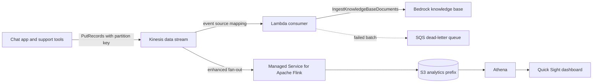

## 0. Before you start
- **Essential:** what S3 is; what a table, a row and a SQL query are; what "streaming" means (data arrives continuously, not as one file).
- **Helpful:** Parquet (a column-oriented file format); partitions; the Glue Data Catalog.
- **Optional advanced:** Apache Spark, Apache Kafka, Lambda event source mappings.

## 1. Simple explanation
These five services move and examine data around your GenAI application. **Athena** lets you run SQL on files that sit in S3, with no server to run: good for questions like "how many tokens did each team use last week?" when the logs are in S3. **EMR** is a rented cluster for heavy data jobs with Spark or Hadoop, for example cleaning a billion documents before you embed them. **Quick Sight** (a capability of Amazon Quick) draws dashboards and lets people ask questions of data in plain English. **Kinesis Data Streams** and **MSK (Kafka)** are pipes for data that never stops, such as click events, chat events or new support tickets, so that several programs can read the same flow at the same time.


```figure
flow kinesis-kb-fresh
```

## 2. Structured explanation
1. **Athena** ✅: interactive query service; standard SQL directly on S3 data (CSV, JSON, Parquet, ORC); also Apache Spark; serverless; you pay only for the queries you run; integrates with the Glue Data Catalog and Amazon Quick.
2. **EMR** ✅: managed cluster platform for Hadoop, Spark and related frameworks; storage can be HDFS (ephemeral), EMRFS or S3A on S3; YARN schedules work.
3. **Quick Sight** ✅: BI service inside Amazon Quick; generative BI ("Amazon Q in Quick") is built on Amazon Bedrock and is not in every Region.
4. **Kinesis Data Streams** ✅: durable ordered streams split into shards; capacity modes On-demand Standard, On-demand Advantage, Provisioned; retention 24 hours to 365 days; classic consumers and enhanced fan-out consumers.
5. **MSK** ✅: managed Apache Kafka; Provisioned (Standard or Express brokers) and Serverless cluster types; MSK Connect and MSK Replicator.

## 3. Analogy
**A city water system.** Kinesis or Kafka is the main pipe where water (events) keeps flowing and several houses tap it at once. S3 is the reservoir where water is stored. Athena is a lab technician who samples the reservoir with a query without draining it. EMR is a water-treatment plant you rent for a big job. Quick Sight is the public dashboard on the town hall wall.

*Where it breaks:* a stream is *replayable* inside its retention window (a tap does not return water); Athena charges by the data it reads, which no technician does; and a Kafka topic keeps order *per partition*, not across the whole system.

## 4. The seven questions

**WHAT?** Query (Athena), big-data processing (EMR), visualization (Quick Sight), real-time ingestion and fan-out (Kinesis, MSK).

**WHY?** GenAI systems produce and consume lots of data: invocation logs, feedback events, documents to prepare, usage numbers. These services answer questions about it, transform it and deliver it on time.

**WHEN?**
| Need | Pick |
|---|---|
| Ad hoc SQL on logs or documents in S3, no cluster | Athena |
| Custom Spark or Hadoop code over very large data | EMR |
| Executive dashboard or natural-language BI | Quick Sight |
| AWS-native real-time stream with simple operations | Kinesis Data Streams |
| You already use Kafka clients and tools, or need Kafka APIs | MSK |
| Long-term structured reporting with many large joins | Redshift (not in this module; the Athena page recommends it for that) ✅ |

**WHERE?** All are Regional. Quick Sight generative features and MSK Serverless are not in every Region ✅ (look up the Region lists).

**HOW?** §5.

**WHAT IF?**
| Situation | Effect | Remedy |
|---|---|---|
| A consumer is down longer than the retention period | Records expire unread ✅ | Raise retention (extra charge above 24 h ✅), alarm on iterator age |
| One partition key carries most traffic | Hot shard, write exceptions ✅ | Better key, provisioned shard splits ✅ |
| Traffic more than doubles the previous peak within 15 minutes (on-demand) | Throttling for about 15 minutes ✅ | Retry; warm throughput in Advantage mode ✅ |
| Athena queries scan whole CSV tables | Slow and expensive (cost follows scanned data 🟡) | Parquet, partitions |
| You call `IngestKnowledgeBaseDocuments` while a `StartIngestionJob` runs | Documented warning: do not do both at once ✅ | Serialize the two |

**WHY NOT?** Do not run a cluster (EMR, MSK Provisioned) for a job Athena or Kinesis could do serverless. Do not use a stream as long-term storage when S3 is the system of record. Do not put raw prompts in dashboards without the access controls of [08/01](aip:08-security/01-least-privilege-iam-identity-center-and-data-masking).

## 5. Technical depth

```figure
kinesis-shards
```


### 5.1 Athena ✅ (`what-is.html`, `when-should-i-use-ate.html`, `athena-aws-service-integrations.html`)
- Interactive queries with ANSI SQL on unstructured, semi-structured and structured data in S3, **without loading the data into Athena**; also Apache Spark applications through notebooks or Spark APIs; both serverless.
- **Glue Data Catalog** is the persistent metadata store; the catalog is Hive metastore compatible, so an EMR Hive metastore's DDL can be run in Athena without touching EMR jobs ✅.
- Connect BI tools through JDBC or ODBC drivers; **Amazon Quick** integration for dashboards ✅.
- Documented log-analysis integrations: CloudTrail, CloudFront, Application Load Balancer, VPC flow logs, S3 Inventory, Systems Manager Inventory ✅. **Step Functions** can start Athena queries and fetch results ✅ ([06/04](aip:06-app-building-tools/04-step-functions-states-circuit-breaker-and-prompt-chaining)).
- **Workgroups** isolate queries and control cost; **capacity reservations** exist ✅ (names from the CloudFormation resource list; details not read ❌).
- **Use Athena when** you need ad hoc SQL on S3 with no clusters ✅. **Use Redshift when** you pull many sources into one warehouse and run join-heavy reporting ✅. **Use EMR when** you need custom code and full control of cluster software ✅.
- **GenAI angle** 🟡: Bedrock model invocation logs can be delivered to S3 ([07/03](aip:07-governance-qa/03-cloudwatch-logs-alarms-rum-and-genai-observability)); define a table over that prefix and use SQL for cost, latency, error-rate and per-application usage questions. The log field names must be read from your own logs ❌.
- **Cost behavior** 🟡: you pay for queries; reading fewer bytes (columnar format, partitions, selecting only needed columns) lowers cost and time. The per-TB price and the tuning page were not read ❌.

### 5.2 EMR ✅ (`emr-what-is-emr.html`, `emr-overview-arch.html`)
- Previously called Elastic MapReduce; a **managed cluster platform** for Hadoop, Spark and related open-source projects; moves data between S3, DynamoDB and other stores ✅.
- **Storage:** HDFS (distributed, **ephemeral**, reclaimed when the cluster ends), **EMRFS** to read S3 like a file system, **S3A** (default connector from EMR 7.10.0 for `s3://`, `s3a://`, `s3n://`), local instance store ✅. Common pattern: S3 for input and output, HDFS for intermediate results ✅.
- **Resource management:** YARN by default; application masters run only on **core** nodes so Spot-based **task** nodes can disappear without killing jobs ✅. The primary (master) node role is standard 🟡 (page not read for it).
- **Frameworks:** Hadoop MapReduce (Hive generates MapReduce programs) and Spark (DAG execution, in-memory caching, Spark SQL, MLlib, GraphX) ✅.
- **Deployment variants** (EMR Serverless, EMR on EKS) exist 🟡 ❌ not read in this session.
- **GenAI angle** 🟡: large-scale document cleanup, deduplication and chunking before embedding; feature generation for fine-tuning data. For small jobs prefer Glue ([02/03](aip:02-data-management/03-aws-glue-data-quality-and-cloudwatch-metrics)) or Lambda.

### 5.3 Quick Sight ✅ (`quicksight-gen-bi.html`)
- The Athena page now links to "What is Amazon Quick", and the Quick page says **Amazon Q in Quick** (generative BI) is "built on Amazon Bedrock" with automated abuse detection ✅. AWS describes a newer **Amazon Quick chat** experience (multi-dataset Topics as a semantic layer, agentic workflows); the older Generative BI features "continue to work as before" ✅. See [03/07](aip:03-agentic-ai/07-amazon-q-apps-and-amazon-quick) for Quick Suite naming.
- Generative BI features: authoring (calculated fields, visuals), executive summaries, Q&A on data, data stories; **not available in all Regions** ✅.
- Pricing, SPICE, row-level security and embedding were not read ❌ (SPICE and RLS are standard Quick Sight vocabulary 🟡).

### 5.4 Kinesis Data Streams ✅ (`introduction.html`, `how-do-i-size-a-stream.html`, `kinesis-extended-retention.html`, `service-sizes-and-limits.html`)
- Part of the Kinesis platform with **Firehose**, **Kinesis Video Streams** and **Managed Service for Apache Flink** ✅. Put-to-get delay is typically under 1 second ✅.
- **Capacity modes:**
  | Mode | You manage | Notes ✅ |
  |---|---|---|
  | On-demand Standard | nothing | scales to double the previous 30-day peak write throughput; new streams start at 4 MB/s write and 8 MB/s read; limit 50 on-demand streams per account by default |
  | On-demand Advantage | account setting | warm throughput, lower per-dimension prices, up to 50 enhanced fan-out consumers, commits the account to at least 25 MiB/s ingest and 25 MiB/s retrieval, 24-hour minimum before disabling |
  | Provisioned | shard count | each shard up to 1 MB/s or 1,000 records/s write and 2 MB/s or 2,000 records/s read; shards = `ceiling(max(write KiB/s ÷ 1024, read KiB/s ÷ 2048))` |
- **Hot shards:** a partition key must go with each record; the stream hashes keys to shards; on-demand splits a shard within 15 minutes when traffic exceeds 500 KB/s per shard but cannot isolate a single hot key above 1 MB/s or 1,000 records/s; use provisioned mode for granular splits ✅.
- **Retention:** 24 hours default, up to 8,760 hours (365 days); extra charge above 24 hours; decreasing retention makes older records inaccessible almost immediately ✅.
- **Consumers:** default consumers share 2 MB/s per shard through `GetRecords` (5 reads per second per shard); **enhanced fan-out** (`SubscribeToShard`) gives dedicated throughput, 20 registered consumers (50 in Advantage) ✅.
- **Record size:** up to 10 MiB payload before base64, `PutRecords` up to 500 records and 10 MiB per request ✅.
- **Switching** between on-demand and provisioned: twice per 24 hours per stream, no disruption ✅.
- **Streaming ingestion for RAG** ✅ (`kb-direct-ingestion.html`): knowledge bases with **S3 or custom** data sources can use direct ingestion (`IngestKnowledgeBaseDocuments`, in the `KnowledgeBaseDocuments` operation family) to add, update or delete documents without a sync; for S3 sources the S3 object is not changed, so make the same change in S3 or the next sync overwrites it; never submit it together with `StartIngestionJob` ✅. A Lambda function reading a stream and calling this operation is a standard near-real-time freshness pattern 🟡 (consistent with [02/06](aip:02-data-management/06-s3-vectors-and-keeping-vector-stores-current)).


*Reading the arrows:* producers write events with a partition key; Lambda reads the stream and pushes new or changed documents into the knowledge base; Flink (a second, independent reader with its own throughput) aggregates events into S3; Athena queries that data and Quick Sight shows it. A failed batch goes to a dead-letter queue instead of blocking the shard (see [06/08](aip:06-app-building-tools/08-sqs-eventbridge-sns-and-appflow)).

### 5.5 MSK ✅ (`what-is-msk.html`, `serverless.html`, `msk-broker-types-express.html`)
- **Fully managed Apache Kafka**: AWS runs the control plane (create, update, delete clusters); you use the Kafka data plane (produce, consume); it runs open-source Kafka so existing clients and tools work ✅.
- **Provisioned** clusters: at least one broker per Availability Zone; **Standard** or **Express** brokers; metadata through ZooKeeper or **KRaft** controllers (KRaft at no extra cost) ✅.
- **Express brokers:** pay-as-you-go storage with no sizing, up to 3x throughput per broker, scaling up to 20x faster, no maintenance windows; three-AZ only; select instance sizes; not yet full Kafka Streams support ✅.
- **Serverless:** no capacity management; **IAM access control required, no Kafka ACLs**; integrates with PrivateLink, Glue Schema Registry, Managed Service for Apache Flink and Lambda; available in a listed set of Regions ✅.
- **MSK Connect** (stream to and from Kafka) and **MSK Replicator** (replicate between Provisioned clusters) ✅.
- **Kinesis vs MSK** 🟡 (decision summary): Kinesis is AWS-native and operationally lighter, with shards and AWS IAM; MSK keeps Kafka APIs, ecosystem and partitions, which matters for migration of existing Kafka applications.

## 6. Worked example
*Problem:* a support-chat product wants (a) new help-center articles searchable within a minute, (b) a weekly dashboard of tokens used per team, (c) a one-off cleanup of 8 million archived tickets before embedding.

| Need | Design | Why |
|---|---|---|
| (a) fresh articles | CMS publishes events to a Kinesis stream; Lambda calls `IngestKnowledgeBaseDocuments` on a custom-data-source knowledge base; retention 48 h as a safety net; failures go to a dead-letter queue | Direct ingestion without a sync ✅ |
| (b) token dashboard | Invocation logs to S3 → Glue table → Athena view → Quick Sight dashboard | Serverless SQL, no cluster ✅ |
| (c) archive cleanup | EMR (Spark) job or Glue job, output Parquet to S3, then chunk and embed | Large distributed transform ✅ |
| Access | Athena workgroup per team; Lake Formation permissions ([07/05](aip:07-governance-qa/05-lake-formation-and-mixed-review-for-quiz-7)) | Least privilege |

## 7. Knowledge checkpoints
1. Which service runs SQL directly on S3 with no cluster?
2. What are the minimum and maximum Kinesis retention periods?
3. What shard count does the provisioned-mode formula give for 1,200 KiB/s write and 3,600 KiB/s read?
4. Which MSK cluster type forbids Kafka ACLs?
5. Name the API for adding a document directly to a knowledge base.

## 7b. Practice questions (exam-style, original) — answers in §14

**Q1.** A team keeps Bedrock invocation logs in S3 and wants ad hoc SQL over them without creating any servers. Which service?
A. Amazon Athena
B. Amazon EMR with a permanent cluster
C. Amazon MSK
D. Amazon Kinesis Video Streams

**Q2.** (Select TWO) Which statements about Kinesis Data Streams are correct?
A. Retention can be raised to 365 days
B. Default retention is 24 hours
C. A stream cannot have more than one consumer
D. Retention above 24 hours is free
E. Records can never exceed 1 KB

**Q3.** A provisioned stream gets 1,000 writes per second of 2 KB each and has 2 consumers on `GetRecords`. How many shards by the documented formula?
A. 2
B. 1
C. 4
D. 8

**Q4.** One customer key sends 70% of the events and the stream throws write exceptions even though total traffic is low. What is the best remedy in provisioned mode?
A. Redesign the partition key and split the hot shard
B. Disable encryption
C. Lower retention to 24 hours
D. Switch to Athena

**Q5.** An organization already runs Kafka producers and consumers and wants a managed service that needs no application code change. Which?
A. Amazon MSK
B. Amazon SQS FIFO
C. Amazon Kinesis Data Firehose only
D. AWS DataSync

**Q6.** (Select TWO) Which are true of MSK Serverless?
A. IAM access control is required
B. Kafka ACLs are supported
C. It integrates with Lambda and Managed Service for Apache Flink
D. You choose the broker instance type
E. It is available in every Region

**Q7.** A knowledge base uses an S3 data source. A Lambda function adds a document with direct ingestion. What should the team also do?
A. Make the same change in the S3 location so the next sync does not overwrite it
B. Nothing, S3 is updated automatically
C. Delete the knowledge base
D. Run `StartIngestionJob` at the same moment

**Q8.** A data engineer needs custom Spark code over hundreds of terabytes with control over installed software. Which is the best fit?
A. Amazon EMR
B. Amazon Athena SQL
C. Amazon Quick Sight
D. Amazon Route 53

## 7c. Mixed review for Quiz 9 (analytics) — answers in §14
1. Which two services in this file can read data directly from S3 without you loading it first? 2. Which service has "shards" and which has "partitions"? 3. What is the default Kinesis read share per shard for all `GetRecords` consumers together? 4. Which services are named as integrations of Athena for visualization and orchestration? 5. Which statement is true: "Quick Sight generative BI is built on Amazon Bedrock and is in all Regions"?

## 8. Hands-on lab: stream sizing, hot keys, retention loss, and Athena bytes scanned (offline model) + Kinesis console and CLI steps

### 8.1 Objective
Apply the documented provisioned sizing formula, see a hot shard and how a key suffix spreads it, apply the on-demand "double the previous peak" rule, see records expire during a consumer outage, and estimate how format and partitions change bytes scanned by a query.

### 8.2 Prerequisites
Python 3 (standard library). Optional AWS part: a Kinesis data stream, IAM permissions, AWS CLI.

### 8.3 AWS services
Offline: none. Optional: Kinesis Data Streams, CloudWatch.

### 8.4 IAM permissions
Offline: none. Real: create stream, put and read records (`kinesis:CreateStream`, `PutRecord`, `GetRecords`, `GetShardIterator`, `DescribeStream`, `DeleteStream`; names are the API operation names, policy resource formats not read ❌).

### 8.5 Region notes
On-demand maximum throughput differs by Region (10 GB/s write in N. Virginia, Oregon and Ireland, 200 MB/s elsewhere unless raised) ✅.

### 8.6 Architecture
§5.4 diagram (producers → stream → consumers).

### 8.7 Cost
Offline: none. Real: on-demand charges per GB written and read, per stream-hour in Standard mode, extended retention; prices ❌ not read. Delete the stream when done.

### 8.8 Code
**Simplification:** Kinesis maps a partition key to a 128-bit hash value and each shard owns a hash range 🟡 (MD5 is the documented hash function in the API reference, not read here ❌). The demo splits the hash range into equal parts. Event counts, sizes and format ratios are made up; the sizing formula and the on-demand rule come from the pages in §13.

```python lab-run
import hashlib, math
from collections import Counter

# ---------- 1. Provisioned sizing: shards = ceil(max(write KiB/s / 1024, read KiB/s / 2048)) ----------
def shards_needed(avg_kb, records_per_s, consumers):
    write = avg_kb * records_per_s
    read = write * consumers
    return math.ceil(max(write / 1024, read / 2048)), write, read
print("1) provisioned sizing")
for name, args in [("chat events", (3, 400, 3)), ("support feed", (2, 1000, 2)), ("big documents", (512, 10, 1))]:
    n, w, r = shards_needed(*args)
    print(f"   {name:<14}write {w:>5} KiB/s read {r:>5} KiB/s -> {n} shard(s)")

# ---------- 2. Hot shard: partition key hashed into 4 equal hash ranges ----------
def shard_of(key, shards):
    h = int(hashlib.md5(key.encode()).hexdigest(), 16)
    return h * shards // (1 << 128)
def spread(keys, shards):
    c = Counter(shard_of(k, shards) for k in keys)
    return [c.get(i, 0) for i in range(shards)]
tenants = [f"tenant-{i:02d}" for i in range(40)]
events = ["tenant-00"] * 6000 + [tenants[1 + i % 39] for i in range(4000)]
print("2) 10,000 events, 4 shards; tenant-00 sends 60%")
print("   plain key:           per-shard counts", spread(events, 4))
salted = [k if k != "tenant-00" else f"tenant-00#{i % 32}" for i, k in enumerate(events)]
print("   key + 32-way suffix: per-shard counts", spread(salted, 4))
print("   trade-off: ordering is now only guaranteed per suffix, not per tenant")

# ---------- 3. On-demand: a stream accepts up to double the previous 30-day peak write throughput ----------
def on_demand(previous_peak, demand):
    limit = previous_peak * 2
    return min(demand, limit), max(0, demand - limit)
print("3) on-demand write throughput in MB/s (previous peak 40, so the limit is 80)")
for demand in [30, 80, 100]:
    ok, throttled = on_demand(40, demand)
    print(f"   demand {demand:>3} -> accepted {ok:>3}, throttled {throttled:>2} (retry these)")
ok, throttled = on_demand(100, 100)
print(f"   after a sustained new peak of 100, demand 100 -> accepted {ok}, throttled {throttled}")

# ---------- 4. Retention: a consumer outage and records that expire unread ----------
def lost_records(retention_h, outage_h, arrival_every_h=1, history_h=72):
    arrivals = list(range(0, history_h, arrival_every_h))
    outage_start, outage_end = 20, 20 + outage_h
    lost = 0
    for t in arrivals:
        if t < outage_start:
            continue
        read_time = max(t, outage_end)
        if read_time - t > retention_h:
            lost += 1
    return lost
print("4) records lost after a consumer outage starting at hour 20 (one record per hour)")
for retention in [24, 48, 168]:
    print(f"   retention {retention:>3} h: outage 30 h loses {lost_records(retention, 30)} | outage 60 h loses {lost_records(retention, 60)}")

# ---------- 5. Athena-style bytes scanned: format, partitions, columns (made-up sizes) ----------
DAYS, GB_PER_DAY_CSV, COLUMNS, PARQUET_RATIO = 365, 2.0, 10, 0.25
def scanned_gb(days_read, fmt, columns_read):
    if fmt == "csv":
        return days_read * GB_PER_DAY_CSV
    return days_read * GB_PER_DAY_CSV * PARQUET_RATIO * columns_read / COLUMNS
print("5) query for the last 7 days, 2 of 10 columns")
for label, days, fmt, cols in [("CSV, no partitions", DAYS, "csv", COLUMNS), ("CSV, date partitions", 7, "csv", COLUMNS),
                               ("Parquet, no partitions", DAYS, "parquet", 2), ("Parquet, date partitions", 7, "parquet", 2)]:
    print(f"   {label:<26}{scanned_gb(days, fmt, cols):>8.2f} GB scanned")
```

### 8.9 Captured output
Generated on 2026-10-26 by extracting the block above from this file and running it (Python 3). It models documented rules with made-up data; it is **not** Kinesis or Athena output.
```text lab-out
1) provisioned sizing
   chat events   write  1200 KiB/s read  3600 KiB/s -> 2 shard(s)
   support feed  write  2000 KiB/s read  4000 KiB/s -> 2 shard(s)
   big documents write  5120 KiB/s read  5120 KiB/s -> 5 shard(s)
2) 10,000 events, 4 shards; tenant-00 sends 60%
   plain key:           per-shard counts [716, 925, 922, 7437]
   key + 32-way suffix: per-shard counts [2027, 2050, 2800, 3123]
   trade-off: ordering is now only guaranteed per suffix, not per tenant
3) on-demand write throughput in MB/s (previous peak 40, so the limit is 80)
   demand  30 -> accepted  30, throttled  0 (retry these)
   demand  80 -> accepted  80, throttled  0 (retry these)
   demand 100 -> accepted  80, throttled 20 (retry these)
   after a sustained new peak of 100, demand 100 -> accepted 100, throttled 0
4) records lost after a consumer outage starting at hour 20 (one record per hour)
   retention  24 h: outage 30 h loses 6 | outage 60 h loses 36
   retention  48 h: outage 30 h loses 0 | outage 60 h loses 12
   retention 168 h: outage 30 h loses 0 | outage 60 h loses 0
5) query for the last 7 days, 2 of 10 columns
   CSV, no partitions          730.00 GB scanned
   CSV, date partitions         14.00 GB scanned
   Parquet, no partitions       36.50 GB scanned
   Parquet, date partitions      0.70 GB scanned
```

### 8.10 Explanation
- Part 1 is the page's own formula; the large-document row shows that read bandwidth, not record count, can set the shard count.
- Part 2: one tenant with 60% of events overloads whichever shard owns its key; a suffix spreads it at the cost of per-tenant ordering.
- Part 3: the doc example (10 to 40 MB/s allows 80, a new peak of 50 allows 100) is the rule; throttled records must be retried.
- Part 4: the retention period is a safety net; a 24-hour retention cannot survive a 30-hour outage.
- Part 5: relative sizes only; cost follows bytes scanned 🟡.

### 8.11 Optional AWS lab: Kinesis Data Streams hands on (lesson 240; shown, not run against AWS ❌)
1. **Console:** Kinesis → Data streams → Create data stream; name `genai-events`; choose **On-demand**; create. Open the stream's **Data viewer** or **Monitoring** tab ✅ (console flow standard 🟡).
2. **CLI (syntax 🟡):**
   ```text
   aws kinesis create-stream --stream-name genai-events --stream-mode-details StreamMode=ON_DEMAND
   aws kinesis put-record --stream-name genai-events --partition-key tenant-01 --cli-binary-format raw-in-base64-out --data "hello"
   aws kinesis increase-stream-retention-period --stream-name genai-events --retention-period-hours 48
   aws kinesis delete-stream --stream-name genai-events
   ```
   The retention command is the page's own example ✅; the others follow the same CLI shape and were not read ❌.
3. Read back with `get-shard-iterator` and `get-records` (iterators expire after 5 minutes ✅).
4. Connect a Lambda function as a consumer (event source mapping), then delete everything.

### 8.12 Common errors
| Error | Cause | Fix |
|---|---|---|
| `ProvisionedThroughputExceededException` | Shard limit hit or `GetRecords` called too often ✅ | More shards, better keys, enhanced fan-out |
| Writes throttled in on-demand | Traffic more than doubled the previous peak ✅ | Retry; warm throughput (Advantage) |
| Expired shard iterator | Older than 5 minutes ✅ | Request a new iterator |
| Records missing for a late consumer | Retention elapsed ✅ | Raise retention earlier |
| `StartIngestionJob` and direct ingestion collide | Documented not to run together ✅ | Serialize them |

### 8.13 Security recommendations
Encrypt streams with KMS ([08/03](aip:08-security/03-kms-secrets-manager-macie-and-bedrock-data-protection); the page shows rate limits on changing the key ✅); give producers `PutRecord` only and consumers read only; use VPC endpoints for private access 🟡; do not put secrets or unmasked personal data in events; require IAM authentication on MSK ✅ (mandatory on Serverless); protect Athena results buckets and use workgroups and Lake Formation for column-level access.

## 9. What can go wrong?
| Failure | Why | Symptoms | Investigate | Fix | Prevent |
|---|---|---|---|---|---|
| **Hot shard** | One key dominates ✅ | Write exceptions at low total traffic | Per-shard metrics | New key, split | Test key distribution |
| **Expired records** | Consumer outage beyond retention ✅ | Gaps in the knowledge base | Iterator-age alarm | Raise retention, replay from source | Alarm early |
| **Poison record blocks a shard** | Consumer retries one bad batch forever 🟡 | Iterator age grows | Consumer logs | Dead-letter queue, bisect batch | Handler error design |
| **Athena full-table scans** | CSV, no partitions | Slow, costly queries | Query stats | Parquet, partitions | Table design |
| **KB overwritten by sync** | S3 not updated after direct ingestion ✅ | Edited document reverts | Compare S3 and KB | Update S3 too | Process rule |
| **Over-provisioned EMR cluster** | Left running | Idle cost | Cluster list | Auto-terminate, use Athena or Glue | Job-scoped clusters 🟡 |
| **Dashboard leaks prompts** | Raw logs shown to a broad audience | Privacy incident | Dataset permissions | Mask or aggregate | Least privilege |

## 10. Common misconceptions
1. **"Kinesis is storage."** It is a time-limited log (24 h to 365 days ✅).
2. **"On-demand never throttles."** It can, above twice the previous peak ✅.
3. **"Athena loads my data."** It queries S3 in place ✅.
4. **"MSK Serverless supports Kafka ACLs."** It requires IAM access control ✅.
5. **"Quick Sight generative BI works in every Region."** It does not ✅.
6. **"EMR HDFS is permanent."** It is ephemeral ✅.
7. **"Direct ingestion updates my S3 files."** It does not ✅.

## 11. Exam notes
- **Patterns:** "ad hoc SQL on S3, no servers" → Athena; "custom Spark at scale" → EMR; "dashboards and natural-language BI" → Quick Sight; "real-time stream, AWS-native" → Kinesis Data Streams; "existing Kafka apps" → MSK; "keep a knowledge base fresh from events" → stream + Lambda + direct ingestion (or sync jobs).
- **Keywords:** shard, partition key, enhanced fan-out, retention period, iterator age, on-demand vs provisioned, Express brokers, KRaft, Glue Data Catalog, partition pruning, Parquet.
- **Traps:** assuming one key spreads evenly; keeping a stream as an archive; picking EMR where Athena or Glue is simpler; forgetting that Kinesis consumers share 2 MB/s per shard without enhanced fan-out.
- **Compare:** Kinesis Data Streams vs Firehose (delivery to S3 and others; not read in detail ❌) vs MSK vs SQS ([06/08](aip:06-app-building-tools/08-sqs-eventbridge-sns-and-appflow)); Athena vs Redshift vs EMR.

## 12. Summary and revision cards
- Athena = SQL on S3, serverless; EMR = managed Spark/Hadoop clusters; Quick Sight = dashboards and Bedrock-powered generative BI; Kinesis = shards, retention 24 h–365 d; MSK = managed Kafka, Serverless needs IAM.
- Streaming freshness for RAG: stream → Lambda → direct ingestion, and keep S3 in step.

**Cards.** Q: Kinesis per-shard write? A: 1 MB/s or 1,000 records/s. · Q: Enhanced fan-out consumers? A: 20 (50 in On-demand Advantage). · Q: Kinesis max retention? A: 8,760 hours. · Q: MSK Serverless auth? A: IAM only.

## 13. References
| Source | URL | Verified |
|---|---|---|
| What is Amazon Athena | https://docs.aws.amazon.com/athena/latest/ug/what-is.html | 2026-10-26 |
| When should I use Athena | https://docs.aws.amazon.com/athena/latest/ug/when-should-i-use-ate.html | 2026-10-26 |
| Athena service integrations | https://docs.aws.amazon.com/athena/latest/ug/athena-aws-service-integrations.html | 2026-10-26 |
| What is Amazon EMR / architecture | https://docs.aws.amazon.com/emr/latest/ManagementGuide/emr-what-is-emr.html · .../emr-overview-arch.html | 2026-10-26 |
| Generative BI with Quick Sight | https://docs.aws.amazon.com/quick/latest/userguide/quicksight-gen-bi.html | 2026-10-26 |
| Kinesis Data Streams (intro, modes, retention, quotas) | https://docs.aws.amazon.com/streams/latest/dev/introduction.html · .../how-do-i-size-a-stream.html · .../kinesis-extended-retention.html · .../service-sizes-and-limits.html | 2026-10-26 |
| Amazon MSK (overview, Serverless, Express brokers) | https://docs.aws.amazon.com/msk/latest/developerguide/what-is-msk.html · .../serverless.html · .../msk-broker-types-express.html | 2026-10-26 |
| Ingest changes directly into a knowledge base | https://docs.aws.amazon.com/bedrock/latest/userguide/kb-direct-ingestion.html | 2026-10-26 |

**Unverified here:** all prices; Athena tuning, workgroup and capacity-reservation details; EMR Serverless/EKS and node-type pages; Quick Sight SPICE, row-level security, embedding and Regions list; Kinesis Firehose and Flink details; the Kinesis CLI create/put syntax and partition-key hash function; MSK quotas and supported versions beyond the Express page; Bedrock invocation-log field names.

## 14. Answers to checkpoints and practice questions
**Checkpoints.** 1) Athena ✅. 2) 24 hours minimum and 8,760 hours (365 days) maximum ✅. 3) ceiling(max(1200/1024, 3600/2048)) = ceiling(max(1.17, 1.76)) = 2 ✅. 4) MSK Serverless ✅. 5) `IngestKnowledgeBaseDocuments` ✅.

**Practice questions.**
- **Q1 → A.** Athena queries S3 in place. B needs a cluster, C is a streaming service, D is video ✅.
- **Q2 → A, B.** C false (many consumers), D false (extra charge above 24 h), E false (up to 10 MiB) ✅.
- **Q3 → A.** Write 2,000 KiB/s → 1.95; read 4,000 KiB/s → 1.95; ceiling = 2 ✅.
- **Q4 → A.** Hot key; provisioned mode supports granular splits ✅. B, C, D do not address key skew.
- **Q5 → A.** MSK runs open-source Kafka ✅.
- **Q6 → A, C.** B false (no ACLs), D false (MSK manages brokers), E false (listed Regions) ✅.
- **Q7 → A.** Direct ingestion does not change S3 ✅. D is explicitly discouraged.
- **Q8 → A.** Custom frameworks and cluster control ✅.

**Mixed review (§7c).** 1) Athena (S3 in place) and EMR (EMRFS or S3A) ✅. 2) Kinesis has shards; Kafka (MSK) has partitions ✅ (partition vocabulary is standard Kafka 🟡). 3) 2 MB/s per shard shared by classic consumers ✅. 4) Amazon Quick for visualization, Step Functions for orchestration (also Glue Data Catalog as metadata) ✅. 5) False: it is built on Bedrock but is not available in all Regions ✅.
