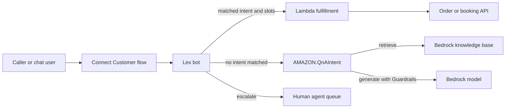

## 0. Before you start
- **Essential:** what a virtual server and a container are; what a security group is.
- **Helpful:** Docker images and registries; the idea of an "orchestrator" that keeps containers running.
- **Optional advanced:** Kubernetes objects (pod, deployment, node), GPU drivers.

## 1. Simple explanation
Most GenAI apps simply call Bedrock, but sometimes you must run your own code or your own model. **EC2** gives you a virtual server (you manage everything on it). **ECS** and **EKS** run *containers* (packaged programs) for you: ECS is AWS's own, simpler container service; EKS is managed Kubernetes for teams that already use or need Kubernetes. Both can run on servers you manage or on **Fargate**-style serverless capacity (ECS). **Amazon Lex** builds chatbots that understand what a caller wants, and **Amazon Connect** (now named **Connect Customer**) is the cloud contact center where those bots answer phone calls and chats. Together they form the classic "customer-service assistant", now with Bedrock behind it.


```figure
flow contact-center
```

## 2. Structured explanation
1. **EC2** ✅: virtual servers (instances); instance type sets CPU, memory, network, storage and accelerators; AMIs, EBS volumes, instance store, key pairs, security groups; purchase options On-Demand, Savings Plans, Reserved Instances, Spot, Dedicated Hosts, Capacity Reservations.
2. **ECS** ✅: fully managed container orchestration; **task definition** (blueprint), **task** (runs and stops), **service** (long-running stateless app), **cluster**; capacity: **Fargate**, **EC2**, **ECS Managed Instances**, **ECS Anywhere** (on-premises).
3. **EKS** ✅: managed Kubernetes; **EKS standard** (AWS runs the control plane) and **EKS Auto Mode** (AWS also manages nodes); EKS Capabilities (Argo CD, ACK, kro); hybrid nodes and EKS Anywhere.
4. **Amazon Lex V2** ✅: conversational interfaces (voice and text) with ASR and NLU; **Assisted NLU** uses LLMs for intent classification and slot resolution; Lambda integration; **AMAZON.QnAIntent** answers from a knowledge store using a Bedrock model.
5. **Connect Customer** ✅: the contact-center product formerly called Amazon Connect; routing, queues, flows, agents and supervisors.

## 3. Analogy
**A restaurant kitchen.** EC2 is renting an empty kitchen: you bring the cooks, stoves and rules. ECS is a catering company that runs your recipes (containers) in a kitchen it organizes; Fargate is "we also supply the kitchen". EKS is the same with an industry-standard (Kubernetes) rulebook so cooks can move between restaurants. Lex is the waiter who understands "a table for two at seven", and Connect is the whole front desk with the phone lines.

*Where it breaks:* a container is not a mini-server with its own life; when its task stops, local data is gone. And Lex does not "know" your menu: it only maps sentences to the intents and slots you defined (or answers from a knowledge store).

## 4. The seven questions

**WHAT?** Compute (EC2), container platforms (ECS, EKS), and customer-conversation services (Lex, Connect).

**WHY?** Host custom code, tools, MCP servers, embedding or reranking services and self-managed models; or put a managed conversational front door on a contact center.

**WHEN?**
| Need | Pick |
|---|---|
| Full control of OS, GPU drivers or custom inference stack | EC2 (or ECS/EKS on EC2) |
| Run a containerized API or agent tool with minimal ops | ECS on Fargate |
| Existing Kubernetes skills, portability, Kubernetes tooling | EKS |
| Short event-driven code | Lambda ([06/01](aip:06-app-building-tools/01-lambda-integration-patterns-and-lambda-with-bedrock)) |
| Managed model hosting with scaling, monitoring | SageMaker AI ([05/01](aip:05-sagemaker/01-sagemaker-ai-deployment-guardrails-and-fm-optimization)) |
| Voice or chat bot for a contact center | Lex + Connect Customer |
| Free-form agent behavior | Bedrock Agents / AgentCore ([03/04](aip:03-agentic-ai/04-agentcore-runtime-memory-gateway-identity-policy-evaluations)) |

**WHERE?** Regional; Lex V2 supports **Multi-Region Replication** ✅; ECS can also register on-premises servers (ECS Anywhere) and EKS runs on-premises through EKS Anywhere or Hybrid Nodes ✅.

**HOW?** §5.

**WHAT IF?**
| Situation | Effect | Remedy |
|---|---|---|
| A container needs a GPU | ECS documents GPUs on EC2-based container instances ✅ | Use a GPU instance family and the ECS GPU-optimized AMI |
| A Spot instance is reclaimed mid-job | The job stops 🟡 | Checkpoint to S3; use Spot only for interruptible work |
| A task stops | Its local disk is gone; a **service** replaces it, a plain **task** does not ✅ | Store state in S3, DynamoDB, EFS |
| Lex cannot classify an utterance | QnAIntent can answer it, but not while Lex is asking for a slot value ✅ | Design a fallback path |
| Both QnAIntent and KendraSearchIntent are added to one locale | Not allowed ✅ | Pick one |
| Bedrock model for QnAIntent is retired | The page warns to check the deprecation schedule ✅ | Plan migrations ([01/01](aip:01-bedrock-genai-fundamentals/01-bedrock-overview-and-converse-api)) |

**WHY NOT?** Do not host an FM on raw EC2 if Bedrock or SageMaker meets the need; you own patching, scaling and drivers. Do not choose EKS only because it sounds modern: ECS is simpler when Kubernetes features are not needed 🟡.

## 5. Technical depth

### 5.1 EC2 ✅ (`concepts.html`, `accelerated-computing-instances.html`)
- An instance is a virtual server; **instance type** fixes the balance of compute, memory, network and storage; **AMI** is the template; **EBS** is persistent block storage; **instance store** is deleted on stop, hibernate or terminate; **key pairs** (AWS keeps the public key) and **security groups** (virtual firewall) ✅.
- **Purchase options** ✅: On-Demand (per second, minimum 60 seconds), Savings Plans (USD per hour for 1 or 3 years), Reserved Instances (specific configuration, 1 or 3 years), Spot (unused capacity, "significantly" lower cost), Dedicated Hosts, On-Demand Capacity Reservations. Prices ❌ not read.
- **Accelerated computing families** ✅ (table on the page): GPU families such as **G4dn, G5, G6, G6e, G6f**, **P4d, P4de, P5, P5e, P5en**; **Trainium** training families **Trn1, Trn1n, Trn2, Trn2u**; **Inferentia** inference families **Inf1, Inf2**; also DL1 and F2. Exam relevance: Trn for training and Inf for inference on AWS silicon 🟡 (the page lists the hardware; it does not say "for LLM training").
- **Related services** ✅: Auto Scaling, CloudWatch, ELB, Systems Manager, GuardDuty, Image Builder, AWS Backup.
- **GenAI angle** 🟡: self-hosted open models, vLLM-style servers, custom embedding or reranker services, and batch preprocessing; prefer SageMaker or Bedrock Custom Model Import ([01/02](aip:01-bedrock-genai-fundamentals/02-model-customization-finetuning-and-lora)) when they fit.

### 5.2 ECS ✅ (`Welcome.html`, `ecs-gpu.html`)
- **Three layers:** capacity (where containers run), controller (the scheduler), provisioning (console, CLI, SDKs, CDK) ✅.
- **Capacity:** **ECS Managed Instances** (EC2 types including GPU, with AWS managing provisioning, patching and scaling), **EC2 instances** you manage, **Fargate** (serverless), **ECS Anywhere** ✅.
- **Objects:** task definition → cluster → **task** (job that runs and stops) or **service** (long-running stateless application; Service Auto Scaling changes the task count; Cluster Auto Scaling manages registered EC2 instances) ✅.
- **GPU** ✅: GPU workloads need container instances with GPUs (p3, p4d, p5, g4, g5, g6, g6e, g6f listed); use the GPU-optimized AMI; set `ECS_ENABLE_GPU_SUPPORT=true`; request GPUs in the task definition so the scheduler pins physical GPUs to containers; GPUs are not supported on Windows containers. Whether Fargate offers GPUs ❌ not verified here.
- **Related** ✅: ECR (images), ELB, CloudWatch, GuardDuty.
- **Official MCP-on-ECS guidance** ❌ (still unverified; see [03/06](aip:03-agentic-ai/06-mcp-openapi-tools-and-human-in-the-loop)).

### 5.3 EKS ✅ (`what-is-eks.html`)
- Managed Kubernetes; **EKS standard**: AWS manages the control plane; **EKS Auto Mode**: AWS also provisions nodes, picks instances, scales, patches and optimizes cost ✅.
- Runs in AWS and on-premises (EKS Anywhere, Hybrid Nodes); certified Kubernetes-conformant, with standard and extended version support ✅.
- Access uses Kubernetes RBAC plus IAM, and Kubernetes service accounts for workload access to AWS ✅. Storage via CSI drivers (EBS, S3, EFS, FSx) ✅.
- Per-cluster pricing plus the resources you run ✅ (rates ❌).
- **GenAI angle** 🟡: teams standardizing on Kubernetes run inference servers, agents and vector databases there; the exam rarely requires Kubernetes details.

### 5.4 Lex V2 and Connect Customer ✅ (`what-is.html`, `built-in-intent-qna.html`, `what-is-amazon-connect.html`)
- **Lex V2:** build voice and text bots; ASR and NLU; Lambda for fulfillment and enterprise connectors; integrates with **Connect Customer**, Comprehend and Kendra; conditional branching for flows without Lambda (bots created after 17 August 2022); **Assisted NLU** (LLM-assisted intent classification and slot resolution, staying within configured intents and slots); custom vocabularies in 17 more languages; **Multi-Region Replication**; pay per text or speech request ✅.
- **AMAZON.QnAIntent** ✅: needs generative AI turned on for the bot locale and a Bedrock model; triggers when an utterance matches no other intent (not while eliciting a slot); knowledge stores: **OpenSearch Service domain**, **Kendra index**, **Bedrock knowledge base**; "Exact response" mode returns stored answer text without synthesis (for a knowledge base: JSON files with an answer field, **no chunking**); request attributes `x-amz-lex:qnA-search-response` and `...-source`; session attributes for extra context, Bedrock metadata filters (`x-amz-lex:bkb-retrieval-filter`), inference config (`temperature`, `topP`, `maxTokens`) and **Guardrails** (`x-amz-lex:bedrock-guardrails-identifier` and `-version`); the default prompt asks the model to use only the retrieved context and answer `CANNOTANSWER` otherwise; **cannot be combined with `AMAZON.KendraSearchIntent` in one locale** ✅.
- **Connect Customer** ✅: "the current name for the product previously called Amazon Connect"; a contact center for customers, agents, supervisors and administrators; queues, routing profiles, flows and rules; pay for what you use. Generative features such as agent assistance (earlier branded Amazon Q in Connect) were announced in 2023 🟡 but a current official page was not read ❌.


*Reading the arrows:* the caller reaches a Connect flow that hands the conversation to a Lex bot. A recognized intent runs Lambda against a business API. If nothing matches (and Lex is not in the middle of asking for a slot), QnAIntent retrieves from a knowledge base and asks a Bedrock model to answer, with a guardrail. Anything the bot cannot handle goes to a human queue.

## 6. Worked example
*Problem:* an energy company wants a phone and chat assistant that (a) reports outages, (b) answers tariff questions from policy documents, (c) hands angry customers to a person. Back-end: a small containerized outage-lookup API with variable traffic.

| Step | Design | Why |
|---|---|---|
| 1 | Connect Customer flow answers the call and invokes a Lex bot | Contact-center front door ✅ |
| 2 | Intent `ReportOutage` with slots `postcode`, `meterId`; Lambda calls the outage API | Structured task ✅ |
| 3 | QnAIntent on a Bedrock knowledge base of tariff PDFs, with a guardrail and temperature 0 | Grounded answers ✅ |
| 4 | Outage API as an ECS **service** on Fargate behind an ALB, desired count 2, Service Auto Scaling | Long-running stateless container ✅ |
| 5 | A nightly job that re-embeds changed PDFs runs as an ECS **task** (or Lambda) | Run-and-stop work ✅ |
| 6 | Escalation intent routes to a human queue | Human in the loop |
| 7 | CloudWatch alarms on bot fallback rate and API 5xx ([07/03](aip:07-governance-qa/03-cloudwatch-logs-alarms-rum-and-genai-observability)) | Operations |

## 7. Knowledge checkpoints
1. What is the difference between an ECS task and an ECS service?
2. Which EC2 family names correspond to Trainium and Inferentia?
3. When does AMAZON.QnAIntent fire?
4. Which two intents cannot share a bot locale?
5. What is Amazon Connect called now?

## 7b. Practice questions (exam-style, original) — answers in §14

**Q1.** A containerized tool server must run continuously, behind a load balancer, with no servers to patch. Which is the best fit?
A. ECS service on Fargate
B. A single EC2 instance with a cron job
C. An ECS task started once by hand
D. AWS Direct Connect

**Q2.** (Select TWO) Which are true of an ECS **task**? 
A. It is an application such as a batch job that performs work and then stops
B. It is created from a task definition
C. It automatically restarts forever when it ends
D. It is the same as a cluster
E. It can never run on EC2

**Q3.** A team already operates Kubernetes and wants AWS to manage the control plane and also the nodes. Which?
A. Amazon EKS with EKS Auto Mode
B. Amazon ECS Anywhere
C. Amazon Lex
D. AWS DataSync

**Q4.** A Lex bot should answer free-form questions from policy PDFs when no intent matches. Which feature?
A. AMAZON.QnAIntent with a Bedrock knowledge base
B. A second AMAZON.KendraSearchIntent in the same locale as QnAIntent
C. A larger EBS volume
D. A security group

**Q5.** (Select TWO) Which statements about AMAZON.QnAIntent are correct?
A. It is not activated while Lex is eliciting a slot value
B. It can use a Bedrock knowledge base, an OpenSearch domain, or a Kendra index
C. It requires a Windows container
D. It can be used together with AMAZON.KendraSearchIntent in the same locale
E. It stores answers in an S3 bucket by default

**Q6.** A job can be interrupted and restarted from checkpoints in S3, and the team wants the lowest compute cost. Which EC2 purchase option fits?
A. Spot Instances
B. Dedicated Hosts
C. 3-year Reserved Instances for a once-a-month job
D. On-Demand Capacity Reservation held all year

**Q7.** A custom inference container needs eight NVIDIA GPUs on ECS. What must the cluster provide?
A. EC2 (or managed) container instances with GPUs, the GPU-optimized AMI and GPU support enabled in the agent
B. Only Windows containers
C. A CloudFront distribution
D. A Route 53 hosted zone

**Q8.** A company says "we use Amazon Connect". What is the current name of the product in the documentation?
A. Connect Customer
B. Amazon Kinesis
C. Amazon Macie
D. EC2 Image Builder

## 7c. Mixed review for Quiz 10 (compute, containers, customer service) — answers in §14
1. Which three ECS capacity options were named on the overview page besides ECS Anywhere? 2. Which documented EC2 purchase option is billed per second with a 60-second minimum? 3. What does Fargate remove? 4. Why is a Lambda function often a better choice than ECS for a 2-second event handler? 5. Which layer of ECS decides where a task is placed?

## 8. Hands-on lab: ECS service reconciliation, GPU task placement, purchase-option math and a Lex-style dialog (offline) + console steps for EC2, ECS and EKS

### 8.1 Objective
See a service replace failed tasks while a one-off task ends, pack GPU tasks onto instance types from the ECS GPU table, compare purchase options with made-up discount factors, and watch a small dialog manager fill slots and fall back to a knowledge answer only when it is not eliciting a slot.

### 8.2 Prerequisites
Python 3 (standard library). Optional AWS part: an AWS account, a VPC, permissions for EC2, ECS and EKS.

### 8.3 AWS services
Offline: none. Optional: EC2, ECS, ECR, Fargate, EKS, CloudWatch.

### 8.4 IAM permissions
Offline: none. Real: ECS task execution role (pull images, write logs), a task role for the container's own AWS calls, EC2 instance profile; EKS cluster and node roles (exact policies ❌ not read; use the console's guided creation).

### 8.5 Region notes
Check Region support for Lex generative features and Connect features ✅ (lists not read ❌), and for GPU instance families.

### 8.6 Architecture
§5.4 diagram, plus an ECS service on Fargate.

### 8.7 Cost
Offline: none. Real: EC2 instance-hours, EBS, Fargate vCPU and memory, EKS per-cluster fee plus nodes, Lex requests, Connect usage; rates ❌ not read. Stop or delete everything afterwards.

### 8.8 Code
**Simplification:** the discount factors are **made up** and are not AWS prices; the GPU counts come from the ECS GPU page ✅ (g5.xlarge 1 GPU, g5.12xlarge 4 GPUs, p5.48xlarge 8 GPUs); the scheduler and the dialog manager are teaching models, not ECS or Lex code.

```python lab-run
import random

# ---------- 1. ECS service vs task: a service keeps the desired count, a task runs once and ends ----------
random.seed(7)
def run_service(desired, ticks, failure_rate):
    running, log = desired, []
    for t in range(1, ticks + 1):
        failed = sum(1 for _ in range(running) if random.random() < failure_rate)
        running -= failed
        replaced = desired - running
        running = desired
        log.append((t, failed, replaced, running))
    return log
print("1) service with desired count 3 (failures are random but seeded)")
for t, failed, replaced, running in run_service(3, 5, 0.3):
    print(f"   tick {t}: failed {failed}, replaced {replaced}, running {running}")
print("   one-off task: runs, exits with code 0, and is NOT restarted (that is what a service is for)")

# ---------- 2. GPU placement onto instances (GPU counts from the ECS GPU page) ----------
CATALOG = {"g5.xlarge": 1, "g5.12xlarge": 4, "p5.48xlarge": 8}
def place(tasks, instance_type):
    gpus = CATALOG[instance_type]
    instances = []
    for name, need in sorted(tasks, key=lambda x: -x[1]):
        if need > gpus:
            return None
        for inst in instances:
            if inst["free"] >= need:
                inst["free"] -= need
                inst["tasks"].append(name)
                break
        else:
            instances.append({"free": gpus - need, "tasks": [name]})
    return instances
workload = [("embed-1", 1), ("embed-2", 1), ("rerank", 1), ("llm-a", 4), ("llm-b", 4), ("llm-c", 8)]
print("2) placing tasks that need 1, 1, 1, 4, 4 and 8 GPUs")
for itype in CATALOG:
    result = place(workload, itype)
    if result is None:
        print(f"   {itype:<12} impossible: a task needs more GPUs than one instance has")
    else:
        idle = sum(i["free"] for i in result)
        print(f"   {itype:<12} {len(result)} instance(s), idle GPUs {idle}")

# ---------- 3. Purchase options with MADE-UP factors (relative to On-Demand = 1.00 per hour) ----------
HOURS_MONTH = 730
OPTIONS = {"on-demand": 1.00, "savings-plan (commit)": 0.70, "spot (interruptible)": 0.40}
def monthly(option, hours_used, committed_hours=None):
    rate = OPTIONS[option]
    if option.startswith("savings"):
        return rate * (committed_hours if committed_hours is not None else hours_used)
    return rate * hours_used
print("3) relative monthly cost, made-up factors")
steady = HOURS_MONTH
batch = 100
print(f"   steady 24x7 ({steady} h): on-demand {monthly('on-demand', steady):.0f} | savings plan {monthly('savings-plan (commit)', steady):.0f} | spot {monthly('spot (interruptible)', steady):.0f} (but can be interrupted)")
print(f"   batch ({batch} h):        on-demand {monthly('on-demand', batch):.0f} | savings plan committed for the whole month {monthly('savings-plan (commit)', batch, steady):.0f} | spot {monthly('spot (interruptible)', batch):.0f}")
print("   a commitment only pays off if the hours are really used")

# ---------- 4. A Lex-style dialog: intents, slot elicitation, and QnA only when no intent matches ----------
INTENTS = {"ReportOutage": {"words": {"outage", "power", "blackout"}, "slots": ["postcode"]},
           "CheckBill": {"words": {"bill", "invoice"}, "slots": ["accountId"]}}
FAQ = {"tariff": "Standard tariff applies from 1 January.", "meter": "Meters are read every three months."}
def classify(text):
    words = set(text.lower().replace("?", "").split())
    for name, spec in INTENTS.items():
        if words & spec["words"]:
            return name
    return None
def turn(state, text):
    if state["eliciting"]:
        state["slots"][state["eliciting"]] = text
        state["filled"].append(state["eliciting"])
        state["eliciting"] = None
        remaining = [s for s in INTENTS[state["intent"]]["slots"] if s not in state["slots"]]
        if remaining:
            state["eliciting"] = remaining[0]
            return f"bot asks for {remaining[0]}"
        return f"bot fulfills {state['intent']} with {state['slots']}"
    intent = classify(text)
    if intent:
        state.update(intent=intent, slots={}, filled=[])
        state["eliciting"] = INTENTS[intent]["slots"][0]
        return f"intent {intent}; bot asks for {state['eliciting']}"
    for key, answer in FAQ.items():
        if key in text.lower():
            return f"QnAIntent answers: {answer}"
    return "QnAIntent: CANNOTANSWER, offer a human agent"
state = {"eliciting": None, "intent": None, "slots": {}, "filled": []}
print("4) dialog")
for text in ["The power is out", "SW1A 1AA", "What is the tariff?", "Can I get a pony?"]:
    print(f"   user: {text:<22}-> {turn(state, text)}")
state2 = {"eliciting": None, "intent": None, "slots": {}, "filled": []}
print("   same question while a slot is being asked:")
turn(state2, "I want my bill")
print(f"   user: {'What is the tariff?':<22}-> {turn(state2, 'What is the tariff?')} (taken as the slot value, QnA not used)")
```

### 8.9 Captured output
Generated on 2026-10-26 by extracting the block above from this file and running it (Python 3). It models documented rules with made-up numbers; it is **not** ECS, EC2 or Lex output.
```text lab-out
1) service with desired count 3 (failures are random but seeded)
   tick 1: failed 1, replaced 1, running 3
   tick 2: failed 1, replaced 1, running 3
   tick 3: failed 2, replaced 2, running 3
   tick 4: failed 2, replaced 2, running 3
   tick 5: failed 1, replaced 1, running 3
   one-off task: runs, exits with code 0, and is NOT restarted (that is what a service is for)
2) placing tasks that need 1, 1, 1, 4, 4 and 8 GPUs
   g5.xlarge    impossible: a task needs more GPUs than one instance has
   g5.12xlarge  impossible: a task needs more GPUs than one instance has
   p5.48xlarge  3 instance(s), idle GPUs 5
3) relative monthly cost, made-up factors
   steady 24x7 (730 h): on-demand 730 | savings plan 511 | spot 292 (but can be interrupted)
   batch (100 h):        on-demand 100 | savings plan committed for the whole month 511 | spot 40
   a commitment only pays off if the hours are really used
4) dialog
   user: The power is out      -> intent ReportOutage; bot asks for postcode
   user: SW1A 1AA              -> bot fulfills ReportOutage with {'postcode': 'SW1A 1AA'}
   user: What is the tariff?   -> QnAIntent answers: Standard tariff applies from 1 January.
   user: Can I get a pony?     -> QnAIntent: CANNOTANSWER, offer a human agent
   same question while a slot is being asked:
   user: What is the tariff?   -> bot fulfills CheckBill with {'accountId': 'What is the tariff?'} (taken as the slot value, QnA not used)
```

### 8.10 Explanation
- Part 1: the service restores the desired count after random failures; a one-off task is not restarted (✅ task vs service definitions).
- Part 2: eight-GPU tasks only fit on the largest instance; small instances show "impossible" instead of silently oversubscribing, which mirrors the scheduler pinning physical GPUs ✅.
- Part 3: only relative effects are shown; a commitment costs the same whether used or not 🟡 (Savings Plans are an hourly spend commitment ✅).
- Part 4: matches the documented rule that QnAIntent is not used while a slot is being elicited ✅.

### 8.11 Optional AWS labs (lessons 243, 245, 246, 248; shown, not run against AWS ❌)
**EC2 (243):** console → EC2 → Launch instance → choose an AMI, an instance type, a key pair (or Session Manager, see [09/06](aip:09-other-services/06-management-and-governance-auto-scaling-cost-tools-grafana-and-systems-manager)), a security group that allows only what you need, storage; launch; connect; **terminate** when done ✅ (feature list from the page; click path 🟡).
**ECS cluster (245):** console → ECS → Create cluster → choose Fargate (and optionally EC2 or Managed Instances) as capacity ✅.
**ECS service (246):** create a task definition (container image, CPU and memory, log configuration), then create a **service** with desired count 2 in the cluster, optionally behind a load balancer; watch tasks replace themselves when you stop one ✅ (concepts); delete the service and cluster afterwards.
**EKS (248):** create a cluster in the console (or with `eksctl`, listed as a supported interface ✅), choose standard or **Auto Mode**, connect with `aws eks update-kubeconfig` 🟡 and `kubectl`, deploy a sample app; delete the cluster (it bills per cluster ✅).

### 8.12 Common errors
| Error | Cause | Fix |
|---|---|---|
| ECS task stops at once | Wrong image, missing execution role, bad command | Check stopped-task reason and logs |
| Task cannot pull the image | No route to ECR or missing permissions | NAT or VPC endpoints, execution role |
| GPU task stays pending | No instance with enough free GPUs ✅ | Add GPU capacity |
| EKS pods pending | No nodes or wrong access setup | Check node group, Auto Mode, RBAC |
| Lex answers "I don't understand" | No intent matched and QnA not set up | Add QnAIntent with a knowledge store ✅ |
| QnAIntent never fires mid-form | Lex is eliciting a slot ✅ | Add an intent for FAQ-in-form or exit phrases |

### 8.13 Security recommendations
Use a separate task role per service; do not bake secrets into images ([08/03](aip:08-security/03-kms-secrets-manager-macie-and-bedrock-data-protection)); private subnets with VPC endpoints for ECR and Bedrock ([08/05](aip:08-security/05-vpc-privatelink-and-network-security)); least-privilege security groups; patch AMIs (Image Builder ✅ listed); use Guardrails on QnAIntent ✅ and do not log caller PII unmasked; apply data-retention rules to call recordings and transcripts.

## 9. What can go wrong?
| Failure | Why | Symptoms | Investigate | Fix | Prevent |
|---|---|---|---|---|---|
| **Stateful data in a container** | Task stopped ✅ | Data vanished | Task events | External storage | Design for stateless |
| **GPU not available** | Wrong instance family or agent flag ✅ | Pending tasks | Agent config | Enable GPU support | Test AMI |
| **Spot interruption** | Capacity reclaimed 🟡 | Job dies | Spot notices | Checkpoint, retry | Use for tolerant work |
| **Idle cluster cost** | Forgotten cluster | Bill creeps | Cost tools | Delete | Tags, budgets |
| **Bot hallucinates policy** | QnA without guardrail or grounding | Wrong answers | Test transcripts | Grounding, Guardrails ✅, exact-response mode | Evaluate regularly |
| **Retired model in QnAIntent** | Model lifecycle ✅ | Errors | Release notes | Switch model | Track EOL |
| **Over-engineering** | EKS for a simple API 🟡 | Ops burden | Team skills | ECS or Lambda | Choose simplest fit |

## 10. Common misconceptions
1. **"Fargate means no containers."** It is serverless *capacity* for containers ✅.
2. **"An ECS task and service are the same."** Task runs and stops; service stays up ✅.
3. **"EKS is always better than ECS."** Only if you need Kubernetes 🟡.
4. **"Lex invents answers."** It maps utterances to your intents; QnAIntent adds generation from a knowledge store ✅.
5. **"Trainium and Inferentia are GPUs."** They are AWS accelerators (the page lists them separately from NVIDIA GPU families ✅).
6. **"Amazon Connect is just a phone number."** It is a full contact-center product ✅.

## 11. Exam notes
- **Patterns:** "run containers without managing servers" → ECS/EKS on Fargate (ECS), Auto Mode (EKS); "Kubernetes" → EKS; "GPU container" → EC2 or managed instances with GPUs; "chatbot for contact center" → Lex + Connect; "answer FAQs from a knowledge base in a Lex bot" → QnAIntent; "interruptible and cheapest" → Spot.
- **Keywords:** task definition, service, Fargate, Managed Instances, Auto Mode, Trainium, Inferentia, QnAIntent, slot, intent, utterance, Connect Customer.
- **Traps:** assuming a task restarts; combining QnAIntent with KendraSearchIntent; self-hosting when Bedrock suffices; forgetting terminate/delete (cost).
- **Compare:** EC2 vs Lambda vs ECS vs EKS vs SageMaker endpoints; Lex vs Bedrock Agents; Kendra search intent vs QnAIntent.

## 12. Summary and revision cards
- EC2 = servers (GPU, Trn, Inf families); ECS = AWS containers (task, service, Fargate, Managed Instances); EKS = Kubernetes (standard or Auto Mode); Lex = intents and slots plus QnAIntent; Connect Customer = the contact center.

**Cards.** Q: Fargate? A: serverless capacity for containers. · Q: QnAIntent fires when? A: no other intent matches (not while eliciting a slot). · Q: EC2 On-Demand billing? A: per second, 60-second minimum.

## 13. References
| Source | URL | Verified |
|---|---|---|
| What is Amazon EC2 | https://docs.aws.amazon.com/AWSEC2/latest/UserGuide/concepts.html | 2026-10-26 |
| EC2 accelerated computing instances | https://docs.aws.amazon.com/AWSEC2/latest/UserGuide/accelerated-computing-instances.html | 2026-10-26 |
| What is Amazon ECS | https://docs.aws.amazon.com/AmazonECS/latest/developerguide/Welcome.html | 2026-10-26 |
| ECS task definitions for GPU workloads | https://docs.aws.amazon.com/AmazonECS/latest/developerguide/ecs-gpu.html | 2026-10-26 |
| What is Amazon EKS | https://docs.aws.amazon.com/eks/latest/userguide/what-is-eks.html | 2026-10-26 |
| What is Amazon Lex V2 | https://docs.aws.amazon.com/lexv2/latest/dg/what-is.html | 2026-10-26 |
| AMAZON.QnAIntent | https://docs.aws.amazon.com/lexv2/latest/dg/built-in-intent-qna.html | 2026-10-26 |
| What is Connect Customer | https://docs.aws.amazon.com/connect/latest/adminguide/what-is-amazon-connect.html | 2026-10-26 |

**Unverified here:** all prices and Spot behavior; Fargate GPU support; ECS deployment settings; EKS node group details and IAM policies; Lex Regions and quotas; Connect generative features and Regions; Bedrock Custom Model Import status.

## 14. Answers to checkpoints and practice questions
**Checkpoints.** 1) A task performs work and stops; a service is a long-running stateless application that keeps the desired count ✅. 2) Trn1/Trn1n/Trn2/Trn2u for Trainium; Inf1/Inf2 for Inferentia ✅. 3) When an utterance is not classified into another intent (and Lex is not eliciting a slot) ✅. 4) QnAIntent and KendraSearchIntent ✅. 5) Connect Customer ✅.

**Practice questions.**
- **Q1 → A.** Service for long-running, Fargate for no servers ✅. B, C lack service semantics; D is networking.
- **Q2 → A, B.** C false (that is a service), D false, E false (tasks can run on EC2 capacity) ✅.
- **Q3 → A.** Auto Mode manages nodes too ✅.
- **Q4 → A.** B is explicitly not allowed ✅.
- **Q5 → A, B.** C, E invented; D not allowed ✅.
- **Q6 → A.** Spot is for interruptible work 🟡 (page: unused capacity at lower cost ✅). B, C, D are commitments or dedicated capacity.
- **Q7 → A.** ✅
- **Q8 → A.** ✅

**Mixed review (§7c).** 1) ECS Managed Instances, EC2 instances, Fargate ✅. 2) On-Demand ✅. 3) Server, capacity-planning and workload-isolation management ✅. 4) Short event-driven code needs no always-on container 🟡 ([06/01](aip:06-app-building-tools/01-lambda-integration-patterns-and-lambda-with-bedrock)). 5) The scheduler (controller layer) ✅.
