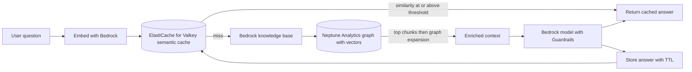

## 0. Before you start
- **Essential:** what a database is; what an embedding vector is and that "similar meaning = nearby vectors" ([00-foundations/03](aip:00-foundations/03-embeddings-vectors-semantic-search)).
- **Helpful:** JSON documents; key-value stores; a cache and a TTL (time to live); what a graph (nodes and edges) is.
- **Optional advanced:** HNSW and IVFFlat indexes; MongoDB, Redis or Valkey commands; Gremlin, openCypher and SPARQL.

## 1. Simple explanation
Not every GenAI app needs a special "vector database". Often the data already lives somewhere, and that place can also search by meaning. **DocumentDB** stores JSON documents (it speaks the MongoDB language) and now has vector search. **ElastiCache** and **MemoryDB** keep data in memory so reads take microseconds; with **Valkey** (the open-source Redis-compatible engine) they can also hold vectors, which makes them ideal for a **semantic cache**: if someone asks nearly the same question as before, return the old answer instead of paying for the model again. **Neptune** stores *relationships* (a graph), and **Neptune Analytics** adds vector search inside graph walks, which is what Bedrock's **GraphRAG** uses to answer questions that need facts from several documents joined together.


```figure
flow semantic-cache-graphrag
```

## 2. Structured explanation
1. **DocumentDB** ✅: MongoDB-compatible managed document database; cluster = 0 to 16 instances + one shared storage volume copied across three Availability Zones; **vector search** on 5.0+ instance-based clusters with HNSW or IVFFlat indexes.
2. **ElastiCache** ✅: managed in-memory cache; **serverless** or **node-based**; engines **Valkey, Memcached, Redis OSS**; Valkey adds **search** (full-text, tag, numeric, vector, hybrid).
3. **MemoryDB** ✅: *durable* in-memory database, Valkey and Redis OSS compatible, Multi-AZ transactional log; **vector search** in every Region where MemoryDB is available.
4. **Neptune Database** ✅: managed graph database; Gremlin, openCypher, SPARQL; up to 15 read replicas.
5. **Neptune Analytics** ✅: memory-optimized graph analytics engine with graph algorithms, low-latency queries and **vector search within graph traversals**; powers Bedrock Knowledge Bases **GraphRAG**.

## 3. Analogy
**A library.** The *card catalog drawer on the front desk* is ElastiCache: tiny, instant, but you refill it from the stacks if the librarian leaves (cache). MemoryDB is the same drawer with a duplicate kept in the basement vault (durable). DocumentDB is the filing cabinet of folders (documents) where you can also ask "find folders about something like this". Neptune is the wall of string connecting pinned photos: who knows whom, which company bought which. Neptune Analytics is photographing the whole wall at once to study patterns quickly.

*Where it breaks:* a cache can hand back a *similar-but-wrong* answer if the similarity threshold is too low; real databases keep more than one copy automatically; and a graph is not "smarter", it only helps when your questions are about relationships.

## 4. The seven questions

**WHAT?** Five database services with GenAI-relevant features: document storage with vectors, in-memory caching and memory, durable in-memory data, and graph storage and analytics.

**WHY?** To cut latency and model cost (semantic cache), to reuse the database you already run (DocumentDB vectors), to give agents fast memory (Valkey vectors for agentic memory ✅), and to answer multi-hop questions (GraphRAG).

**WHEN?**
| Need | Pick |
|---|---|
| Existing MongoDB-style JSON app, add semantic search without a second system | DocumentDB vector search |
| Repeated or near-repeated prompts; cut Bedrock calls and latency | ElastiCache for Valkey semantic cache |
| Fast data that must survive failures, used as a primary store | MemoryDB |
| Questions about relationships (people, companies, dependencies) | Neptune |
| Cross-document reasoning in RAG | Bedrock Knowledge Bases GraphRAG on Neptune Analytics |
| General-purpose vector and hybrid search at scale | OpenSearch ([02/05](aip:02-data-management/05-amazon-opensearch-for-genai)), Aurora pgvector ([02/07](aip:02-data-management/07-rds-aurora-and-pgvector)), S3 Vectors ([02/06](aip:02-data-management/06-s3-vectors-and-keeping-vector-stores-current)) |

**WHERE?** All Regional; DocumentDB runs only inside a VPC ✅; GraphRAG is limited to listed Regions ✅ (see §5.5).

**HOW?** §5.

**WHAT IF?**
| Situation | Effect | Remedy |
|---|---|---|
| No vector index in DocumentDB | Exact nearest-neighbor search, perfect recall but slower ✅ | Create an HNSW index for production ✅ |
| Cache similarity threshold too low | Wrong cached answers returned | Raise the threshold, validate by evaluation |
| Cache entries never expire | Stale answers after the source changes | TTL (the AWS example sets one at 82,800 s ✅) |
| ElastiCache node-based cluster loses all nodes | Data is lost unless durability is on (Valkey node-based option ✅) | Enable durability or use MemoryDB |
| GraphRAG used with a non-S3 data source | Not supported ✅ | Stage the content in S3 |
| Knowledge base deleted but graph left behind | Charges continue ✅ | Delete the graph too |

**WHY NOT?** Do not use a cache as the system of record. Do not add Neptune just to store embeddings: use a vector store. Do not use GraphRAG when questions are answered by one chunk, since it adds cost and complexity 🟡.

## 5. Technical depth

```figure
semantic-cache
```


### 5.1 DocumentDB ✅ (`what-is.html`, `vector-search.html`)
- **Architecture:** primary instance writes; all instances read; storage separate from compute, six copies across three AZs; up to 15 replicas share the storage; reader endpoint; storage grows in 10 GB steps to 256 TiB (engine 8.0 and later) or 128 TiB (earlier); point-in-time restore with up to 35 days retention; KMS encryption; runs in a VPC ✅. **Elastic clusters** are a second cluster type for millions of reads and writes per second ✅.
- **Vector search** ✅: available on **5.0+ instance-based clusters**. Store vectors in a field with normal inserts. **Index types:** HNSW (better query performance and recall, slower build, no training step, default from engine patch 3.0.4574, recommended for most cases) and IVFFlat (clusters into `lists`, query inspects `probes` lists; load data first). **Without an index** the search is exact. Index options: `dimensions` (index up to **2,000**; up to **16,000** stored unindexed), `similarity` (**euclidean, cosine, dotProduct**), HNSW `m` (default 16) and `efConstruction` (default 64, at least 2×m), query-time `efSearch` (default 40) or `probes` (default 1). Raising `efSearch` or `probes` raises recall and lowers speed. No compound, sparse or partial vector indexes. Query operator `$search` with `vectorSearch`; `$vectorSearch` from engine 8.0 (HNSW only).
- **Pricing dimensions** ✅: instance hours (per-second billing, 10-minute minimum), I/O requests, backup storage, data transfer; rates ❌.

### 5.2 ElastiCache ✅ (`WhatIs.html`, `search.html`, `semantic-caching-implementation.html`)
- **Two formats:** **serverless** (no node planning; Valkey 7.2+, Memcached 1.6.22+, Redis OSS 7.1; VPC or public endpoint, public endpoint needs IAM authentication and TLS 1.3 and Valkey 9.0+) and **node-based** (you choose node type, count and AZ placement; cluster mode for horizontal scaling) ✅.
- **Durability** option for node-based Valkey: a Multi-AZ transactional log protects data even if all nodes fail ✅.
- **ElastiCache for Valkey search** ✅: full-text, tag, numeric range, **vector** and hybrid search; stated use cases: **semantic caching, AI agent memory, RAG, real-time recommendations, personalization, anomaly detection**; limits per engine version are on a "Search features and limits" page that was not read ❌. Marketing claims about "lowest latency" were not used.
- **Semantic cache walkthrough** ✅: Valkey **8.2 or later**; embed the question with a Bedrock embedding model (the example uses Titan Text Embeddings V2, 1,024 dimensions); index type HNSW, cosine distance; look up the nearest cached questions (KNN), accept only if the similarity is at least a threshold (the example uses 0.8); on a miss call the model, then store question, answer and embedding with a TTL; the page lists lookups in microseconds versus 500–6,000 ms for a model call ✅ (page's own estimate). Raw commands: `FT.CREATE`, `FT.SEARCH` with `KNN`, `HSET`, `EXPIRE` ✅. ([04/02](aip:04-operational-efficiency/02-throughput-utilization-and-intelligent-caching) compares this with prompt caching and API Gateway caching.)
- **Agentic memory** ✅: a separate guide sets up Valkey as a vector store for agent memory (search result 🟡; the page was not read ❌). See [03/02](aip:03-agentic-ai/02-multi-agent-workflows-and-agent-memory).

### 5.3 MemoryDB ✅ (`what-is-memorydb.html`, `vector-search.html`)
- Durable in-memory database; Valkey and Redis OSS compatible; microsecond reads and single-digit-millisecond writes; data stored durably across multiple AZs with a **Multi-AZ transactional log**; can be the primary database, "eliminating the need to separately manage both a cache and durable database" ✅.
- **Vector search** ✅: extends MemoryDB, available in all MemoryDB Regions; use cases RAG, anomaly detection, document retrieval, real-time recommendations; limits and commands on sub-pages not read ❌.
- **ElastiCache vs MemoryDB** 🟡 (decision summary built from the two pages): ElastiCache is a cache in front of another database (data can be rebuilt; durability optional for node-based Valkey); MemoryDB is itself the durable store.

### 5.4 Neptune Database ✅ (`intro.html`)
- Managed graph database for billions of relationships with millisecond queries; property graph via **Gremlin** and **openCypher**, RDF via **SPARQL**; primary writer, up to 15 replicas on one cluster volume across AZs; encryption with KMS; VPC isolation; availability design target above 99.99 percent ✅.
- Use cases listed: recommendations, fraud detection, **knowledge graphs**, drug discovery, network security ✅.

### 5.5 Neptune Analytics and GraphRAG ✅ (`what-is-neptune-analytics.html`, `neptune-analytics-vs-neptune-database.html`, `knowledge-base-build-graphs.html`)
- **Neptune Analytics:** memory-optimized engine; graph algorithms; low-latency queries; **vector search capabilities within graph traversals**; load from a Neptune Database graph, a snapshot, or graph data in S3; good for exploratory, data-science and analysis workloads; Neptune Database is the choice for high-scale transactional graph workloads (100,000 queries per second, Multi-AZ, multi-Region) ✅. Capacity unit (m-NCU) and pricing ❌.
- **Bedrock Knowledge Bases GraphRAG** ✅: managed feature that builds a graph of entities and structure from documents and, after the initial vector search, (1) retrieves graph nodes or chunk identifiers linked to the hits, (2) traverses the graph to expand related chunks, (3) returns the enriched context. Stated benefits: relationships across documents, multi-step connection of content, cross-document reasoning.
- **Limits** ✅: seven Regions (Frankfurt, London, Ireland, Oregon, N. Virginia, Tokyo, Singapore); **S3 is the only data source**; no custom graph-build configuration; **no autoscaling** of the Neptune Analytics graph; you choose a **graph construction model** (which also turns on contextual enrichment; a legacy model name appears as a warning, so pick a currently supported one); up to **1,000 files per data source** (raisable to 10,000, or split into folders); with hierarchical chunking only **child chunks** are returned; delete the knowledge base first and then the graph (or set the data source deletion policy to `RETAIN`).


*Reading the arrows:* the question is embedded and looked up in the semantic cache; a close-enough match returns immediately. On a miss the knowledge base does a vector search, expands through graph links to related chunks, and the model answers using that richer context; the answer is written back to the cache with a time to live.

## 6. Worked example

```figure
ann-index
```

*Problem:* an insurer's claims assistant answers policy questions. Many users ask nearly the same things; some questions need linked facts ("Which reinsurer covers the subsidiary that issued policy X?"); the claims app already stores JSON case files in a MongoDB-style database.

| Need | Design | Why |
|---|---|---|
| Repeated questions | ElastiCache for Valkey semantic cache, threshold chosen by testing, TTL shorter than the policy-update cycle | Latency and cost ✅ |
| Linked facts | Bedrock knowledge base with GraphRAG, documents staged in S3 (under 1,000 files per data source or split into folders) | Cross-document reasoning ✅ |
| Case-file similarity ("find claims like this") | Vector index (HNSW) on a field in DocumentDB 5.0+ | Reuse existing data store ✅ |
| Agent session state that must survive a node loss | MemoryDB, or DynamoDB ([02/08](aip:02-data-management/08-amazon-dynamodb-for-genai)) | Durable ✅ |
| Safety | Guardrails on the model call; encryption with KMS; private subnets | [08/03](aip:08-security/03-kms-secrets-manager-macie-and-bedrock-data-protection) |

## 7. Knowledge checkpoints
1. What happens in DocumentDB if you query vectors without creating a vector index?
2. Which Valkey version does the AWS semantic-cache walkthrough require?
3. What is the key difference between ElastiCache and MemoryDB?
4. Which data source does GraphRAG support?
5. Which query languages does Neptune support?

## 7b. Practice questions (exam-style, original) — answers in §14

**Q1.** A company runs a MongoDB-compatible app on AWS and wants semantic search over product descriptions without adding a new database. Which?
A. DocumentDB vector search (5.0+ instance-based cluster)
B. Amazon Athena
C. Amazon Neptune Database only
D. AWS DataSync

**Q2.** (Select TWO) Which are true of DocumentDB vector search?
A. HNSW and IVFFlat index types are supported
B. Without an index the search is exact
C. Indexes can hold up to 100,000 dimensions
D. It is available on every DocumentDB version
E. It supports only the Manhattan distance

**Q3.** A chatbot sends many near-identical questions to a Bedrock model. The team wants microsecond lookups of previous answers for similar questions. Which design?
A. Semantic cache in ElastiCache for Valkey using embeddings, a similarity threshold and a TTL
B. A bigger EBS volume
C. CloudTrail
D. An S3 lifecycle rule

**Q4.** (Select TWO) Which statements about Bedrock Knowledge Bases GraphRAG are correct?
A. It uses Amazon Neptune Analytics
B. S3 is the only supported data source
C. It supports any data source type
D. Neptune Analytics graphs autoscale
E. It works in every Region

**Q5.** An engineer needs an in-memory data store that is itself durable across AZs and can serve as a primary database, compatible with Valkey. Which?
A. Amazon MemoryDB
B. A single-node Memcached cluster
C. Amazon S3 Glacier
D. AWS Backup

**Q6.** Which query languages does Amazon Neptune Database support?
A. Gremlin, openCypher and SPARQL
B. T-SQL only
C. PartiQL only
D. MQL only

**Q7.** A semantic cache returns an answer about last year's pricing after prices changed. What is the best mitigation?
A. Set a TTL and invalidate affected entries when source data changes
B. Remove the embedding model
C. Disable KMS
D. Use a larger instance

**Q8.** A team wants to answer questions that connect entities across hundreds of PDFs (for example, "which suppliers of company A are also suppliers of company B?"). Which approach?
A. GraphRAG with Neptune Analytics
B. A Route 53 hosted zone
C. S3 Transfer Acceleration
D. CloudFront signed URLs

## 7c. Mixed review for Quiz 11 (database) — answers in §14
1. Which engines does ElastiCache work with? 2. Which service stores six copies of data across three AZs and speaks the MongoDB API? 3. What does `efSearch` trade? 4. Where must a GraphRAG knowledge base keep its documents? 5. Name two services in this file that can hold vectors besides Neptune Analytics.

## 8. Hands-on lab: semantic cache with TTL, IVFFlat-style recall vs probes, and a GraphRAG-style expansion (offline) + console and CLI steps

### 8.1 Objective
Build a tiny semantic cache (cosine similarity, threshold, TTL), watch how the threshold changes hit quality, see recall improve as more IVFFlat-style lists are probed (at the cost of scanning more vectors), and compare vector-only retrieval with graph expansion on a two-hop question.

### 8.2 Prerequisites
Python 3 (standard library). Optional AWS part: an ElastiCache for Valkey cache, a VPC, a Bedrock embedding model.

### 8.3 AWS services
Offline: none. Optional: ElastiCache, Bedrock, EC2 or Cloud9 as a client.

### 8.4 IAM permissions
Offline: none. Real: `elasticache:CreateServerlessCache`, `elasticache:DescribeServerlessCaches`, `elasticache:DeleteServerlessCache` and `bedrock:InvokeModel` for the embedding model (names are API operation names; resource formats not read ❌).

### 8.5 Region notes
Vector search, serverless and node types vary by Region and engine version ❌ (lists not read); GraphRAG has the seven Regions in §5.5.

### 8.6 Architecture
§5.5 diagram.

### 8.7 Cost
Offline: none. Real: ElastiCache serverless (data stored and compute used) or nodes, Bedrock embedding calls, data transfer; prices ❌ not read. Delete the cache after the lab.

### 8.8 Code
**Simplification:** real systems embed text with a model such as Titan Text Embeddings V2. This demo builds toy vectors by hashing words into 16 buckets, so it only captures word overlap, not meaning. The threshold 0.8 and TTL 82,800 s are the AWS walkthrough's example values ✅ and the lists/probes idea is from the DocumentDB page ✅. Vectors, sizes and recall numbers are made up and seeded.

```python lab-run
import hashlib, math, random

# ---------- toy embedding: words hashed into 16 buckets, then normalized ----------
DIM = 16
STOP = {"the", "a", "is", "what", "of", "my", "for", "how", "do", "i", "to"}
def embed(text):
    v = [0.0] * DIM
    for w in text.lower().replace("?", "").split():
        if w not in STOP:
            v[int(hashlib.md5(w.encode()).hexdigest(), 16) % DIM] += 1.0
    n = math.sqrt(sum(x * x for x in v)) or 1.0
    return [x / n for x in v]
def cosine(a, b):
    return sum(x * y for x, y in zip(a, b))

# ---------- 1. Semantic cache: threshold and TTL ----------
TTL = 82_800
class SemanticCache:
    def __init__(self, threshold):
        self.threshold, self.items = threshold, []
    def get(self, question, now):
        q = embed(question)
        live = [(cosine(q, e), a) for e, a, born in self.items if now - born < TTL]
        if not live:
            return None, 0.0
        score, answer = max(live)
        return (answer if score >= self.threshold else None), score
    def put(self, question, answer, now):
        self.items.append((embed(question), answer, now))
def run(threshold):
    cache, calls, wrong = SemanticCache(threshold), 0, 0
    cache.put("how do I reset my password", "Use the reset link.", 0)
    cache.put("what is the refund policy for premium plans", "Refunds within 30 days.", 0)
    asks = [("how to reset my password", "Use the reset link."), ("password reset how", "Use the reset link."),
            ("what is the refund policy for basic plans", "Basic plans are not refundable."), ("how do I cancel my plan", "Use the cancel page.")]
    for q, truth in asks:
        ans, _ = cache.get(q, 100)
        if ans is None:
            calls += 1
        elif ans != truth:
            wrong += 1
    return calls, wrong
print("1) semantic cache over 4 questions (model calls on misses, wrong cached answers)")
for t in (0.5, 0.8, 0.95):
    calls, wrong = run(t)
    print(f"   threshold {t}: model calls {calls}, wrong cached answers {wrong}")
cache = SemanticCache(0.8)
cache.put("how do I reset my password", "Use the reset link.", 0)
for now in (3600, TTL - 1, TTL + 1):
    ans, score = cache.get("how to reset my password", now)
    print(f"   t={now:>6} s: {'HIT ' + repr(ans) if ans else 'MISS'} (score {score:.2f})")

# ---------- 2. IVFFlat-style index: more probes -> better recall, more vectors scanned ----------
random.seed(11)
N, LISTS, D = 3000, 30, 8
data = [[random.gauss(0, 1) for _ in range(D)] for _ in range(N)]
def dist(a, b):
    return sum((x - y) ** 2 for x, y in zip(a, b))
centroids = random.sample(data, LISTS)
for _ in range(5):
    groups = [[] for _ in range(LISTS)]
    for i, v in enumerate(data):
        groups[min(range(LISTS), key=lambda c: dist(v, centroids[c]))].append(i)
    centroids = [[sum(data[i][d] for i in g) / len(g) for d in range(D)] if g else centroids[c] for c, g in enumerate(groups)]
queries = [[random.gauss(0, 1) for _ in range(D)] for _ in range(40)]
def exact(q, k):
    return set(sorted(range(N), key=lambda i: dist(q, data[i]))[:k])
def approx(q, k, probes):
    order = sorted(range(LISTS), key=lambda c: dist(q, centroids[c]))[:probes]
    cand = [i for c in order for i in groups[c]]
    return set(sorted(cand, key=lambda i: dist(q, data[i]))[:k]), len(cand)
print("2) top-5 recall vs probes (3,000 vectors, 30 lists)")
for probes in (1, 3, 8, 30):
    rec, scanned = 0.0, 0
    for q in queries:
        got, n = approx(q, 5, probes)
        rec += len(got & exact(q, 5)) / 5
        scanned += n
    print(f"   probes {probes:>2}: recall {rec / len(queries):.2f}, vectors scanned per query {scanned // len(queries)}")
print("   probes = lists is exact search (every list is inspected)")

# ---------- 3. GraphRAG-style expansion on a two-hop question ----------
CHUNKS = {"c1": "Acme Corp acquired Beta Ltd in 2022.", "c2": "Beta Ltd is regulated by the Financial Authority.",
          "c3": "Gamma Inc sells garden tools.", "c4": "The Financial Authority publishes annual reports."}
ENTITIES = {"c1": {"Acme Corp", "Beta Ltd"}, "c2": {"Beta Ltd", "Financial Authority"}, "c3": {"Gamma Inc"}, "c4": {"Financial Authority"}}
def vector_top(question, k=1):
    q = embed(question)
    return sorted(CHUNKS, key=lambda c: -cosine(q, embed(CHUNKS[c])))[:k]
def expand(chunk_ids):
    seen = set(chunk_ids)
    for c in list(chunk_ids):
        for other, ents in ENTITIES.items():
            if other not in seen and ENTITIES[c] & ents:
                seen.add(other)
    return sorted(seen)
question = "Who regulates the company Acme Corp acquired"
top = vector_top(question)
print("3) question:", question)
print("   vector search top-1:", top, "->", [CHUNKS[c] for c in top])
print("   with graph expansion:", expand(top))
print("   the answer needs c2 (the regulator), which shares no query words but shares the entity Beta Ltd with c1")
```

### 8.9 Captured output
Generated on 2026-10-26 by extracting the block above from this file and running it (Python 3). It uses toy vectors and made-up data; it is **not** ElastiCache, DocumentDB or Neptune output.
```text lab-out
1) semantic cache over 4 questions (model calls on misses, wrong cached answers)
   threshold 0.5: model calls 1, wrong cached answers 1
   threshold 0.8: model calls 2, wrong cached answers 0
   threshold 0.95: model calls 2, wrong cached answers 0
   t=  3600 s: HIT 'Use the reset link.' (score 1.00)
   t= 82799 s: HIT 'Use the reset link.' (score 1.00)
   t= 82801 s: MISS (score 0.00)
2) top-5 recall vs probes (3,000 vectors, 30 lists)
   probes  1: recall 0.43, vectors scanned per query 100
   probes  3: recall 0.82, vectors scanned per query 304
   probes  8: recall 0.98, vectors scanned per query 813
   probes 30: recall 1.00, vectors scanned per query 3000
   probes = lists is exact search (every list is inspected)
3) question: Who regulates the company Acme Corp acquired
   vector search top-1: ['c1'] -> ['Acme Corp acquired Beta Ltd in 2022.']
   with graph expansion: ['c1', 'c2']
   the answer needs c2 (the regulator), which shares no query words but shares the entity Beta Ltd with c1
```

### 8.10 Explanation
- Part 1: a threshold of 0.5 turns a near-miss (basic plans vs premium plans) into a wrong cached answer; 0.8 and 0.95 behave the same here because the toy vectors score exactly 1.0 on the reworded password questions and well below 0.8 on the others (real embeddings give graded scores, so test your own threshold); the TTL removes entries after 82,800 s so changed facts are not served forever 🟡 (TTL value from the AWS example ✅).
- Part 2: with fewer probes the index scans fewer vectors but misses neighbors; probing every list equals exact search, which matches the DocumentDB note that a higher `probes` raises recall and lowers speed ✅.
- Part 3: the second hop is found only by following the shared entity, which is the GraphRAG idea ✅ (expand related chunks by traversing the graph).

### 8.11 Optional AWS lab (lessons 252, 253; shown, not run against AWS ❌)
1. **ElastiCache (252):** console → ElastiCache → **Create cache** → choose **Valkey**, **serverless**, name `genai-cache`, a VPC connection type; wait until it is **Available** ✅ (console path 🟡).
2. **Connect** from an EC2 instance or Cloud9 in the same VPC (security group allows the cache port ✅ principle); run `valkey-cli` or a Python Valkey client; set a key with `SET`/`EXPIRE` and read it back.
3. **Semantic cache (optional):** use the AWS walkthrough for a node-based Valkey 8.2+ cluster (`create-replication-group` shown on the page ✅) and a Titan embedding model; create the index with `FT.CREATE`, then `FT.SEARCH` with `KNN` ✅.
4. **MemoryDB (253):** compare in the console: create a cluster, note the durability description (Multi-AZ transactional log ✅); delete it.
5. **Delete** every cache and cluster.

### 8.12 Common errors
| Error | Cause | Fix |
|---|---|---|
| Cannot connect to the cache | Different VPC, security group or private endpoint | Same VPC, allow the port from the client's security group |
| `FT.CREATE` unknown command | Engine or version without search ✅ | Use a Valkey version that supports it (8.2+ for the walkthrough) |
| Vector index creation fails in DocumentDB | Dimensions above 2,000 or unsupported index option ✅ | Reduce dimensions; no compound/sparse/partial |
| IVFFlat poor recall | Index built on little data ✅ | Load data first; raise `probes` |
| GraphRAG sync fails on a non-S3 source | Only S3 supported ✅ | Stage files in S3 |
| Graph charges continue after cleanup | Graph not deleted ✅ | Delete the graph after the knowledge base |

### 8.13 Security recommendations
Keep caches and databases in private subnets; encrypt at rest and in transit (public ElastiCache endpoints require IAM authentication and TLS 1.3 ✅); never cache answers across tenants without a tenant key in the cache entry 🟡; treat cached answers as sensitive as the source documents; use KMS-managed keys ([08/03](aip:08-security/03-kms-secrets-manager-macie-and-bedrock-data-protection)); restrict who can read the vector fields; apply Guardrails before caching a generated answer.

## 9. What can go wrong?
| Failure | Why | Symptoms | Investigate | Fix | Prevent |
|---|---|---|---|---|---|
| **Wrong cache hits** | Threshold too low | Inaccurate or off-topic answers | Hit log with scores | Raise threshold, add filters | Evaluate before launch |
| **Stale answers** | No TTL or invalidation | Old facts | Entry ages | TTL, purge on change | Tie TTL to data refresh |
| **Cross-tenant leak** | Cache key ignores tenant 🟡 | Users see another's answer | Cache entries | Namespace by tenant | Design review |
| **Cache stampede after restart** | Cold cache | Bedrock throttling | CloudWatch | Backoff ([04/04](aip:04-operational-efficiency/04-backoff-connection-pooling-and-cross-region-inference)) | Warm-up, durability |
| **Low recall** | Index parameters too small ✅ | Missed relevant docs | Compare with exact search | Raise `efSearch`/`probes` | Recall tests |
| **Graph left running** | Forgotten graph ✅ | Unexpected cost | Neptune console | Delete graph | Cleanup checklist |
| **GraphRAG file limit** | Over 1,000 files ✅ | Ingestion errors | Data source size | Folders or limit increase | Plan layout |

## 10. Common misconceptions
1. **"ElastiCache is durable."** Not by default; node-based Valkey can enable durability, MemoryDB is built durable ✅.
2. **"Vector search needs a dedicated vector database."** Several general databases offer it ✅.
3. **"No index means no vector search."** DocumentDB searches exactly without an index ✅.
4. **"GraphRAG works with any data source."** S3 only ✅.
5. **"Semantic caching is the same as prompt caching."** Prompt caching reuses model-side prefix computation; a semantic cache avoids the call by returning a stored answer ([04/02](aip:04-operational-efficiency/02-throughput-utilization-and-intelligent-caching)).
6. **"A graph database replaces a vector store."** They answer different questions; GraphRAG combines both ✅.

## 11. Exam notes
- **Patterns:** "reduce repeated FM calls and latency" → semantic cache in ElastiCache for Valkey; "durable in-memory primary" → MemoryDB; "MongoDB workload + vectors" → DocumentDB; "relationships and multi-hop" → Neptune / GraphRAG; "vector search inside a graph" → Neptune Analytics.
- **Keywords:** HNSW, IVFFlat, `efSearch`, `probes`, TTL, similarity threshold, KNN, Multi-AZ transactional log, Gremlin, openCypher, SPARQL, GraphRAG.
- **Traps:** treating a cache as a database; threshold set without testing; assuming DocumentDB vector search on 4.0; using GraphRAG with non-S3 sources; forgetting to delete the graph.
- **Compare:** DocumentDB vs OpenSearch vs Aurora pgvector vs S3 Vectors vs MemoryDB vs Neptune Analytics (choose by existing data, latency, relationship needs, hybrid search needs).

## 12. Summary and revision cards
- DocumentDB: MongoDB-compatible, vectors on 5.0+, HNSW or IVFFlat. ElastiCache: cache, Valkey search, semantic cache. MemoryDB: durable in-memory. Neptune: graphs. Neptune Analytics: in-memory graph analytics with vector search; GraphRAG's engine.

**Cards.** Q: Semantic cache steps? A: embed, KNN lookup, threshold check, miss → model → store with TTL. · Q: DocumentDB index dimension limit? A: 2,000 indexed (16,000 stored). · Q: GraphRAG data source? A: S3 only.

## 13. References
| Source | URL | Verified |
|---|---|---|
| What is Amazon DocumentDB | https://docs.aws.amazon.com/documentdb/latest/developerguide/what-is.html | 2026-10-26 |
| Vector search for DocumentDB | https://docs.aws.amazon.com/documentdb/latest/developerguide/vector-search.html | 2026-10-26 |
| What is Amazon ElastiCache | https://docs.aws.amazon.com/AmazonElastiCache/latest/dg/WhatIs.html | 2026-10-26 |
| ElastiCache search and semantic cache | https://docs.aws.amazon.com/AmazonElastiCache/latest/dg/search.html · .../semantic-caching-implementation.html | 2026-10-26 |
| What is MemoryDB and vector search | https://docs.aws.amazon.com/memorydb/latest/devguide/what-is-memorydb.html · .../vector-search.html | 2026-10-26 |
| What is Neptune | https://docs.aws.amazon.com/neptune/latest/userguide/intro.html | 2026-10-26 |
| Neptune Analytics | https://docs.aws.amazon.com/neptune-analytics/latest/userguide/what-is-neptune-analytics.html · .../neptune-analytics-vs-neptune-database.html | 2026-10-26 |
| Bedrock Knowledge Bases with Neptune Analytics (GraphRAG) | https://docs.aws.amazon.com/bedrock/latest/userguide/knowledge-base-build-graphs.html | 2026-10-26 |

**Unverified here:** all prices; ElastiCache "Search features and limits" and vector-search overview pages (the overview fetch returned only a title); MemoryDB vector limits and commands; Neptune Analytics capacity units and vector index details; DocumentDB Region list for vector search; agentic-memory guide content; Lambda or Bedrock Agents memory comparisons.

## 14. Answers to checkpoints and practice questions
**Checkpoints.** 1) An exact nearest-neighbor search with perfect recall (slower) ✅. 2) 8.2 or later ✅. 3) ElastiCache is an in-memory cache (durability optional on node-based Valkey); MemoryDB is a durable in-memory database ✅. 4) Amazon S3 ✅. 5) Gremlin, openCypher, SPARQL ✅.

**Practice questions.**
- **Q1 → A.** Reuse the document database ✅. B queries S3, C stores graphs, D moves data.
- **Q2 → A, B.** C false (2,000 indexed, 16,000 stored), D false (5.0+ instance-based), E false (euclidean, cosine, dotProduct) ✅.
- **Q3 → A.** ✅ The page's walkthrough.
- **Q4 → A, B.** C, D (no autoscaling), E (seven Regions) false ✅.
- **Q5 → A.** ✅
- **Q6 → A.** ✅
- **Q7 → A.** Staleness is solved with TTL and invalidation 🟡 (TTL ✅).
- **Q8 → A.** Cross-document, multi-hop ✅.

**Mixed review (§7c).** 1) Valkey, Memcached and Redis OSS ✅. 2) DocumentDB ✅. 3) Higher `efSearch` (or `probes`) gives better recall at lower speed ✅. 4) Amazon S3 ✅. 5) DocumentDB, ElastiCache for Valkey, MemoryDB (also OpenSearch, Aurora pgvector, S3 Vectors from earlier modules) ✅.
