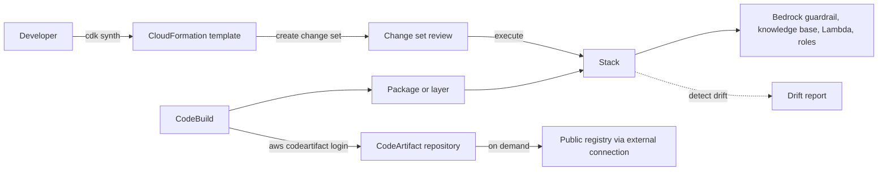

## 0. Before you start
- **Essential:** what an API call is; what a JSON or YAML file is; what IAM credentials are.
- **Helpful:** a package manager (`pip`, `npm`); Git; the idea of "describe what you want, let the tool build it" (declarative).
- **Optional advanced:** TypeScript or Python classes; software supply-chain attacks.

## 1. Simple explanation
When you click around the console to build a GenAI app, nobody can repeat or review what you did. **Infrastructure as code** fixes that: you write the setup in a file. **CloudFormation** reads a YAML or JSON template and builds everything as one *stack*. The **CDK** lets you write that template in a normal programming language (Python, TypeScript...) and generates the CloudFormation for you. The **CLI** and **SDKs** are how scripts and apps call AWS, and they need *credentials*: long-lived **access keys** are risky, so use temporary ones. **CodeArtifact** is a private store for your software packages (and a safe cache of public ones) so builds always get approved dependencies.


```figure
flow cdk-deploy
```

## 2. Structured explanation
1. **CDK** ✅: open-source framework to define infrastructure in TypeScript, JavaScript, Python, Java, C#/.NET or Go; **constructs** (reusable building blocks) are composed into **stacks** and **apps**; the CDK CLI (`cdk`) synthesizes and deploys through CloudFormation.
2. **CloudFormation** ✅: **templates** (YAML or JSON) describe resources; a **stack** is the managed unit; **change sets** preview updates; failed creation rolls back; **drift detection** finds out-of-band changes.
3. **Access keys, CLI, SDK** ✅: the CLI authenticates in a documented order of recommendation (console login, IAM Identity Center, IAM user short-term, instance metadata, assume role; long-term IAM user keys are "not recommended").
4. **CodeArtifact** ✅: managed artifact repository for npm, Maven, Gradle, pip/twine, NuGet and more; **domains**, **repositories**, **upstream repositories** and **external connections**; authorization tokens last 12 hours by default.

## 3. Analogy
**Building a house from blueprints.** The CloudFormation template is the blueprint; the stack is the finished house; a change set is the contractor's list of what the new blueprint will tear down or rebuild; drift detection is the inspector noticing someone painted a wall without the plan. The CDK is an architect who writes the blueprint for you from a short brief. CodeArtifact is the approved-materials warehouse: the crew may only build from what is stocked there. Access keys are copies of the site key: the fewer long-lived copies exist, the better.

*Where it breaks:* a house is not rebuilt by renaming a room, but some CloudFormation edits *do* replace a resource (renaming a database replaces it and the data is lost unless backed up ✅); and drift detection cannot see every property ✅.

## 4. The seven questions

**WHAT?** Tools to define, deploy and call AWS infrastructure repeatably, and to store software dependencies privately.

**WHY?** Repeatable GenAI environments (dev, test, prod and several Regions), reviewed changes, safe credentials, and trusted dependencies (for example, the exact versions of a Bedrock SDK or agent framework your Lambda layers use).

**WHEN?**
| Need | Pick |
|---|---|
| Define infrastructure with loops, conditions and reuse in code | CDK |
| Plain declarative templates, simple reviews | CloudFormation YAML/JSON |
| Script an ad hoc task | AWS CLI |
| Call AWS inside an app | SDK (for example boto3) |
| Private packages, vetted open-source dependencies | CodeArtifact |
| Detect console edits to a stack | Drift detection |
| Preview an update | Change set |

**WHERE?** Regional (CloudFormation stacks, CodeArtifact domains); the CDK environment must be **bootstrapped** in each account and Region you deploy to ✅.

**HOW?** §5.

**WHAT IF?**
| Situation | Effect | Remedy |
|---|---|---|
| A stack create fails | CloudFormation rolls back by deleting what it created ✅ | Read the stack events, fix, retry |
| You rename a database resource property that forces replacement | New database, old one deleted, data lost unless backed up ✅ | Check the change set; back up first |
| Someone edits a resource in the console | Stack and reality differ (drift) ✅ | Detect drift, fix in the template or resource |
| The change set looks fine but the update fails | Change sets do not check quotas, update support or permissions ✅ | Verify quotas and IAM separately |
| A long-term access key is leaked | Anyone can use it until deleted | Deactivate, delete, review CloudTrail ([00-foundations/01](aip:00-foundations/01-aws-account-iam-and-cli-setup)) |
| Environment not bootstrapped | `cdk deploy` cannot upload assets ✅ | Run `cdk bootstrap` for that account and Region |
| CodeArtifact token expires mid-build | Authentication fails after the lifetime (default 12 h) ✅ | Fetch a fresh token at the start of each build |

**WHY NOT?** Do not put long-term access keys in code, containers or CI settings; prefer roles ([08/01](aip:08-security/01-least-privilege-iam-identity-center-and-data-masking)). Do not edit CDK-managed resources by hand. Do not make CodeArtifact repositories public: they cannot be ✅.

## 5. Technical depth

### 5.1 AWS CDK ✅ (`home.html`, `getting-started.html`, `bootstrapping.html`)
- **Two parts:** the **Construct Library** (pre-written modular constructs) and the **CDK Toolkit** (CLI plus a programmatic library) ✅. Low-level constructs define single CloudFormation resources; high-level constructs add sensible, secure defaults ✅. One high-level Fargate example in the docs produces a CloudFormation template of more than 500 lines and more than 50 resources ✅.
- **Languages:** TypeScript, JavaScript, Python, Java, C#/.NET, Go ✅. CDK v1 ended support on 1 June 2023 ✅.
- **Setup:** install the CLI with `npm install -g aws-cdk`; check with `cdk --version`; credentials come from the AWS CLI configuration (`aws configure sso` for Identity Center users, `aws configure` for IAM users); the `default` profile is used unless `--profile` is given ✅.
- **Bootstrapping:** `cdk bootstrap` deploys a CloudFormation stack (default name **CDKToolkit**) with an **S3 bucket** (assets such as Lambda code), an **ECR repository** (Docker images) and **IAM roles** for deployments; each environment (account and Region) must be bootstrapped once ✅.
- **Typical commands** 🟡 (this session read only `cdk --version` and `cdk bootstrap` on the pages): `cdk init`, `cdk synth` (print the CloudFormation template), `cdk diff`, `cdk deploy`, `cdk destroy`.

```python snippet
# The documentation's Python example (imports added): a load-balanced Fargate service.
# Needs aws-cdk-lib installed; here it is only syntax-checked, not run against AWS.
from aws_cdk import Stack, aws_ec2 as ec2, aws_ecs as ecs, aws_ecs_patterns as ecs_patterns
from constructs import Construct

class MyEcsConstructStack(Stack):
    def __init__(self, scope: Construct, id: str, **kwargs) -> None:
        super().__init__(scope, id, **kwargs)
        vpc = ec2.Vpc(self, "MyVpc", max_azs=3)
        cluster = ecs.Cluster(self, "MyCluster", vpc=vpc)
        ecs_patterns.ApplicationLoadBalancedFargateService(self, "MyFargateService",
            cluster=cluster, cpu=512, desired_count=6,
            task_image_options=ecs_patterns.ApplicationLoadBalancedTaskImageOptions(
                image=ecs.ContainerImage.from_registry("amazon/amazon-ecs-sample")),
            memory_limit_mib=2048, public_load_balancer=True)
```

### 5.2 CloudFormation ✅ (`Welcome.html`, `cloudformation-overview.html`, `using-cfn-stack-drift.html`)
- **Template** (YAML or JSON) → **stack**: you create, update and delete resources as one unit; independent resources are created in parallel; local templates are uploaded to a CloudFormation-created S3 bucket per Region ✅.
- **Pre-deployment validation** runs on create stack, update stack and create change set (checks like invalid syntax and name conflicts; can be skipped with `DisableValidation`) ✅. **Express mode** speeds up development operations ✅.
- **Failure:** if creation fails, CloudFormation rolls back by deleting created resources; if an update fails it rolls back to the last known working state ✅.
- **Change sets** ✅: generate a summary of proposed changes before updating; show replacements; **do not** predict quota, unsupported-update or permission failures.
- **Drift detection** ✅: compares actual and expected property values for **explicitly set** properties (defaults are not tracked); stack statuses `IN_SYNC`, `DRIFTED`, `NOT_CHECKED`; resource statuses `IN_SYNC`, `MODIFIED`, `DELETED`, `NOT_CHECKED`; resources that do not support detection are `NOT_CHECKED`; nested stacks are checked separately; the `KMSKeyId` property and values the service never returns (such as passwords) are not compared; permissions include `cloudformation:DetectStackDrift` ✅.
- **Resolving drift** can use an **import** operation ✅ (title only).
- **GenAI resources in templates** ✅: CloudFormation has Amazon Bedrock resource types such as `AWS::Bedrock::Guardrail`, `GuardrailVersion`, `KnowledgeBase`, `DataSource`, `Agent`, `AgentAlias`, `Prompt`, `PromptVersion`, `Flow`, `FlowAlias`, `ApplicationInferenceProfile`, `IntelligentPromptRouter`, `ResourcePolicy`, `EnforcedGuardrailConfiguration` and others. This lets a whole GenAI application (guardrail, knowledge base, agent, prompts) be defined as code. Property details ❌ not read.

```yaml
AWSTemplateFormatVersion: "2010-09-09"
Description: Documents bucket for a knowledge base (teaching sample, not run against AWS)
Parameters:
  Stage:
    Type: String
    AllowedValues: [dev, prod]
Resources:
  DocsBucket:
    Type: AWS::S3::Bucket
    Properties:
      VersioningConfiguration:
        Status: Enabled
      PublicAccessBlockConfiguration:
        BlockPublicAcls: true
        BlockPublicPolicy: true
        IgnorePublicAcls: true
        RestrictPublicBuckets: true
Outputs:
  BucketName:
    Value: !Ref DocsBucket
```
*The template shape (version, description, parameters, resources, outputs, `!Ref`) matches the documented examples ✅; the S3 property names are standard CloudFormation 🟡 and were not read in this session.*

### 5.3 Access keys, CLI and SDK ✅ (`cli-chap-authentication.html`, `id-credentials-access-keys-update.html`)
- **CLI authentication options in order of recommendation** ✅: (1) console credentials login (short-term), (2) IAM Identity Center workforce users (short-term), (3) IAM user short-term credentials, (4) EC2 instance metadata, (5) assume a role, (6) **IAM user long-term credentials ("not recommended", no expiry)**, (7) external process (not recommended).
- **Precedence** ✅ (what the CLI actually uses first): command-line options → environment variables → assume role → assume role with web identity → IAM Identity Center → credentials file → custom process → config file → container credentials (ECS task role) → EC2 instance profile.
- **Rotate an IAM user's access key without downtime** ✅: create a second key (both active) → update every application → check **last used** (`aws iam get-access-key-last-used`) → **deactivate** (do not delete) the old key → verify → delete after some time (`aws iam update-access-key`, `delete-access-key`). A lost secret cannot be recovered: delete and recreate ✅.
- **SDKs** ✅ (CDK and CLI pages): the SDKs sign requests, retry and handle errors (the EC2 page says this) ✅; they read the same credential sources 🟡.

### 5.4 CodeArtifact ✅ (`welcome.html`, `tokens-authentication.html`, `repos-upstream.html`)
- **Repository** stores packages of any supported type (polyglot); each repository belongs to one **domain** (one production domain per organization is recommended); packages in repositories **cannot be made public** ✅.
- **External connection** to a public repository (npmjs, Maven Central, NuGet Gallery, PyPI): CodeArtifact fetches and stores packages **on demand** when a package manager asks, so open-source dependencies stay available ✅. A repository can have **one** external connection and up to **10 upstream repositories** ✅.
- **Upstream** repositories make packages in one repository available downstream in the same domain, including those pulled in through an external connection ✅.
- **Authentication** ✅: create an **authorization token** from your AWS credentials with `aws codeartifact login --tool {dotnet|npm|nuget|pip|swift|twine}` (or `get-authorization-token` for others such as Maven and Gradle); default lifetime **12 hours**, configurable from **15 minutes (900 s) to 12 hours (43,200 s)**; with an assumed role `--duration-seconds 0` ties the token to the remaining session time; root users cannot call `GetAuthorizationToken`; both `codeartifact:GetAuthorizationToken` and `sts:GetServiceBearerToken` are required; keep the token in an environment variable rather than a file in source control ✅.
- **GenAI angle** 🟡: pin approved versions of Bedrock/agent SDKs and ML libraries for build and Lambda layers; reduce the chance that a build pulls a malicious look-alike package (the page does not use the term "dependency confusion"; package origin controls were not read ❌).


*Reading the arrows:* the CDK turns code into a CloudFormation template; a change set shows what would change; executing it updates the stack that owns the Bedrock and Lambda resources. The build logs in to CodeArtifact (which pulls public packages on demand through its external connection), builds the artifact, and the stack uses it. Drift detection later checks that nobody changed the resources by hand.

## 6. Worked example
*Problem:* a team deploys a RAG assistant to dev and prod in two Regions and wants every change reviewed, no long-term keys in CI, and approved dependencies only.

| Step | Design | Why |
|---|---|---|
| 1 | CDK app in Python defines the guardrail, knowledge base, Lambda and IAM roles; `cdk bootstrap` once per account and Region | Repeatable stacks ✅ |
| 2 | CI uses an assumed role with short-term credentials (no IAM user keys) | CLI order of recommendation ✅ |
| 3 | `cdk synth` and `cdk diff` in the pull request; for production a CloudFormation change set is reviewed before execute | Review, replacement visibility ✅ |
| 4 | CodeBuild runs `aws codeartifact login` first; CodeArtifact repository has an external connection to the public registry and an internal repository for private packages | Dependency control ✅ |
| 5 | Weekly drift detection on the production stack; alert on `DRIFTED` | Out-of-band changes ✅ |
| 6 | An IAM user with a long-term key (legacy script) is rotated with the two-key procedure, then removed | Rotation ✅ |

## 7. Knowledge checkpoints
1. What does `cdk bootstrap` create?
2. What does a change set not tell you?
3. What is the default CodeArtifact token lifetime?
4. Which AWS CLI credential type is labelled "not recommended"?
5. Name two CloudFormation drift statuses for a resource.

## 7b. Practice questions (exam-style, original) — answers in §14

**Q1.** A team wants to define infrastructure with loops and classes in Python and deploy through CloudFormation. Which tool?
A. AWS CDK
B. AWS DataSync
C. Amazon Lex
D. AWS Direct Connect

**Q2.** (Select TWO) What does `cdk bootstrap` provision in an environment?
A. An S3 bucket for assets
B. An ECR repository
C. A Bedrock knowledge base
D. A Route 53 hosted zone
E. A Kinesis stream

**Q3.** Before updating a production stack that contains a database, an engineer wants to see whether the change would replace the database. What should they use?
A. A CloudFormation change set
B. Drift detection
C. Cost Explorer
D. An S3 lifecycle rule

**Q4.** Someone changed a resource in the console that belongs to a stack. How can the team detect this?
A. CloudFormation drift detection
B. A change set
C. CodeArtifact upstream repositories
D. `aws codeartifact login`

**Q5.** (Select TWO) Which statements about CodeArtifact are correct?
A. A repository can have an external connection to a public repository such as PyPI
B. Authorization tokens default to a 12-hour lifetime
C. Repositories can be made public to the internet
D. Root users can call `GetAuthorizationToken`
E. A repository can have 50 external connections

**Q6.** A CI job currently uses a long-term access key of an IAM user. What is the best improvement?
A. Use short-term credentials from an assumed role or Identity Center instead
B. Commit the key to the repository so it is not lost
C. Share the key with every developer
D. Remove MFA

**Q7.** An engineer must rotate an IAM user's access key with no downtime. Which sequence?
A. Create a second key, update applications, check last-used, deactivate the old key, verify, then delete it
B. Delete the old key first, then create a new one
C. Disable the user
D. Rotate the root password

**Q8.** A stack creation fails halfway. What does CloudFormation do by default?
A. Rolls back by deleting the resources it created
B. Leaves everything and deletes the template
C. Retries forever
D. Creates a second stack automatically

## 7c. Mixed review for Quiz 12 (developer tools) — answers in §14
1. Which tool turns code into CloudFormation templates? 2. Which statuses can a stack have after drift detection? 3. Which command logs a package manager in to CodeArtifact? 4. Which credential sources does the CLI try before the EC2 instance profile? (Name two.) 5. Why is a lost IAM secret access key replaced rather than recovered?

## 8. Hands-on lab: change-set preview, drift check, key rotation, CLI credential order and CodeArtifact token and pull-through (offline) + CDK, CloudFormation and CodeArtifact steps

### 8.1 Objective
Diff two template versions into Add / Modify / Replace / Remove, flag drift only on explicitly set properties, rotate an access key and see what breaks when one application is forgotten, resolve which credential source the CLI would use, and model CodeArtifact token lifetimes and on-demand package retention.

### 8.2 Prerequisites
Python 3 (standard library). Optional AWS part: an AWS account, AWS CLI v2, Node.js for the CDK, permissions for CloudFormation and CodeArtifact.

### 8.3 AWS services
Offline: none. Optional: CloudFormation, CDK, S3, IAM, CodeArtifact, STS.

### 8.4 IAM permissions
Offline: none. Real: CloudFormation create/update/describe stack and change-set actions plus permissions for the resources in the template; `cloudformation:DetectStackDrift`, `cloudformation:DetectStackResourceDrift`, `cloudformation:BatchDescribeTypeConfigurations` ✅; CodeArtifact `codeartifact:GetAuthorizationToken` and `sts:GetServiceBearerToken` ✅ (plus read/publish actions ❌ not read).

### 8.5 Region notes
CloudFormation stacks, CDK bootstrap and CodeArtifact domains are per Region and account ✅.

### 8.6 Architecture
§5.4 diagram.

### 8.7 Cost
Offline: none. CloudFormation itself: see the pricing page ❌; you pay for the resources the stack creates and for CodeArtifact storage and requests (rates ❌). Delete stacks and repositories after the lab.

### 8.8 Code
**Simplification:** the "replacement" property list is **made up for the demo** (the page's example is renaming an RDS database); real replacement rules are in each resource's documentation ❌. The credential order is the page's list ✅. The pull-through model is a teaching model of "fetch and store on demand" ✅.

```python lab-run
# ---------- 1. Change set: compare two template versions ----------
BEFORE = {"DocsBucket": {"Type": "AWS::S3::Bucket", "Properties": {"BucketName": "docs-prod", "Versioning": "Enabled"}},
          "ClaimsDb": {"Type": "AWS::RDS::DBInstance", "Properties": {"DBInstanceIdentifier": "claims-db", "AllocatedStorage": 20}},
          "OldTopic": {"Type": "AWS::SNS::Topic", "Properties": {"TopicName": "old"}}}
AFTER = {"DocsBucket": {"Type": "AWS::S3::Bucket", "Properties": {"BucketName": "docs-prod", "Versioning": "Suspended"}},
         "ClaimsDb": {"Type": "AWS::RDS::DBInstance", "Properties": {"DBInstanceIdentifier": "claims-db-v2", "AllocatedStorage": 20}},
         "Guardrail": {"Type": "AWS::Bedrock::Guardrail", "Properties": {"Name": "support-guardrail"}}}
REPLACES = {("AWS::RDS::DBInstance", "DBInstanceIdentifier"), ("AWS::S3::Bucket", "BucketName")}
def change_set(before, after):
    out = []
    for name in sorted(set(before) | set(after)):
        if name not in before:
            out.append((name, "Add", ""))
        elif name not in after:
            out.append((name, "Remove", ""))
        else:
            changed = [k for k in after[name]["Properties"] if after[name]["Properties"][k] != before[name]["Properties"].get(k)]
            if changed:
                replace = any((after[name]["Type"], k) in REPLACES for k in changed)
                out.append((name, "Modify", f"{', '.join(changed)}; replacement: {'YES - data loss risk' if replace else 'no'}"))
    return out
print("1) change set preview")
for name, action, note in change_set(BEFORE, AFTER):
    print(f"   {action:<7}{name:<11}{note}")
print("   (a change set does not check quotas, unsupported updates or IAM permissions)")

# ---------- 2. Drift: only explicitly set properties are compared ----------
EXPECTED = {"DocsBucket": {"Versioning": "Enabled"}, "Fn": {"Timeout": 30}, "Gone": {"X": 1}}
ACTUAL = {"DocsBucket": {"Versioning": "Suspended", "Tags": "added-in-console"}, "Fn": {"Timeout": 30, "MemorySize": 512}}
def drift(expected, actual):
    results = {}
    for name, props in expected.items():
        if name not in actual:
            results[name] = "DELETED"
        else:
            results[name] = "MODIFIED" if any(actual[name].get(k) != v for k, v in props.items()) else "IN_SYNC"
    stack = "DRIFTED" if any(s != "IN_SYNC" for s in results.values()) else "IN_SYNC"
    return stack, results
stack_status, per_resource = drift(EXPECTED, ACTUAL)
print("2) drift detection ->", stack_status, per_resource)
print("   Fn has an extra MemorySize that the template never set, so it stays IN_SYNC")

# ---------- 3. Access key rotation: two keys, last-used check, deactivate before delete ----------
apps = {"web-app": "OLD", "batch-job": "OLD", "forgotten-cron": "OLD"}
keys = {"OLD": "Active"}
log = []
keys["NEW"] = "Active"; log.append("create second key (both active)")
for a in ("web-app", "batch-job"):
    apps[a] = "NEW"
log.append("updated web-app and batch-job to the new key (forgot forgotten-cron)")
last_used_old = [a for a, k in apps.items() if k == "OLD"]
log.append(f"old key last used by: {last_used_old}")
keys["OLD"] = "Inactive"; log.append("deactivate old key (do not delete yet)")
broken = [a for a, k in apps.items() if keys[k] != "Active"]
log.append(f"apps now failing: {broken}")
keys["OLD"] = "Active"; apps["forgotten-cron"] = "NEW"; log.append("reactivate old, fix forgotten-cron")
keys["OLD"] = "Inactive"; broken2 = [a for a, k in apps.items() if keys[k] != "Active"]
log.append(f"deactivate again, failing: {broken2}")
del keys["OLD"]; log.append("delete old key")
print("3) rotation")
for i, line in enumerate(log, 1):
    print(f"   step {i}: {line}")
print("   final keys:", keys)

# ---------- 4. Which credential source does the CLI use first? (order from the AWS CLI page) ----------
ORDER = ["command line options", "environment variables", "assume role", "assume role with web identity", "IAM Identity Center",
         "credentials file", "custom process", "config file", "container credentials", "EC2 instance profile"]
def pick(present):
    for source in ORDER:
        if source in present:
            return source
    return "no credentials"
print("4) credential resolution")
for present in [{"EC2 instance profile"}, {"EC2 instance profile", "credentials file"}, {"credentials file", "environment variables"},
                {"IAM Identity Center", "EC2 instance profile", "container credentials"}, set()]:
    print(f"   present {sorted(present)!s:<68} -> {pick(present)}")

# ---------- 5. CodeArtifact: token lifetime rules and on-demand retention ----------
def token_lifetime(duration=None, assumed_role_remaining=None):
    if duration is None:
        return 43200
    if duration == 0:
        return assumed_role_remaining if assumed_role_remaining is not None else "invalid: 0 is only for an assumed role"
    if 900 <= duration <= 43200:
        return duration
    return "invalid: must be 900-43200"
print("5) token lifetimes (seconds)")
for label, args in [("default", {}), ("1 hour", {"duration": 3600}), ("too short", {"duration": 60}), ("0, plain user", {"duration": 0}),
                    ("0, role with 900 s left", {"duration": 0, "assumed_role_remaining": 900})]:
    print(f"   {label:<24}{token_lifetime(**args)}")
public = {"requests@2.0": "ok", "evil-lookalike@9.9": "malicious"}
repo = {}
def pull(package, approved):
    if package in repo:
        return f"{package}: served from repository"
    if package in approved and package in public:
        repo[package] = public[package]
        return f"{package}: fetched from public registry and stored"
    return f"{package}: not available (not approved or not found)"
approved = {"requests@2.0"}
print("   pull-through:")
for p in ["requests@2.0", "requests@2.0", "evil-lookalike@9.9"]:
    print("   ", pull(p, approved))
public.pop("requests@2.0")
print("    after the public copy disappears:", pull("requests@2.0", approved))
print("   (the approval list is a demo of governance; real CodeArtifact origin controls were not read)")
```

### 8.9 Captured output
Generated on 2026-10-26 by extracting the block above from this file and running it (Python 3). It models documented behavior with made-up data; it is **not** CloudFormation, IAM or CodeArtifact output.
```text lab-out
1) change set preview
   Modify ClaimsDb   DBInstanceIdentifier; replacement: YES - data loss risk
   Modify DocsBucket Versioning; replacement: no
   Add    Guardrail  
   Remove OldTopic   
   (a change set does not check quotas, unsupported updates or IAM permissions)
2) drift detection -> DRIFTED {'DocsBucket': 'MODIFIED', 'Fn': 'IN_SYNC', 'Gone': 'DELETED'}
   Fn has an extra MemorySize that the template never set, so it stays IN_SYNC
3) rotation
   step 1: create second key (both active)
   step 2: updated web-app and batch-job to the new key (forgot forgotten-cron)
   step 3: old key last used by: ['forgotten-cron']
   step 4: deactivate old key (do not delete yet)
   step 5: apps now failing: ['forgotten-cron']
   step 6: reactivate old, fix forgotten-cron
   step 7: deactivate again, failing: []
   step 8: delete old key
   final keys: {'NEW': 'Active'}
4) credential resolution
   present ['EC2 instance profile']                                             -> EC2 instance profile
   present ['EC2 instance profile', 'credentials file']                         -> credentials file
   present ['credentials file', 'environment variables']                        -> environment variables
   present ['EC2 instance profile', 'IAM Identity Center', 'container credentials'] -> IAM Identity Center
   present []                                                                   -> no credentials
5) token lifetimes (seconds)
   default                 43200
   1 hour                  3600
   too short               invalid: must be 900-43200
   0, plain user           invalid: 0 is only for an assumed role
   0, role with 900 s left 900
   pull-through:
    requests@2.0: fetched from public registry and stored
    requests@2.0: served from repository
    evil-lookalike@9.9: not available (not approved or not found)
    after the public copy disappears: requests@2.0: served from repository
   (the approval list is a demo of governance; real CodeArtifact origin controls were not read)
```

### 8.10 Explanation
- Part 1: the change set lists Add, Modify and Remove and flags the database identifier change as a replacement (the page's own example of data loss) ✅.
- Part 2: drift only compares properties the template set explicitly, so extra console-set properties on `Fn` do not drift ✅; a deleted resource is `DELETED`.
- Part 3: deactivating (not deleting) the old key reveals a forgotten application, which you can reactivate and fix ✅.
- Part 4: follows the documented precedence ✅.
- Part 5: the token range and the `0` rule are from the page ✅; the pull-through shows that once stored, a package remains available ✅ (the page says CodeArtifact fetches and stores on demand and helps ensure dependencies are always available).

### 8.11 Optional AWS labs (lessons 257, 262, 264, 266; shown, not run against AWS ❌)
**CDK (257):** `npm install -g aws-cdk` → `cdk --version` → configure credentials (`aws configure sso`) → in an empty folder `cdk init app --language python` 🟡 → install requirements → add the snippet's stack or a small S3 bucket → `cdk bootstrap` (once) → `cdk synth` → `cdk diff` → `cdk deploy` → `cdk destroy` 🟡.
**CLI (262):** `aws sts get-caller-identity` (who am I), `aws s3 ls`, `aws iam list-access-keys` 🟡 (commands standard; the page set was authentication only ✅).
**CloudFormation (264):** console → CloudFormation → Create stack → upload the §5.2 template → give a `Stage` parameter → create; edit the template to change a property; use **Create change set** and review before **Execute**; run **Detect drift**; delete the stack ✅ (workflow from the overview page).
**CodeArtifact (266):** create a domain and a repository with an upstream/external connection to the public registry; run `aws codeartifact login --tool pip --domain my_domain --repository my_repo` ✅ then `pip install requests`; check that the package now appears in the repository; delete the repository and domain ✅ (login syntax from the page).

### 8.12 Common errors
| Error | Cause | Fix |
|---|---|---|
| `cdk deploy` fails on assets | Environment not bootstrapped ✅ | `cdk bootstrap` in that account and Region |
| Stack in `ROLLBACK_COMPLETE` | Create failed and rolled back ✅ | Read events, fix, delete the stack, recreate |
| Change set creation fails validation | Syntax or name conflict ✅ | Fix the template |
| Update fails despite a clean change set | Quota or permission issue ✅ | Check quotas and IAM |
| `pip` returns 401 from CodeArtifact | Expired token (12 h default) ✅ | Run `aws codeartifact login` again |
| `AccessDenied` on `GetAuthorizationToken` | Missing `sts:GetServiceBearerToken` ✅ | Add both permissions |
| Root user cannot get a token | Not allowed ✅ | Use an IAM role or user |
| Drift shows `NOT_CHECKED` | Resource type does not support drift detection ✅ | Review manually |

### 8.13 Security recommendations
Prefer short-term credentials and roles over IAM user keys ✅; rotate any remaining keys with the two-key procedure and delete unused ones; never commit keys or CodeArtifact tokens; read the CodeArtifact token into an environment variable rather than a file ✅; scope the CDK deployment roles and CI roles to least privilege ([08/01](aip:08-security/01-least-privilege-iam-identity-center-and-data-masking)); require change-set review for production; enable drift checks; log CloudFormation and CodeArtifact activity in CloudTrail ([07/04](aip:07-governance-qa/04-cloudtrail-and-x-ray-for-genai)).

## 9. What can go wrong?
| Failure | Why | Symptoms | Investigate | Fix | Prevent |
|---|---|---|---|---|---|
| **Data loss by replacement** | A property forces replacement ✅ | Database recreated empty | Change set, stack events | Restore backup | Review change sets, snapshots |
| **Rollback loop** | Bad template or quota ✅ | `ROLLBACK_COMPLETE` | Stack events | Fix, recreate | Validate early |
| **Out-of-band edits** | Console changes ✅ | Drift | Drift report | Template or resource fix | Restrict console writes |
| **Leaked access key** | Key in Git or image | Unknown usage | CloudTrail, last used ✅ | Deactivate, delete | Roles, scanning |
| **Un-bootstrapped Region** | New Region added | Deploy failures ✅ | Missing CDKToolkit stack | Bootstrap | Checklist |
| **Expired package token** | Default 12 h ✅ | 401 in long builds | Build logs | Login per build | Short builds |
| **Unvetted dependency** | Direct public pulls | Supply-chain risk 🟡 | Build logs | Route via CodeArtifact | Policy |

## 10. Common misconceptions
1. **"A change set guarantees a successful update."** It does not check quotas, support or permissions ✅.
2. **"CDK replaces CloudFormation."** It generates and deploys through CloudFormation ✅.
3. **"Drift detection sees every property."** Only explicit, supported ones ✅.
4. **"Access keys are the normal way to use the CLI."** Long-term keys are labelled not recommended ✅.
5. **"CodeArtifact repositories can be public."** They cannot ✅.
6. **"Bootstrapping is per account."** Per environment: account and Region ✅.

## 11. Exam notes
- **Patterns:** "infrastructure as code in a programming language" → CDK; "preview changes" → change set; "detect manual changes" → drift detection; "avoid long-term credentials" → roles, Identity Center, short-term credentials; "private package repository / proxy for public packages" → CodeArtifact; "reproducible Bedrock guardrail and knowledge base deployment" → CloudFormation or CDK.
- **Keywords:** construct, synth, bootstrap, stack, change set, drift, `login`, external connection, upstream, authorization token.
- **Traps:** deleting an old key before deactivating; using root credentials; assuming change sets detect permission errors; forgetting to bootstrap.
- **Compare:** CDK vs CloudFormation vs SAM (SAM not read ❌) vs Terraform (not AWS-native); CodeArtifact vs ECR (images) vs S3.

## 12. Summary and revision cards
- CDK → CloudFormation; change set = preview; drift = out-of-band changes; CLI prefers short-term credentials; CodeArtifact = private package repos with external connections, tokens 12 h by default.

**Cards.** Q: CDKToolkit stack holds? A: S3 bucket, ECR repository, IAM roles. · Q: Token range? A: 900–43,200 s. · Q: Safe key rotation order? A: create new, update apps, check last used, deactivate, verify, delete.

## 13. References
| Source | URL | Verified |
|---|---|---|
| What is the AWS CDK | https://docs.aws.amazon.com/cdk/v2/guide/home.html | 2026-10-26 |
| Getting started with the CDK | https://docs.aws.amazon.com/cdk/v2/guide/getting-started.html | 2026-10-26 |
| CDK bootstrapping | https://docs.aws.amazon.com/cdk/v2/guide/bootstrapping.html | 2026-10-26 |
| What is CloudFormation / How it works | https://docs.aws.amazon.com/AWSCloudFormation/latest/UserGuide/Welcome.html · .../cloudformation-overview.html | 2026-10-26 |
| Drift detection | https://docs.aws.amazon.com/AWSCloudFormation/latest/UserGuide/using-cfn-stack-drift.html | 2026-10-26 |
| CloudFormation Bedrock resource types | https://docs.aws.amazon.com/AWSCloudFormation/latest/TemplateReference/AWS_Bedrock.html | 2026-10-26 |
| AWS CLI authentication | https://docs.aws.amazon.com/cli/latest/userguide/cli-chap-authentication.html | 2026-10-26 |
| Update IAM access keys | https://docs.aws.amazon.com/IAM/latest/UserGuide/id-credentials-access-keys-update.html | 2026-10-26 |
| CodeArtifact (overview, tokens, upstream) | https://docs.aws.amazon.com/codeartifact/latest/ug/welcome.html · .../tokens-authentication.html · .../repos-upstream.html | 2026-10-26 |

**Unverified here:** all prices and quotas; CDK commands other than `bootstrap` and `--version`; CloudFormation property schemas for Bedrock and S3, update behaviors per resource, StackSets, nested stacks beyond one note; SAM; CodeArtifact permissions list, package origin controls and upstream priority order; SDK retry and credential-chain details beyond the CLI page.

## 14. Answers to checkpoints and practice questions
**Checkpoints.** 1) An S3 bucket, an ECR repository and IAM roles (the CDKToolkit stack) ✅. 2) Whether the update will succeed: quotas, unsupported updates and permissions are not checked ✅. 3) 12 hours ✅. 4) IAM user long-term credentials (also external-process storage) ✅. 5) Any two of `IN_SYNC`, `MODIFIED`, `DELETED`, `NOT_CHECKED` ✅.

**Practice questions.**
- **Q1 → A.** CDK ✅. B, C, D unrelated.
- **Q2 → A, B.** Bucket and repository (plus IAM roles) ✅.
- **Q3 → A.** Change sets show replacements ✅. B finds past drift, not future impact.
- **Q4 → A.** ✅
- **Q5 → A, B.** C false (cannot be public), D false (root cannot), E false (one external connection) ✅.
- **Q6 → A.** ✅ (long-term keys are the least recommended option).
- **Q7 → A.** ✅
- **Q8 → A.** ✅

**Mixed review (§7c).** 1) The AWS CDK ✅. 2) `IN_SYNC`, `DRIFTED`, `NOT_CHECKED` ✅. 3) `aws codeartifact login` ✅. 4) Any two of command-line options, environment variables, assume role, web identity, IAM Identity Center, credentials file, custom process, config file, container credentials ✅. 5) The secret key is shown only at creation ✅.
