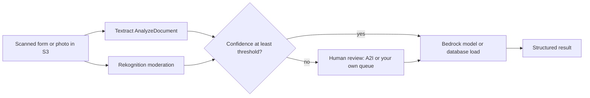

## 0. Before you start
- **Essential:** what OCR (reading text from an image) is; what a confidence score is; what "human in the loop" means ([03/06](aip:03-agentic-ai/06-mcp-openapi-tools-and-human-in-the-loop)).
- **Helpful:** JSON responses; S3 as the place documents and images live; RAG basics ([01/03](aip:01-bedrock-genai-fundamentals/03-retrieval-augmented-generation-rag)).
- **Optional advanced:** document layout analysis, face collections, Lex versions and aliases.

## 1. Simple explanation
Before a language model can use a scanned invoice or a photo, something must turn pixels into data. **Textract** reads documents (text, forms, tables, answers to questions). **Rekognition** looks at images and video (objects, text, unsafe content, faces). Neither is perfect, so **Augmented AI (A2I)** lets a person check results the machine is unsure about. **Lex** builds chatbots, and **Kendra** is an older enterprise search service. Two of these (A2I and Kendra) are now **closed to new customers**: existing users can keep using them, but new projects should use newer options such as Bedrock Knowledge Bases.


```figure
flow doc-human-review
```

## 2. Structured explanation
1. **Textract** ✅: detects typed and handwritten text; **AnalyzeDocument** with `FeatureTypes` TABLES, FORMS, QUERIES, SIGNATURES, LAYOUT; **AnalyzeExpense** (invoices, receipts), **AnalyzeID** (US government IDs), **Analyze Lending**; Custom Queries with adapters; synchronous for single pages, asynchronous for multi-page.
2. **Rekognition** ✅: image and video analysis: labels, text, unsafe content (moderation), celebrities, faces (analysis, comparison, collections), custom labels, face liveness, PPE detection, adapters.
3. **A2I** ✅: human review loops for low-confidence or sampled predictions; built-in workflows for Textract and Rekognition; **closed to new customers**.
4. **Kendra** ✅: managed intelligent search (GenAI Enterprise Edition, Basic Enterprise, Basic Developer indexes); **Maintenance Mode** and **closed to new customers**; replacement guidance: Bedrock Managed Knowledge Base.
5. **Lex V2** ✅: bots, languages, intents, utterances, slots, slot types, versions, aliases; Assisted NLU; fallback intent ([09/02](aip:09-other-services/02-compute-containers-ec2-ecs-eks-lex-and-connect) covers QnAIntent and Connect).

## 3. Analogy
**A mailroom with a supervisor.** Textract is the clerk who opens each envelope and copies the fields into a form. Rekognition is the clerk who inspects photos and flags anything inappropriate. A2I is the supervisor's desk where only the clerk's "I'm not sure" pile lands. Lex is the receptionist who asks you questions until the form is complete. Kendra was the old filing-cabinet search service, now closed to new subscribers.

*Where it breaks:* a clerk never "learns" from your corrections unless you retrain or add adapters; and confidence is a score from the model, not a probability that the answer is right.

## 4. The seven questions

**WHAT?** Pre-built AI services for documents, images, human review, search and conversation.

**WHY?** They turn unstructured inputs into structured data that an FM or application can use, and add control points (human review, moderation) around them.

**WHEN?**
| Need | Pick |
|---|---|
| Extract fields and tables from scans before a prompt or database load | Textract |
| Extract understanding from complex documents, images, audio and video in one managed flow | Bedrock Data Automation ([02/01](aip:02-data-management/01-structured-data-and-bedrock-data-automation)) or an FM with vision ([01/06](aip:01-bedrock-genai-fundamentals/06-multimodal-models-and-pipelines)) |
| Moderate user images | Rekognition moderation, with human review for borderline cases |
| Compare a face with a reference, or search faces | Rekognition faces and collections |
| Human review of low-confidence results (existing customers) | A2I; new builds: custom review step ([03/06](aip:03-agentic-ai/06-mcp-openapi-tools-and-human-in-the-loop)) |
| Enterprise search or RAG on new projects | Bedrock Knowledge Bases (not Kendra) |
| Voice or chat bot with defined tasks | Lex |

**WHERE?** Regional; Textract and Rekognition read documents and images from S3 or bytes in the request ✅; Lex Region list is in the General Reference ✅.

**HOW?** §5.

**WHAT IF?**
| Situation | Effect | Remedy |
|---|---|---|
| Handwriting is poor | Low-confidence results | Route to review (A2I or your own queue), add adapters |
| Document has 200 pages | Synchronous call is for single pages ✅ | Use the asynchronous start/get operations ✅ |
| You start a new project on Kendra or A2I | Not possible for new customers ✅ | Use Bedrock Knowledge Bases or a custom review workflow |
| Existing Kendra app needs a feature Bedrock lacks | Gaps exist (query suggestions, faceting, synonyms, spell check, incremental learning, enrichment hooks) ✅ | Use workarounds from the migration guide ✅ |
| User sends an image your policy forbids | Moderation labels with confidence | Block, review or allow by threshold |
| Face recognition is used for identity | Privacy and fairness obligations | Legal review, consent ([07/02](aip:07-governance-qa/02-principles-of-responsible-ai-and-fairness-evaluation)) |

**WHY NOT?** Do not feed raw OCR output to a model without confidence checks on critical fields. Do not use face analysis attributes (age, gender, emotion) for consequential decisions 🟡. Do not start new work on services marked closed to new customers.

## 5. Technical depth

```figure
confidence-gate
```


### 5.1 Textract ✅ (`what-is.html`, `how-it-works-analyzing.html`)
- **Capabilities:** detect typed and handwritten text; **text, forms (key-value pairs, including checkboxes), tables, query responses, signatures** and **layout** (paragraphs, lists, headers, footers, page numbers, figures, tables, titles, section headers, in reading order) ✅.
- **Queries:** you pass a question ("What is the customer's SSN?") and get an answer in a separate response structure; can be combined with other features; **Custom Queries** use **adapters** trained on your annotated documents (`AdapterId`, `AdapterVersion`) ✅.
- **Other APIs:** `AnalyzeExpense` (invoices, receipts), `AnalyzeID` (US-issued driver's licenses and passports), Analyze Lending (mortgage packages, classification and routing) ✅.
- **Sync vs async:** `AnalyzeDocument` is synchronous (single-page, latency-critical); `StartDocumentAnalysis` then `GetDocumentAnalysis` for multi-page ✅. The response is a list of **Block** objects (lines, words, content, relationships, page, geometry) ✅; **all** detected lines and words are returned even if not tied to the requested feature ✅.
- **Quotas:** adjustable ones in Service Quotas, fixed ones (file size, languages) documented separately ✅ (values ❌ not read).
- **GenAI angle** 🟡: Textract output → cleaned text or JSON → chunks → embeddings ([01/05](aip:01-bedrock-genai-fundamentals/05-chunking-embeddings-reranking-and-rag-evaluation)); or send low-confidence fields to review before an FM acts.

```python snippet
# Shape of a boto3 call; parameter names follow the Textract API (not read in full here) and it is not run against AWS.
import boto3

textract = boto3.client("textract")
response = textract.analyze_document(
    Document={"S3Object": {"Bucket": "my-docs-bucket", "Name": "scans/invoice-001.png"}},
    FeatureTypes=["FORMS", "TABLES", "QUERIES"],
    QueriesConfig={"Queries": [{"Text": "What is the invoice total?"}]},
)
fields = [b for b in response["Blocks"] if b["BlockType"] in ("KEY_VALUE_SET", "QUERY_RESULT")]
low_confidence = [b for b in fields if b.get("Confidence", 100) < 90]
print(len(fields), "candidate fields,", len(low_confidence), "to review")
```

### 5.2 Rekognition ✅ (`what-is.html`, `moderation.html`)
- **Image analysis:** objects, scenes, concepts, celebrities; printed and handwritten **text**; **unsafe content** (granular labels); facial analysis, detection and comparison; **Custom Labels**; image properties (quality, color, sharpness, contrast) ✅.
- **Video analysis:** labels, text, **people pathing**, faces, celebrities, unsafe content, **video segmentation** (black frames, end credits), **face liveness** ✅.
- **Facial search:** index faces into a **face collection** (an index you own), then search ✅.
- **Moderation** ✅: `DetectModerationLabels`; hierarchical labels with confidence scores; **adapters** (Custom Moderation) improve accuracy on your images; AWS says human moderators typically review only **1–5%** of content already flagged by ML, and that **A2I is already integrated with Rekognition** for human review ✅.
- HIPAA-eligible service ✅; integrates with S3 and Lambda ✅.
- **GenAI angle** 🟡: label or caption images for search metadata; moderate uploads before a vision model sees them; Bedrock Guardrails image filters are a separate option ([01/07](aip:01-bedrock-genai-fundamentals/07-bedrock-guardrails)).

```python snippet
# Moderation threshold sketch using the Rekognition API shape (not read in full here); not run against AWS.
import boto3

rekognition = boto3.client("rekognition")
result = rekognition.detect_moderation_labels(
    Image={"S3Object": {"Bucket": "uploads-bucket", "Name": "photos/p1.jpg"}},
    MinConfidence=60,
)
top = max((label["Confidence"] for label in result["ModerationLabels"]), default=0)
decision = "block" if top >= 90 else "human review" if top >= 60 else "allow"
print(decision)
```

### 5.3 Augmented AI (A2I) ✅ (`a2i-use-augmented-ai-a2i-human-review-loops.html`)
- **Status:** "Amazon SageMaker A2I is **no longer open to new customers**. Existing customers can continue to use the service as normal. AWS continues to invest in security and availability improvements for A2I, but we do not plan to introduce new features." ✅ Other pages (search summary 🟡) give the closure date as **30 July 2026**; the product is named A2I, Amazon A2I and SageMaker A2I in different pages.
- **What it does:** human review of low-confidence predictions or random samples; built-in workflows for **Textract** (key-value pairs), **Rekognition** (unsafe images), plus Comprehend, Transcribe, Translate, tabular data and **real-time inferences from a SageMaker endpoint** ✅.
- **Moving parts** (topic list) ✅: human review **workflow** (flow definition), **human loop**, worker **task templates**, output data to S3, CloudWatch Events, permissions.
- **Replacement pattern** 🟡: your own review queue, for example Step Functions waiting for a task token ([06/04](aip:06-app-building-tools/04-step-functions-states-circuit-breaker-and-prompt-chaining)) and an approval UI; or Bedrock Agents return of control ([03/06](aip:03-agentic-ai/06-mcp-openapi-tools-and-human-in-the-loop)).

### 5.4 Kendra ✅ (`what-is-kendra.html`, `kendra-availability-change.html`)
- **Status:** Kendra went into **Maintenance Mode effective 30 June 2026** (no new features); **from 30 July 2026 it is closed to new customers**; existing customers keep full support, bug fixes and security updates ✅. Consistent with the earlier verification ([verification-log §2](aip:meta/verification-log)): "maintenance mode", not "deprecated".
- **Product** ✅: managed semantic search over connected repositories; editions **GenAI Enterprise**, **Basic Enterprise**, **Basic Developer** (POC only); GenAI indexes usable in Amazon Q Business and Bedrock knowledge bases; **Intelligent Ranking** re-ranks other services' results; indexes bill even when empty.
- **Migration guidance** ✅ (AWS page): move to **Amazon Bedrock Managed Knowledge Base (BMKB)**: fully managed RAG with built-in connectors, smart parsing, a managed vector store with **hybrid search**, `RetrieveAndGenerate` and an **agentic retrieval** API; embedding models fixed at 1,024 dimensions float32 (Titan Text Embeddings V2, Cohere Embed English/Multilingual v3, Cohere Embed v4, Nova Multimodal Embeddings); chunking: default (~300 tokens), fixed-size, hierarchical, none (**no semantic chunking**); **seven connectors** (S3, Confluence, SharePoint, Web Crawler, Google Drive, OneDrive, custom) versus Kendra's 32+; always hybrid search; metadata via `.metadata.json` sidecar files up to 10 KB with STRING, NUMBER or BOOLEAN types.
- **Gaps needing workarounds** ✅: query suggestions, faceted search, custom synonyms, spell checking, incremental learning (feedback), custom document enrichment hooks; no `startsWith`/`stringContains` filters.
- **API mapping** ✅: `kendra.create_index` → `bedrock-agent.create_knowledge_base` (type `MANAGED`); `start_data_source_sync_job` → `start_ingestion_job`; `retrieve` → `bedrock-agent-runtime.retrieve` (with `managedSearchConfiguration`); filter `EqualsTo` → `equals`.
- Lex bots can use `AMAZON.KendraSearchIntent` (not together with QnAIntent in one locale ✅, [09/02](aip:09-other-services/02-compute-containers-ec2-ecs-eks-lex-and-connect)).

### 5.5 Lex V2 core concepts and hands on ✅ (`how-it-works.html`)
| Concept | Meaning ✅ |
|---|---|
| Bot | Automated task performer powered by ASR and NLU |
| Language | Each language configured independently |
| Intent | An action the user wants (name, sample utterances, how to fulfill; Lambda recommended) |
| Slot and slot type | Parameter to collect; built-in (for example `AMAZON.Number`) or custom enumerations |
| Fallback intent | Always present; used when the intent cannot be deduced |
| Version | Numbered immutable snapshot |
| Alias | Pointer to a version; change the alias to roll out or roll back without client changes |

- **Learning path on the page** ✅: start from a template, customize, test in the console (enable **Assisted NLU**), publish and integrate (Slack, web, mobile); about 50 minutes in total (the page's own estimate).
- **Lesson 272 hands on** (shown, not run ❌): create a bot from a template (for example appointment booking), add an intent with slots, test, build, publish version 1, create an alias, point a client at the alias; later publish version 2 and move the alias.


*Reading the arrows:* documents and images go through Textract and Rekognition; a confidence check decides whether the result is trusted. Uncertain results go to a human reviewer first, then everything continues to the model or database.

## 6. Worked example
*Problem:* an insurer receives photographed claim forms and damage photos. A model drafts claim summaries. Policy: unsafe photos are blocked, uncertain fields are checked by a person, and the old Kendra-based search must be retired.

| Step | Design | Why |
|---|---|---|
| 1 | Upload to S3; Lambda calls Textract `AnalyzeDocument` with FORMS and TABLES, plus a QUERIES entry for "claim amount" | Structured extraction ✅ |
| 2 | Rekognition `DetectModerationLabels` on photos: ≥ 90 block, 60–90 review, else allow | Content safety, human review for borderline ✅ |
| 3 | Fields below a confidence threshold go to a review queue (existing A2I loop, or a custom Step Functions approval for new builds) | A2I is closed to new customers ✅ |
| 4 | Clean JSON goes to a Bedrock model with a guardrail to draft the summary | [01/07](aip:01-bedrock-genai-fundamentals/07-bedrock-guardrails) |
| 5 | Replace Kendra search with a Bedrock Managed Knowledge Base; run both side by side and compare relevance before cutover | Migration guidance ✅ |
| 6 | Encrypt S3, log access, delete images per retention policy | [08/03](aip:08-security/03-kms-secrets-manager-macie-and-bedrock-data-protection) |

## 7. Knowledge checkpoints
1. Which Textract feature answers a natural-language question about a document?
2. What is the difference between `AnalyzeDocument` and `StartDocumentAnalysis`?
3. What is Kendra's current status?
4. Which service does AWS recommend for new RAG projects instead of Kendra?
5. What does a Lex alias point to?

## 7b. Practice questions (exam-style, original) — answers in §14

**Q1.** A pipeline must extract key-value pairs and tables from scanned forms. Which service?
A. Amazon Textract with FORMS and TABLES
B. Amazon Rekognition Custom Labels
C. Amazon Lex
D. Amazon Kendra

**Q2.** (Select TWO) Which statements about Amazon Kendra are correct?
A. It is in Maintenance Mode and closed to new customers
B. AWS recommends Bedrock Managed Knowledge Base for similar capabilities
C. It is the recommended choice for all new RAG projects
D. It was removed from all accounts on 30 July 2026
E. It cannot connect to any data sources

**Q3.** A multi-page 80-page PDF must be analyzed. Which Textract approach?
A. Asynchronous `StartDocumentAnalysis` then `GetDocumentAnalysis`
B. Only synchronous `AnalyzeDocument` in a loop of one call
C. Rekognition `DetectLabels`
D. Lex `RecognizeText`

**Q4.** A moderation workflow wants humans to review only borderline images. Which combination fits?
A. Rekognition moderation labels with confidence thresholds, plus a human review step
B. Route 53 weighted routing
C. KMS key rotation
D. EC2 Spot Instances

**Q5.** (Select TWO) Which are true about Amazon Augmented AI?
A. It supports human review of low-confidence Textract and Rekognition results
B. It is no longer open to new customers
C. It adds new features regularly
D. It can only review images
E. It trains foundation models

**Q6.** A Lex team wants to ship version 2 of a bot to all clients without changing client code. What should they do?
A. Publish version 2 and move the alias to it
B. Delete version 1
C. Create a new AWS account
D. Change the Region

**Q7.** Which Textract feature lets you ask "What is the invoice total?" and get an answer?
A. Queries
B. Layout
C. Signatures
D. AnalyzeID

**Q8.** An existing Kendra application depends on faceted search and custom synonyms. What is the right expectation when migrating to Bedrock Managed Knowledge Base?
A. Those features need workarounds such as metadata filters and a synonym expansion layer
B. They are available natively and identical
C. Migration is impossible
D. Only OpenSearch can host them

## 7c. Mixed review for Quiz 13 (machine learning) — answers in §14
1. Which two services in this file are closed to new customers? 2. Which service handles invoices through `AnalyzeExpense`? 3. Which Rekognition feature checks that a live person is present? 4. What is the default Lex behavior when no intent matches? 5. Which service reads handwriting in documents and which reads text in images and video? (Both read text; name the document-focused one.)

## 8. Hands-on lab: confidence routing, moderation thresholds, a human-review sample, and Lex version aliases (offline) + console steps

### 8.1 Objective
Route made-up OCR fields by confidence, choose moderation thresholds and see the human workload, take a random review sample (the A2I "audit" idea), and roll an alias forward and back.

### 8.2 Prerequisites
Python 3 (standard library). Optional AWS part: Textract, Rekognition, Lex and an S3 bucket.

### 8.3 AWS services
Offline: none. Optional: Textract, Rekognition, Lex, S3, Lambda.

### 8.4 IAM permissions
Offline: none. Real: S3 read on the input bucket; permission to call the Textract and Rekognition operations you use (action names equal the API operation names 🟡, lists ❌ not read); a Lex runtime role for Lambda fulfillment.

### 8.5 Region notes
Check each service's Regions; Textract and Rekognition read S3 objects in the same Region 🟡.

### 8.6 Architecture
§5.5 diagram.

### 8.7 Cost
Offline: none. Real: per-page Textract pricing by feature, per-image Rekognition pricing, Lex per request; prices ❌ not read. Use a few sample files and delete the bot and bucket afterwards.

### 8.8 Code
**Simplification:** the OCR fields, confidences and moderation scores are **made up** and are not Textract's Block schema or Rekognition's response; thresholds are teaching values. The statement that humans review 1–5% of content comes from the Rekognition page ✅ and is only used as a comparison.

```python lab-run
import random

# ---------- 1. Route extracted fields by confidence ----------
FIELDS = [("policy_number", "PN-48213", 99.1), ("claim_amount", "1,250.00", 97.4), ("date_of_loss", "12-O3-2026", 71.2),
          ("claimant_name", "Jane Doe", 98.6), ("iban", "DE44 5001 0517 5407 3249 31", 84.9)]
CRITICAL = {"claim_amount", "iban", "policy_number"}
def route(name, confidence):
    limit = 95 if name in CRITICAL else 85
    return "auto" if confidence >= limit else "human review"
print("1) field routing (critical fields need 95, others 85)")
for name, value, conf in FIELDS:
    print(f"   {name:<14}{value:<28}{conf:>5.1f} -> {route(name, conf)}")

# ---------- 2. Moderation thresholds: how much goes to humans? ----------
random.seed(5)
scores = [round(min(100, max(0, random.gauss(20, 25))), 1) for _ in range(1000)]
unsafe_truth = [s > 70 for s in scores]
def decide(score, review_from, block_from):
    return "block" if score >= block_from else "review" if score >= review_from else "allow"
print("2) 1,000 images, made-up scores; thresholds review_from / block_from")
for review_from, block_from in [(40, 90), (60, 90), (80, 95)]:
    decisions = [decide(s, review_from, block_from) for s in scores]
    review = decisions.count("review")
    missed = sum(1 for d, u in zip(decisions, unsafe_truth) if d == "allow" and u)
    print(f"   {review_from}/{block_from}: block {decisions.count('block'):>3}, human review {review:>3} ({review / 10:.1f}% of volume), unsafe images allowed {missed}")

# ---------- 3. Random audit sample on top of low-confidence routing (A2I-style) ----------
random.seed(9)
auto_approved = list(range(500))
sample = random.sample(auto_approved, 25)
errors_in_sample = sum(1 for i in sample if i % 17 == 0)
print(f"3) audit sample: {len(sample)} of {len(auto_approved)} auto-approved items reviewed ({len(sample) / len(auto_approved):.0%}); errors found {errors_in_sample}")
print("   a sample estimates the hidden error rate even when confidence looks high")

# ---------- 4. Lex versions and aliases ----------
versions = {1: "bot v1: books appointments", 2: "bot v2: books and cancels"}
alias = {"prod": 1}
def client_call(name):
    return versions[alias[name]]
print("4) alias rollout")
print("   before:", client_call("prod"))
alias["prod"] = 2
print("   alias moved to version 2:", client_call("prod"))
alias["prod"] = 1
print("   rollback by moving the alias back:", client_call("prod"))
print("   clients never change: they always call the alias 'prod'")
```

### 8.9 Captured output
Generated on 2026-10-26 by extracting the block above from this file and running it (Python 3). It uses made-up data; it is **not** Textract, Rekognition, A2I or Lex output.
```text lab-out
1) field routing (critical fields need 95, others 85)
   policy_number PN-48213                     99.1 -> auto
   claim_amount  1,250.00                     97.4 -> auto
   date_of_loss  12-O3-2026                   71.2 -> human review
   claimant_name Jane Doe                     98.6 -> auto
   iban          DE44 5001 0517 5407 3249 31  84.9 -> human review
2) 1,000 images, made-up scores; thresholds review_from / block_from
   40/90: block   2, human review 189 (18.9% of volume), unsafe images allowed 0
   60/90: block   2, human review  48 (4.8% of volume), unsafe images allowed 0
   80/95: block   1, human review   8 (0.8% of volume), unsafe images allowed 18
3) audit sample: 25 of 500 auto-approved items reviewed (5%); errors found 2
   a sample estimates the hidden error rate even when confidence looks high
4) alias rollout
   before: bot v1: books appointments
   alias moved to version 2: bot v2: books and cancels
   rollback by moving the alias back: bot v1: books appointments
   clients never change: they always call the alias 'prod'
```

### 8.10 Explanation
- Part 1: critical fields get a stricter limit; the misread date (letter O in the month) and the low-confidence bank number go to people.
- Part 2: stricter review ranges trade human workload against unsafe images slipping through; AWS's 1–5% figure is a comparison point, not a promise ✅.
- Part 3: a random sample of auto-approved items catches errors that confidence alone hides (the idea behind A2I random sampling ✅).
- Part 4: aliases decouple clients from versions ✅.

### 8.11 Optional AWS labs (lessons 269, 272, 274, 276; shown, not run against AWS ❌)
**A2I (269):** existing SageMaker customers only: create a worker team, a human task UI and a human review workflow, then start a human loop from a Textract call ✅ (topics from the page; click path ❌). New customers cannot create it.
**Lex (272):** §5.5 steps.
**Rekognition (274):** console → Rekognition → try demo → label detection and content moderation with a sample image; then call `detect-labels` or `detect-moderation-labels` from the CLI on an S3 object 🟡.
**Textract (276):** console → Textract → Analyze document → upload a sample form → enable FORMS, TABLES, QUERIES → inspect key-value pairs and confidence; export JSON ✅ (features from the page).

### 8.12 Common errors
| Error | Cause | Fix |
|---|---|---|
| Textract returns an unsupported-document error | Format or size outside limits ❌ (limits not read) | Check the quotas page; convert the file |
| Sync call fails on a PDF with many pages | Sync is for single pages ✅ | Use asynchronous operations |
| Too many false moderation flags | Threshold too low | Raise it, add a custom adapter ✅ |
| A2I console not available | Account is a new customer ✅ | Build a custom review step |
| Lex users still see the old behavior | Alias points to the old version ✅ | Move the alias |
| Kendra index cannot be created | New customer restriction ✅ | Use Bedrock Knowledge Bases |

### 8.13 Security recommendations
Treat scans and photos as sensitive (they may contain IDs and faces); encrypt S3 and restrict access; mask or redact personal data before model calls ([08/01](aip:08-security/01-least-privilege-iam-identity-center-and-data-masking)); keep face collections minimal, with consent and retention rules; do not log full OCR output; limit reviewers to the data they need; apply Guardrails to generated summaries.

## 9. What can go wrong?
| Failure | Why | Symptoms | Investigate | Fix | Prevent |
|---|---|---|---|---|---|
| **Wrong digits accepted** | No field-level confidence check | Bad payments | Compare with source | Review rules, adapters | Critical-field thresholds |
| **Bias in face features** | Face analysis used for decisions 🟡 | Unfair outcomes | Fairness tests | Remove use | Policy ([07/02](aip:07-governance-qa/02-principles-of-responsible-ai-and-fairness-evaluation)) |
| **Review queue overload** | Thresholds too wide ✅ | Backlog | Queue metrics | Tune thresholds | Capacity planning |
| **Built on a closed service** | New project on A2I or Kendra ✅ | Cannot create | Account status | Alternatives | Check service status first |
| **Search regression after migration** | Missing Kendra features ✅ | Worse results | Golden set | Workarounds | Parallel run |
| **Unsafe image reaches a model** | No pre-moderation | Policy breach | Logs | Add Rekognition step | Defense in depth |
| **Alias points to wrong version** | Manual change | Unexpected bot behavior | Alias config ✅ | Fix alias | Release checklist |

## 10. Common misconceptions
1. **"Kendra and A2I are deprecated."** Kendra is in Maintenance Mode and both are closed to new customers; existing customers continue ✅.
2. **"Textract is just OCR."** It also extracts forms, tables, queries, signatures and layout ✅.
3. **"High confidence means correct."** It is a model score; sample and audit ✅.
4. **"Rekognition can't be customized."** Custom Labels and adapters exist ✅.
5. **"A Lex alias is a copy of the bot."** It points to a version ✅.
6. **"A2I only reviews images."** It supports several services and custom workflows ✅.

## 11. Exam notes
- **Patterns:** "extract tables and forms from scans" → Textract; "detect unsafe images" → Rekognition moderation; "human reviews low-confidence predictions" → A2I (legacy) or a human-in-the-loop step; "search replacement for Kendra" → Bedrock Knowledge Bases; "conversational bot with intents and slots" → Lex.
- **Keywords:** FeatureTypes, Queries, AnalyzeExpense, human loop, flow definition, face collection, `DetectModerationLabels`, adapter, version, alias, fallback intent.
- **Traps:** calling Kendra or A2I "deprecated"; using synchronous Textract for multipage files; trusting confidence blindly; confusing Lex version with alias.
- **Compare:** Textract vs BDA vs a vision FM; Rekognition moderation vs Bedrock Guardrails image filters; Lex vs Bedrock Agents; Kendra vs Bedrock Knowledge Bases vs OpenSearch.

## 12. Summary and revision cards
- Textract = documents; Rekognition = images and video; A2I = human review (closed to new customers); Kendra = maintenance mode, closed to new customers, replace with Bedrock Managed Knowledge Base; Lex = intents, slots, versions, aliases.

**Cards.** Q: Kendra status? A: Maintenance Mode from 30 June 2026, closed to new customers from 30 July 2026. · Q: Async Textract ops? A: `StartDocumentAnalysis`, `GetDocumentAnalysis`. · Q: Typical moderator share? A: 1–5% of volume (AWS page).

## 13. References
| Source | URL | Verified |
|---|---|---|
| Amazon A2I human review | https://docs.aws.amazon.com/sagemaker/latest/dg/a2i-use-augmented-ai-a2i-human-review-loops.html | 2026-10-26 |
| What is Amazon Kendra / availability change | https://docs.aws.amazon.com/kendra/latest/dg/what-is-kendra.html · .../kendra-availability-change.html | 2026-10-26 |
| Lex V2 core concepts | https://docs.aws.amazon.com/lexv2/latest/dg/how-it-works.html | 2026-10-26 |
| What is Amazon Rekognition / moderation | https://docs.aws.amazon.com/rekognition/latest/dg/what-is.html · .../moderation.html | 2026-10-26 |
| What is Amazon Textract / analyzing documents | https://docs.aws.amazon.com/textract/latest/dg/what-is.html · .../how-it-works-analyzing.html | 2026-10-26 |

**Unverified here:** all prices and quotas; Textract and Rekognition request and response field details beyond the named operations; the A2I closure date (🟡 from a search summary, official page has the notice without a date); Lex Regions; BMKB Regions and limits beyond the migration page; Textract file-size and language limits; Rekognition face-analysis fairness guidance.

## 14. Answers to checkpoints and practice questions
**Checkpoints.** 1) Queries (inside AnalyzeDocument) ✅. 2) `AnalyzeDocument` is synchronous (single page); `StartDocumentAnalysis` is asynchronous for multi-page, with results from `GetDocumentAnalysis` ✅. 3) Maintenance Mode and closed to new customers ✅. 4) Amazon Bedrock Managed Knowledge Base ✅. 5) A specific bot version ✅.

**Practice questions.**
- **Q1 → A.** ✅ B detects custom objects, C is a chatbot, D is search.
- **Q2 → A, B.** C false, D false (existing customers continue), E false ✅.
- **Q3 → A.** ✅
- **Q4 → A.** ✅ (the page describes moderators reviewing a small flagged share).
- **Q5 → A, B.** C, D, E false ✅.
- **Q6 → A.** ✅
- **Q7 → A.** ✅
- **Q8 → A.** ✅ Faceting and synonyms are listed gaps with workarounds.

**Mixed review (§7c).** 1) Amazon Augmented AI and Amazon Kendra ✅. 2) Textract ✅. 3) Face Liveness ✅. 4) The fallback intent is used ✅. 5) Textract is the document-focused one (Rekognition also detects text in images and video) ✅.
