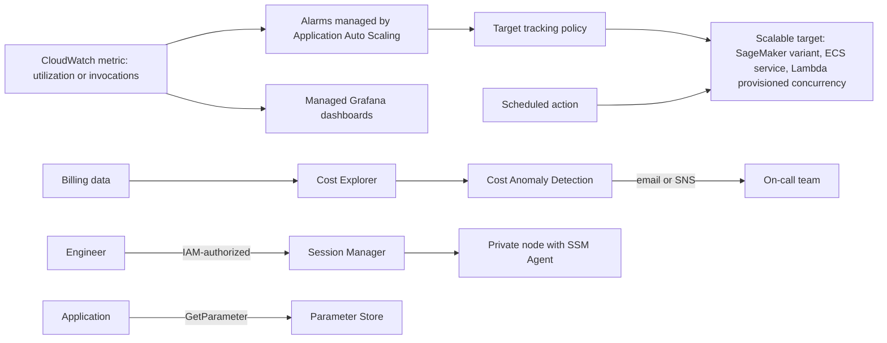

## 0. Before you start
- **Essential:** what CloudWatch metrics and alarms are; what "capacity" means for a service (instances, tasks, replicas).
- **Helpful:** tags on resources; the idea of a bastion host and SSH; key-value configuration.
- **Optional advanced:** target tracking math; seasonality in time series.

## 1. Simple explanation
GenAI traffic and bills move up and down. **Auto Scaling** adds and removes capacity (servers, containers, model endpoint copies) so you do not pay for idle machines or fall over at a peak. **Cost Explorer** shows where the money went, and **Cost Anomaly Detection** sends an alert when spending suddenly looks strange, such as a runaway agent calling a model in a loop. **Managed Grafana** draws dashboards from your metrics, logs and traces. **Systems Manager** is the operations toolbox: **Session Manager** opens a shell on a server without opening any port, and **Parameter Store** keeps configuration values (model IDs, endpoints, prompt-version names) outside your code.


```figure
flow autoscaling-loop
```

## 2. Structured explanation
1. **EC2 Auto Scaling** ✅: Auto Scaling groups with minimum, desired and maximum size; health checks; multi-AZ balance; Spot and On-Demand mix; instance refresh; lifecycle hooks.
2. **Application Auto Scaling** ✅: the same idea for other services: SageMaker endpoint variants and **inference components**, SageMaker Serverless provisioned concurrency, ECS services, Lambda provisioned concurrency, DynamoDB, Aurora replicas, ElastiCache, MSK broker storage, Neptune, EMR, custom resources; target tracking, step, scheduled and predictive scaling.
3. **AWS Auto Scaling (scaling plans)** ✅: groups related resources for one setup; AWS recommends predictive-only users set predictive policies directly (migration guide exists).
4. **Cost Anomaly Detection** ✅: ML-based alerts on unusual spend; monitors by service, account, cost category or tag; alerts by email or SNS.
5. **Cost Explorer** ✅: analyze costs and usage; 13 months of history and an 18-month forecast.
6. **Managed Grafana** ✅: managed Grafana "workspaces"; many AWS data sources; SAML 2.0 or IAM Identity Center sign-in; priced per active user.
7. **Systems Manager** ✅: operations tools for nodes: Run Command, Session Manager, Automation, Patch Manager, Parameter Store.

## 3. Analogy
**A restaurant's back office.** Auto Scaling is the manager calling in extra cooks when the queue grows and sending them home when it shrinks (but not instantly, so nobody is hired and fired every minute: cooldowns). Cost Explorer is the monthly ledger; Anomaly Detection is the bookkeeper who says "why did we spend four times as much on saffron on a Sunday?". Grafana is the wall of screens in the kitchen. Session Manager is a keycard door with a log, replacing a spare key under the mat (SSH keys and open ports). Parameter Store is the laminated card of settings by the stove.

*Where it breaks:* Auto Scaling reacts to metrics with delay, so a sudden spike can still queue; anomaly detection can lag up to a day; and a parameter changes immediately for everyone who reads it, with no safety net ✅.

## 4. The seven questions

**WHAT?** Scaling, cost visibility and alerts, dashboards, and operational access and configuration.

**WHY?** GenAI workloads are bursty and expensive: GPU endpoints idle overnight, agents can loop, and model IDs or endpoints change. These services keep capacity matched to demand, cost surprises visible, and access and settings controlled.

**WHEN?**
| Need | Pick |
|---|---|
| Scale a SageMaker endpoint or inference components by traffic | Application Auto Scaling (target tracking) ✅ |
| Keep a fleet of EC2 model servers sized to load | EC2 Auto Scaling group |
| Scale an ECS service of agent tools | Application Auto Scaling for ECS ✅ |
| Know about a sudden cost spike (for example a looping agent) | Cost Anomaly Detection |
| Break down spend by service, tag or account | Cost Explorer |
| Single dashboard across CloudWatch, OpenSearch, X-Ray, Prometheus | Managed Grafana |
| Shell access to a private instance with an audit trail | Session Manager |
| Static config (endpoints, approved AMI, model alias) | Parameter Store |
| Config that changes often and needs gradual rollout and rollback | AppConfig ([06/03](aip:06-app-building-tools/03-appconfig-and-dynamic-foundation-model-selection)) |
| Passwords, API keys, anything needing rotation | Secrets Manager |

**WHERE?** All Regional. Managed Grafana is available in a listed set of Regions ✅ (ten commercial Regions and two GovCloud Regions on the page read); the unified Systems Manager console is in listed Regions ✅.

**HOW?** §5.

**WHAT IF?**
| Situation | Effect | Remedy |
|---|---|---|
| Traffic doubles within a minute | Scale-out follows after metric and warm-up delay | Scheduled or predictive scaling, minimum capacity, queueing ([06/08](aip:06-app-building-tools/08-sqs-eventbridge-sns-and-appflow)) |
| Metric has missing data | Alarm goes `INSUFFICIENT_DATA`, scaling stops until data returns ✅ | Metric math with `FILL`, emit regular data ✅ |
| Both a target tracking and a step scaling policy act | Can fight each other ✅ | Use one method per direction |
| Brand-new Cost Anomaly monitor | It can take 24 hours to detect new anomalies ✅ | Add budgets for immediate guardrails |
| An agent loops and spends heavily | Anomaly appears after the billing data is processed (up to about a day) ✅ | Quotas, per-request limits, alarms ([04/01](aip:04-operational-efficiency/01-token-efficiency-and-cost-effective-model-selection)) |
| A bad value is written to Parameter Store | Takes effect on next read with no validation or rollback ✅ | Use AppConfig for risky config |
| SSH port is open to the internet | Attack surface | Session Manager, close inbound ports ✅ |

**WHY NOT?** Do not store secrets that need rotation in Parameter Store: AWS recommends Secrets Manager ✅. Do not rely on anomaly alerts as a hard spending limit: use quotas and budgets. Do not edit the CloudWatch alarms that target tracking creates ✅.

## 5. Technical depth

```figure
autoscale-target
```


### 5.1 EC2 Auto Scaling ✅ (`what-is-amazon-ec2-auto-scaling.html`)
- An **Auto Scaling group** has a minimum (never below), maximum (never above) and optional desired size; example on the page: minimum 4, desired 6, maximum 12 ✅.
- Features ✅: EC2 and custom **health checks** with replacement; balancing across **AZs**; multiple instance types and **Spot/On-Demand** purchase options (with Capacity Rebalancing); load balancer registration; **instance refresh** (rolling or canary) when an AMI or launch template changes; **lifecycle hooks**; scale-in protection for stateful work. No extra fee; you pay for the resources ✅.
- Scaling options named: dynamic, predictive, scheduled, manual ✅.

### 5.2 Application Auto Scaling ✅ (`what-is-application-auto-scaling.html`, `target-tracking-scaling-policy-overview.html`)
- **Scalable resources** ✅: WorkSpaces Applications fleets, Aurora replicas, Comprehend endpoints, DynamoDB tables and indexes, ECS services, ElastiCache replication groups and Memcached clusters, EMR clusters, Keyspaces, **Lambda provisioned concurrency**, **MSK broker storage**, Neptune clusters, **SageMaker AI endpoint variants**, **SageMaker AI inference components**, **SageMaker AI Serverless provisioned concurrency**, Spot Fleet, WorkSpaces pools, custom resources.
- **Four methods** ✅: target tracking, step scaling, scheduled scaling, predictive scaling.
- **Target tracking** ✅: pick a CloudWatch metric and a target value; the service creates and manages the CloudWatch alarms (do **not** edit them); it scales out proportionally and **fast**, and scales in **conservatively** (it will not scale in if removing the smallest unit would push the metric back above the target; it waits until utilization is far enough below the target, "usually more than 10% lower"); **cooldowns** slow repeated activity (defaults 300 s for SageMaker endpoint variants, inference components, Serverless provisioned concurrency, ECS, Aurora, Neptune and others; 600 s for ElastiCache; 0 or null for DynamoDB, Lambda provisioned concurrency, MSK storage, Comprehend, Keyspaces); a scale-out can interrupt a scale-in cooldown.
- **Rules** ✅: not every custom metric works (it must be a utilization metric that moves proportionally to capacity); prefer one-minute metrics; with several target tracking policies it scales out if **any** is ready and scales in only if **all** are ready, choosing the largest capacity; a metric that emits real zeros can scale to zero if the minimum capacity is 0; EMR clusters are not supported for target tracking and MSK scale-in is disabled; the minimum and maximum capacity bound everything.
- **CLI** ✅: `register-scalable-target` (service namespace, scalable dimension, resource ID, min and max) then `put-scaling-policy`; the migration page shows the pattern (ECS example `ecs:service:DesiredCount`, resource ID `service/{cluster}/{service}`).
- **SageMaker predefined metric name** 🟡 (`SageMakerVariantInvocationsPerInstance`) was not on a page read ❌; see [05/01](aip:05-sagemaker/01-sagemaker-ai-deployment-guardrails-and-fm-optimization) for inference components that can scale to zero.

### 5.3 AWS Auto Scaling scaling plans ✅ (`what-is-a-scaling-plan.html`, `migrate-scaling-plan.html`)
- Configure scaling for related resources (tag-based or CloudFormation stack-based) for Aurora, EC2 Auto Scaling groups, ECS, DynamoDB and Spot Fleet; features: resource discovery, dynamic scaling, scaling-strategy recommendations, predictive scaling for Auto Scaling groups ✅.
- "If you use scaling plans **only** for predictive scaling, we strongly recommend that you set predictive scaling policies directly on your Auto Scaling resources" ✅ (more features, no `GetMetricData` charge). A seven-step migration guide exists (predictive policies in `ForecastOnly` mode first, then delete the plan, then target tracking, then `ForecastAndScale`) ✅. No retirement statement was read ❌.

### 5.4 Cost Anomaly Detection ✅ (`manage-ad.html`)
- ML models detect unusual spend; alerts by **email or SNS** (chat through Amazon Q Developer in chat applications), also EventBridge and User Notifications ✅; models account for weekly or monthly **seasonality** and natural growth ✅.
- **Root causes** ranked by dollar impact across **service, account, Region, usage type** ✅; **monitors** can follow AWS services, member accounts, cost allocation tags or cost categories ✅.
- **Timing** ✅: runs about **three times a day** on net unblended cost; uses Cost Explorer data (delay up to 24 hours); a new monitor needs about 24 hours; a new service needs 10 days of history.
- **GenAI fact** ✅: it does **not** monitor AWS Marketplace products **except third-party foundation models on Amazon Bedrock** (they appear under the AWS Marketplace billing entity); use **AWS Budgets** for other Marketplace charges.

### 5.5 Cost Explorer ✅ (`ce-what-is.html`)
- View **13 months** of history plus the current month, a forecast for the next **18 months**, RI recommendations; main graph, cost and usage reports, RI reports; export CSV; **free in the console**, but each paginated **API** request costs **$0.01** (page figure ✅); it cannot be disabled once enabled; data refreshes at least every 24 hours; current-month data appears in about 24 hours after sign-up ✅.
- Natural-language questions through Amazon Q Developer ✅.
- **GenAI angle** 🟡: group by service and tags (Bedrock usage tagging and application inference profiles are covered in [04/01](aip:04-operational-efficiency/01-token-efficiency-and-cost-effective-model-selection); per-request metadata is not a cost allocation tag ✅ from that module).

### 5.6 Amazon Managed Grafana ✅ (`what-is-Amazon-Managed-Service-Grafana.html`)
- Fully managed Grafana; you create logically isolated **workspaces**; AWS runs provisioning, scaling and maintenance ✅.
- **Data sources** ✅: CloudWatch, OpenSearch Service, X-Ray, IoT SiteWise, Timestream, Managed Service for Prometheus, plus many open-source and third-party sources; a permission-provisioning feature adds AWS data sources.
- **Auth** ✅: SAML 2.0 identity providers and IAM Identity Center; built-in single sign-on, data access control and audit reporting. **Pricing** per active user per workspace ✅ (rate ❌).
- **GenAI angle** 🟡: one dashboard that combines Bedrock invocation metrics and logs from CloudWatch ([07/03](aip:07-governance-qa/03-cloudwatch-logs-alarms-rum-and-genai-observability)), X-Ray traces ([07/04](aip:07-governance-qa/04-cloudtrail-and-x-ray-for-genai)) and OpenSearch.

### 5.7 Systems Manager ✅ (`what-is-systems-manager.html`, `session-manager.html`, `systems-manager-parameter-store.html`)
- **Managed nodes** ✅: machines with **SSM Agent** that can reach the service (EC2, on-premises, multicloud); a diagnosis and remediation runbook explains "not managed" nodes; a unified console (released 21 November 2024) exists in listed Regions. Tools: Run Command, Session Manager, Automation, Patch Manager, Parameter Store ✅.
- **Session Manager** ✅: shell access without inbound ports, bastion hosts or SSH keys; access by IAM policy (including temporary access for on-call); EC2 and non-EC2 nodes; Windows, Linux and macOS; **port forwarding**; session logging to **CloudTrail**, **S3** and **CloudWatch Logs** (optionally KMS-encrypted) and EventBridge/SNS notifications; **logging is not available for port-forwarding or SSH sessions**; traffic uses TLS 1.2 and signed requests; AWS PrivateLink endpoints for nodes without public IPs; needs the CLI plugin for command-line use. A note says the **legacy Session Manager page will be deprecated on 31 December 2026** (the capability moves into the unified console; the feature is not retired).
- **Parameter Store** ✅: types `String`, `StringList`, `SecureString` (KMS); hierarchies such as `/env/app/name`; the **100 most recent versions** kept; IAM path-based access; references from Lambda (extension), ECS/Fargate environment variables (resolved at task start), CloudFormation, CodeBuild, AppConfig profiles; shared parameters (advanced tier); change events. **Tiers:** standard (default, free, up to **10,000** parameters, **4 KB** values, no parameter policies, no cross-account sharing) and advanced (up to **100,000** parameters, **8 KB**, parameter policies, shareable; charges; cannot be downgraded) ✅. High-throughput mode costs extra ✅.
- **Where to store what** ✅ (page table): Parameter Store = static configuration, no validation or rollback; **AppConfig** = frequently changed configuration with validation, gradual rollout and rollback on CloudWatch alarms; **Secrets Manager** = credentials with rotation and cross-Region replication, fine-grained audit.


*Reading the arrows:* metrics drive alarms that Application Auto Scaling owns, which run the policy that changes capacity on the target; scheduled actions can change it too. Billing data flows into Cost Explorer and Anomaly Detection, which alerts people. CloudWatch also feeds Grafana. Engineers reach a private node through Session Manager under IAM control, and applications read settings from Parameter Store.

## 6. Worked example
*Problem:* a document-chat product hosts an open model on a SageMaker endpoint with inference components, runs agent tools on ECS, and keeps model alias names in configuration. Traffic is high 08:00–18:00 and near zero at night. Last month an agent bug tripled the bill for two days before anyone noticed.

| Step | Design | Why |
|---|---|---|
| 1 | Target tracking on the endpoint variant or inference component, target utilization with a buffer; scheduled action raises the minimum at 07:45 | Proportional scale-out, conservative scale-in, pre-warming ✅ |
| 2 | ECS agent-tool service: target tracking on CPU, minimum 2 for availability | Application Auto Scaling for ECS ✅ |
| 3 | Cost Anomaly Detection monitors per service and per cost-allocation tag; SNS to the on-call channel | Early signal for loops ✅ |
| 4 | AWS Budgets on top for hard thresholds, and Bedrock quotas and token limits | Anomaly detection is not a limit |
| 5 | Managed Grafana workspace with CloudWatch and X-Ray sources; SSO through Identity Center | One dashboard ✅ |
| 6 | Model alias and endpoint names in Parameter Store (standard tier); risky prompt and routing config in AppConfig; API keys in Secrets Manager | Right store per data type ✅ |
| 7 | Session Manager for operations on private nodes; logs to S3 and CloudWatch Logs; no inbound SSH | Auditable access ✅ |

## 7. Knowledge checkpoints
1. Which Application Auto Scaling method scales a resource to match a target CloudWatch value?
2. How long can Cost Anomaly Detection take to notice a new anomaly?
3. Which Parameter Store tier allows 8 KB values?
4. Which Session Manager session types are not logged?
5. What does a target tracking policy do about the CloudWatch alarms it uses?

## 7b. Practice questions (exam-style, original) — answers in §14

**Q1.** A SageMaker endpoint's traffic varies by hour. The team wants capacity to track a utilization target automatically. Which service and method?
A. Application Auto Scaling with a target tracking policy
B. Cost Explorer reports
C. Session Manager
D. Parameter Store advanced tier

**Q2.** (Select TWO) Which are true of target tracking scaling policies in Application Auto Scaling?
A. The service creates and manages the CloudWatch alarms
B. Scale-in is more conservative than scale-out
C. You should edit the generated alarms to tune them
D. They can scale out when the metric is below the target
E. They require the Auto Scaling group to use Windows

**Q3.** A team wants an alert when daily Bedrock spend jumps unexpectedly. Which service?
A. AWS Cost Anomaly Detection
B. AWS Config
C. Amazon Macie
D. AWS Transfer Family

**Q4.** (Select TWO) Which statements about Cost Anomaly Detection are correct?
A. It can send alerts by email or an SNS topic
B. It takes seasonality into account to reduce false positives
C. It detects anomalies in real time within seconds
D. It monitors all AWS Marketplace products
E. It replaces Service Quotas

**Q5.** An engineer needs shell access to a private EC2 instance with no inbound ports and an audit trail. Which?
A. Systems Manager Session Manager
B. Open port 22 to 0.0.0.0/0
C. Share one SSH key among the team
D. A public bastion with no logging

**Q6.** A configuration value (the current model alias) changes weekly, is not secret, and a bad value only affects one small tool. Where should it go?
A. Parameter Store standard parameter
B. Secrets Manager with rotation
C. An S3 Glacier vault
D. A Route 53 record

**Q7.** (Select TWO) When should AppConfig be preferred over Parameter Store?
A. When a bad configuration could cause an outage and you want validation, gradual rollout and rollback on alarms
B. When you need feature flags deployed gradually
C. When storing a 10-byte static string that never changes
D. When storing database passwords that need rotation
E. When you want no deployment features

**Q8.** Which tool provides dashboards from CloudWatch, X-Ray and OpenSearch with SAML or IAM Identity Center sign-in?
A. Amazon Managed Grafana
B. AWS CodeArtifact
C. Amazon Lex
D. AWS Snow Family

## 7c. Mixed review for Quiz 14 (management and governance) — answers in §14
1. How many versions does Parameter Store keep per parameter? 2. What is the default scale-in/out cooldown for SageMaker endpoint variants? 3. How long is Cost Explorer's history and forecast? 4. Which AWS Auto Scaling feature do scaling plans offer only for Auto Scaling groups, and where does AWS recommend setting it up instead? 5. What does Managed Grafana charge per?

## 8. Hands-on lab: target tracking with cooldowns, seasonality-aware anomalies, cost grouping and Parameter Store rules (offline) + console steps

### 8.1 Objective
Simulate a target tracking policy (proportional scale-out, conservative scale-in, cooldowns, minimum and maximum), compare a naive spend threshold with a weekday-aware detector, group made-up cost rows including a Bedrock third-party model under the Marketplace entity, and model Parameter Store tiers, versions and path permissions.

### 8.2 Prerequisites
Python 3 (standard library). Optional AWS part: a SageMaker endpoint or ECS service, Cost Explorer enabled, Systems Manager.

### 8.3 AWS services
Offline: none. Optional: Application Auto Scaling, CloudWatch, Cost Explorer, Cost Anomaly Detection, Managed Grafana, Systems Manager.

### 8.4 IAM permissions
Offline: none. Real: `application-autoscaling:RegisterScalableTarget`, `PutScalingPolicy`, `DescribeScalingActivities`; Cost Explorer and Cost Anomaly Detection permissions ❌ (lists not read); `ssm:GetParameter`, `ssm:PutParameter`, `ssm:StartSession`, `kms:Decrypt` for secure parameters 🟡.

### 8.5 Region notes
Managed Grafana and unified Systems Manager console are only in listed Regions ✅; Cost Explorer is account-wide.

### 8.6 Architecture
§5.7 diagram.

### 8.7 Cost
Offline: none. Real: Auto Scaling has no extra fee ✅ (you pay for the capacity and alarms); Cost Explorer UI is free and API calls are $0.01 per paginated request ✅; Grafana per active user ❌; Parameter Store advanced tier and high throughput ❌ rates.

### 8.8 Code
**Simplification:** the scaling rule follows the page's description (proportional out, conservative in with a margin "usually more than 10%"), but the exact algorithm, warm-up and alarm timing are not modeled. All numbers are made up.

```python lab-run
import math, statistics

# ---------- 1. Target tracking: load in requests per minute, each unit of capacity serves 100 ----------
UNIT, TARGET, MIN_CAP, MAX_CAP = 100, 50.0, 1, 10
LOAD = [100, 100, 300, 600, 600, 600, 300, 150, 100, 100, 100, 100]
SCALE_OUT_COOLDOWN, SCALE_IN_COOLDOWN = 1, 3
cap, last_out, last_in = 2, -99, -99
print("1) target tracking, target utilization 50 percent, capacity bounds 1-10")
for t, load in enumerate(LOAD):
    util = 100.0 * load / (cap * UNIT)
    wanted = math.ceil(cap * util / TARGET)
    action = ""
    if min(MAX_CAP, wanted) > cap and t - last_out >= SCALE_OUT_COOLDOWN:
        cap, last_out, action = min(MAX_CAP, wanted), t, "scale out"
    elif max(MIN_CAP, wanted) < cap and util < TARGET * 0.9 and t - max(last_in, last_out) >= SCALE_IN_COOLDOWN:
        cap, last_in, action = max(MIN_CAP, wanted), t, "scale in"
    elif wanted > cap and cap == MAX_CAP:
        action = "(at the maximum, cannot add more)"
    print(f"   minute {t:>2}: load {load:>3}, utilization {util:>5.1f}% -> capacity {cap:>2} {action}")

# ---------- 2. Anomaly detection: naive threshold vs weekday-aware baseline ----------
costs = []
for day in range(28):
    base = 40 if day % 7 in (5, 6) else 100
    costs.append(base)
costs[15] = 400   # a Tuesday spike
costs[20] = 100   # a Sunday that looks like a normal weekday
mean, sd = statistics.mean(costs[:14]), statistics.pstdev(costs[:14])
naive_limit = mean + 3 * sd
def weekday_baseline(day):
    same = [costs[d] for d in range(day % 7, 14, 7)]
    return statistics.mean(same)
print("2) 28 days of spend, learned from the first 14 days")
print(f"   naive limit (mean + 3 sd over all days): {naive_limit:.0f}")
for day in (15, 20):
    base = weekday_baseline(day)
    print(f"   day {day} ({['Mon','Tue','Wed','Thu','Fri','Sat','Sun'][day % 7]}): cost {costs[day]}, naive {'ALERT' if costs[day] > naive_limit else 'ok'}, "
          f"weekday-aware (baseline {base:.0f}, alert above 1.5x) {'ALERT' if costs[day] > 1.5 * base else 'ok'}")

# ---------- 3. Grouping cost rows (made up) ----------
ROWS = [("Amazon Bedrock", "AWS", "team-chat", 410.0), ("Amazon Bedrock", "AWS Marketplace", "team-chat", 220.0), ("Amazon SageMaker", "AWS", "team-search", 305.0),
        ("Amazon ECS", "AWS", "team-chat", 90.0), ("Amazon OpenSearch Service", "AWS", "team-search", 150.0), ("Amazon Bedrock", "AWS", "team-search", 75.0)]
def group(rows, key_index):
    totals = {}
    for row in rows:
        totals[row[key_index]] = totals.get(row[key_index], 0.0) + row[3]
    return sorted(totals.items(), key=lambda kv: -kv[1])
print("3) cost grouping")
print("   by service:       ", group(ROWS, 0))
print("   by billing entity:", group(ROWS, 1))
print("   by team tag:      ", group(ROWS, 2))
print("   a third-party model on Bedrock shows up under the Marketplace billing entity")

# ---------- 4. Parameter Store: tiers, versions, hierarchy, path permissions ----------
LIMITS = {"standard": 4096, "advanced": 8192}
store = {}
def put(name, value, tier="standard"):
    if len(value.encode()) > LIMITS[tier]:
        return f"REJECT {name}: {len(value.encode())} bytes exceeds the {tier} limit of {LIMITS[tier]}"
    versions = store.setdefault(name, [])
    versions.append(value)
    del versions[:-100]
    return f"OK {name}: version {len(versions)} stored (keeps the latest 100)"
def get_by_path(path):
    return sorted(n for n in store if n.startswith(path.rstrip("/") + "/"))
def allowed(role_prefix, name):
    return name.startswith(role_prefix)
print("4) parameter store")
print("  ", put("/myapp/prod/model-alias", "chat-model-v1"))
print("  ", put("/myapp/prod/endpoint-url", "https://api.example.internal"))
print("  ", put("/myapp/dev/model-alias", "chat-model-v2"))
print("  ", put("/myapp/prod/long-prompt", "x" * 5000))
print("  ", put("/myapp/prod/long-prompt", "x" * 5000, "advanced"))
for i in range(120):
    put("/myapp/prod/model-alias", f"chat-model-v{i}")
print("   versions kept for model-alias:", len(store["/myapp/prod/model-alias"]), "| oldest kept value:", store["/myapp/prod/model-alias"][0])
print("   get by path /myapp/prod:", get_by_path("/myapp/prod"))
for name in ("/myapp/prod/model-alias", "/myapp/dev/model-alias"):
    print(f"   role allowed for /myapp/prod/*  reading {name}: {allowed('/myapp/prod/', name)}")
print("   a change is visible on the next read: no validation, gradual rollout or automatic rollback")
```

### 8.9 Captured output
Generated on 2026-10-26 by extracting the block above from this file and running it (Python 3). It models documented behavior with made-up data; it is **not** Application Auto Scaling, Cost Anomaly Detection or Parameter Store output.
```text lab-out
1) target tracking, target utilization 50 percent, capacity bounds 1-10
   minute  0: load 100, utilization  50.0% -> capacity  2 
   minute  1: load 100, utilization  50.0% -> capacity  2 
   minute  2: load 300, utilization 150.0% -> capacity  6 scale out
   minute  3: load 600, utilization 100.0% -> capacity 10 scale out
   minute  4: load 600, utilization  60.0% -> capacity 10 (at the maximum, cannot add more)
   minute  5: load 600, utilization  60.0% -> capacity 10 (at the maximum, cannot add more)
   minute  6: load 300, utilization  30.0% -> capacity  6 scale in
   minute  7: load 150, utilization  25.0% -> capacity  6 
   minute  8: load 100, utilization  16.7% -> capacity  6 
   minute  9: load 100, utilization  16.7% -> capacity  2 scale in
   minute 10: load 100, utilization  50.0% -> capacity  2 
   minute 11: load 100, utilization  50.0% -> capacity  2 
2) 28 days of spend, learned from the first 14 days
   naive limit (mean + 3 sd over all days): 164
   day 15 (Tue): cost 400, naive ALERT, weekday-aware (baseline 100, alert above 1.5x) ALERT
   day 20 (Sun): cost 100, naive ok, weekday-aware (baseline 40, alert above 1.5x) ALERT
3) cost grouping
   by service:        [('Amazon Bedrock', 705.0), ('Amazon SageMaker', 305.0), ('Amazon OpenSearch Service', 150.0), ('Amazon ECS', 90.0)]
   by billing entity: [('AWS', 1030.0), ('AWS Marketplace', 220.0)]
   by team tag:       [('team-chat', 720.0), ('team-search', 530.0)]
   a third-party model on Bedrock shows up under the Marketplace billing entity
4) parameter store
   OK /myapp/prod/model-alias: version 1 stored (keeps the latest 100)
   OK /myapp/prod/endpoint-url: version 1 stored (keeps the latest 100)
   OK /myapp/dev/model-alias: version 1 stored (keeps the latest 100)
   REJECT /myapp/prod/long-prompt: 5000 bytes exceeds the standard limit of 4096
   OK /myapp/prod/long-prompt: version 1 stored (keeps the latest 100)
   versions kept for model-alias: 100 | oldest kept value: chat-model-v20
   get by path /myapp/prod: ['/myapp/prod/endpoint-url', '/myapp/prod/long-prompt', '/myapp/prod/model-alias']
   role allowed for /myapp/prod/*  reading /myapp/prod/model-alias: True
   role allowed for /myapp/prod/*  reading /myapp/dev/model-alias: False
   a change is visible on the next read: no validation, gradual rollout or automatic rollback
```

### 8.10 Explanation
- Part 1: capacity jumps up in proportion to utilization and stops at the maximum of 10 even though demand still exceeds it; it comes down only after utilization is clearly below target **and** three minutes have passed since the last scaling activity, so the first scale-in happens at minute 6 (three minutes after the last scale-out at minute 3) and the next one waits until minute 9 even though utilization is already low in minutes 7 and 8 ✅ (shape only).
- Part 2: seasonality: a Sunday at weekday level looks normal to a naive limit but is 2.5 times the Sunday baseline ✅ (the page says detection evaluates weekly or monthly seasonality).
- Part 3: group-by views, including the Marketplace billing entity for third-party Bedrock models ✅.
- Part 4: tier size limits, 100-version retention, hierarchy and path permissions ✅.

### 8.11 Optional AWS labs (lessons 278, 283; shown, not run against AWS ❌)
**Auto Scaling (278):** console → EC2 → Auto Scaling groups → create a group from a launch template with min 1, desired 1, max 3 → add a **target tracking** policy (average CPU 50) ✅ → generate load and watch scaling activities → delete the group. For non-EC2 resources use `aws application-autoscaling register-scalable-target` then `put-scaling-policy` ✅.
**Session Manager (283):** launch an instance with an instance profile that allows Systems Manager (permissions not read ❌; the AWS managed policy name `AmazonSSMManagedInstanceCore` is standard 🟡) and no inbound rules; confirm it appears as a **managed node**; Systems Manager → Session Manager → Start session; enable logging to S3 or CloudWatch Logs; end the session and read the log ✅.
**Parameter Store (284):** Systems Manager → Parameter Store → create `/myapp/dev/model-alias` (String), then a `SecureString`; read them with `aws ssm get-parameter` and `get-parameters-by-path` 🟡; update the value and view versions ✅.
**Cost tools (279, 280):** console → Billing and Cost Management → Cost Explorer (enable if needed) → group by Service and Tag; Cost Anomaly Detection → create a monitor (for example per AWS service) and an SNS or email alert subscription ✅.
**Managed Grafana (281):** console → Amazon Managed Grafana → create workspace → choose IAM Identity Center or SAML → add CloudWatch as a data source ✅ → build a panel; delete the workspace afterwards.

### 8.12 Common errors
| Error | Cause | Fix |
|---|---|---|
| Scaling does nothing | Alarm in `INSUFFICIENT_DATA` ✅ | Emit data regularly, use `FILL` metric math |
| Capacity flaps | Two policies fight ✅ | One method per direction, longer cooldowns |
| Instance not listed as managed node | SSM Agent not running or no route to Systems Manager ✅ | Run the diagnosis runbook, add endpoints/NAT |
| Session works but nothing is logged | Port forwarding or SSH sessions are not logged ✅ | Use interactive sessions for audited work |
| `ParameterNotFound` or access denied | Wrong path or IAM path policy ✅ | Check hierarchy and permissions |
| Value too large | Standard tier 4 KB ✅ | Advanced tier (8 KB) or another store |
| No anomaly alert for a new service | 10 days of history needed ✅ | Use budgets meanwhile |

### 8.13 Security recommendations
Prefer Session Manager over open SSH; log sessions with KMS encryption ✅; scope IAM to instances by tag; keep secrets in Secrets Manager, not `String` parameters ✅; use `SecureString` for sensitive configuration and restrict `kms:Decrypt`; limit parameter paths per environment ✅; restrict who can change scaling bounds; send cost alerts to a monitored channel; give Grafana viewers least-privilege data source access.

## 9. What can go wrong?
| Failure | Why | Symptoms | Investigate | Fix | Prevent |
|---|---|---|---|---|---|
| **Slow scale-out at peak** | Metric delay and cooldowns ✅ | Latency or throttling | Scaling activities | Scheduled/predictive, higher minimum | Load tests |
| **Scale to zero surprise** | Minimum 0 and real zero metric ✅ | Cold start on first request | Capacity history | Minimum 1 | Review bounds |
| **Alarm edited by hand** | Manual change to managed alarms ✅ | Policy stops working | Alarm history | Recreate policy | Do not edit |
| **Bill spike unnoticed** | No anomaly monitor or budgets | Month-end shock | Cost Explorer | Add monitors, budgets | Alerts |
| **Marketplace model spend missed** | Marketplace charges not monitored except Bedrock third-party models ✅ | Hidden spend | Billing entity filter | Budgets with billing entity | Review entities |
| **Bad parameter change** | No validation or rollback ✅ | App outage | Parameter versions ✅ | Revert version | AppConfig for risky config |
| **Open SSH on prod** | Legacy habit | Attack surface | Security groups | Session Manager | Policy checks |

## 10. Common misconceptions
1. **"Auto Scaling is only for EC2."** Application Auto Scaling covers many services, including SageMaker and Lambda provisioned concurrency ✅.
2. **"Anomaly Detection is real time."** It runs about three times a day with up to a day of data delay ✅.
3. **"Cost Explorer shows everything instantly."** Data refreshes at least every 24 hours ✅.
4. **"Parameter Store replaces Secrets Manager."** AWS recommends Secrets Manager for credentials ✅.
5. **"Session Manager logs every action."** Port-forwarding and SSH sessions are not logged ✅.
6. **"Scale-in mirrors scale-out."** Scale-in is deliberately more cautious ✅.

## 11. Exam notes
- **Patterns:** "scale SageMaker endpoint automatically" → Application Auto Scaling; "alert on unusual spend" → Cost Anomaly Detection; "analyze spend by tag/service" → Cost Explorer; "shell access without SSH or bastion" → Session Manager; "static config values" → Parameter Store; "config with safe rollout" → AppConfig; "rotating credentials" → Secrets Manager; "dashboards across data sources" → Managed Grafana.
- **Keywords:** target tracking, step scaling, scheduled scaling, predictive scaling, cooldown, scalable target, anomaly monitor, billing entity, SecureString, hierarchy, SSM Agent, managed node.
- **Traps:** editing managed alarms; using anomaly alerts as limits; storing secrets in plain `String`; forgetting minimum capacity.
- **Compare:** Parameter Store vs AppConfig vs Secrets Manager; CloudWatch dashboards vs Managed Grafana; Cost Explorer vs Budgets vs Anomaly Detection (Budgets and CUR not read in detail ❌).

## 12. Summary and revision cards
- Application Auto Scaling = target tracking, step, scheduled, predictive for many services; Cost Explorer = 13 months + 18-month forecast; Anomaly Detection = ML alerts, ~3 runs per day; Grafana = managed workspaces; Session Manager = no inbound ports; Parameter Store = static config, 100 versions, tiers 4 KB and 8 KB.

**Cards.** Q: Default cooldown for SageMaker endpoint variants? A: 300 s. · Q: Standard vs advanced parameter limit? A: 10,000 vs 100,000 parameters; 4 KB vs 8 KB. · Q: Which sessions are not logged? A: Port forwarding and SSH.

## 13. References
| Source | URL | Verified |
|---|---|---|
| What is Amazon EC2 Auto Scaling | https://docs.aws.amazon.com/autoscaling/ec2/userguide/what-is-amazon-ec2-auto-scaling.html | 2026-10-26 |
| What is Application Auto Scaling / target tracking | https://docs.aws.amazon.com/autoscaling/application/userguide/what-is-application-auto-scaling.html · .../target-tracking-scaling-policy-overview.html | 2026-10-26 |
| AWS Auto Scaling scaling plans | https://docs.aws.amazon.com/autoscaling/plans/userguide/what-is-a-scaling-plan.html · .../migrate-scaling-plan.html | 2026-10-26 |
| Cost Anomaly Detection | https://docs.aws.amazon.com/cost-management/latest/userguide/manage-ad.html | 2026-10-26 |
| Cost Explorer | https://docs.aws.amazon.com/cost-management/latest/userguide/ce-what-is.html | 2026-10-26 |
| Amazon Managed Grafana | https://docs.aws.amazon.com/grafana/latest/userguide/what-is-Amazon-Managed-Service-Grafana.html | 2026-10-26 |
| Systems Manager, Session Manager, Parameter Store | https://docs.aws.amazon.com/systems-manager/latest/userguide/what-is-systems-manager.html · .../session-manager.html · .../systems-manager-parameter-store.html | 2026-10-26 |

**Unverified here:** all prices; predefined metric names for SageMaker and other services; step scaling and predictive scaling details for Application Auto Scaling; Cost Explorer and Anomaly Detection IAM actions; AWS Budgets and Cost and Usage Reports; Grafana plugin and version details; Session Manager IAM policy examples and instance-profile policy; Parameter Store throughput limits and parameter policy syntax.

## 14. Answers to checkpoints and practice questions
**Checkpoints.** 1) Target tracking ✅. 2) Up to about 24 hours (it runs about three times a day on data with up to a 24-hour delay; a new monitor needs 24 hours) ✅. 3) Advanced ✅. 4) Port-forwarding and SSH sessions ✅. 5) Application Auto Scaling creates and manages them, and you should not edit or delete them ✅.

**Practice questions.**
- **Q1 → A.** ✅
- **Q2 → A, B.** C false (do not edit), D false (scale out when above target), E false ✅.
- **Q3 → A.** ✅ (third-party Bedrock models are covered).
- **Q4 → A, B.** C false, D false (only third-party Bedrock models), E false ✅.
- **Q5 → A.** ✅
- **Q6 → A.** ✅ Static, non-secret, low risk.
- **Q7 → A, B.** ✅ AppConfig adds validation, gradual rollout and rollback and fits feature flags; C is static; D needs Secrets Manager.
- **Q8 → A.** ✅

**Mixed review (§7c).** 1) 100 ✅. 2) 300 seconds ✅. 3) 13 months of history and an 18-month forecast ✅. 4) Predictive scaling for Auto Scaling groups; AWS recommends setting predictive scaling policies directly on the Auto Scaling resources ✅. 5) Per active user in a workspace ✅.
