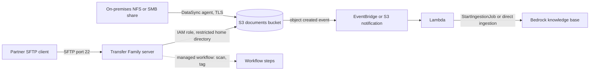

## 0. Before you start
- **Essential:** what S3 is; what a file share (NFS, SMB) and an SFTP server are.
- **Helpful:** IAM roles; VPC endpoints; cron-style scheduling.
- **Optional advanced:** checksums; Snow Family (not covered here).

## 1. Simple explanation
A RAG system is only as good as the documents that reach it. Those documents often start on an office file server, in another cloud, or on a partner's SFTP site. **DataSync** copies large amounts of data between storage systems quickly and checks that every file arrived intact. **Transfer Family** gives partners and applications a ready-made SFTP (or FTPS, FTP, AS2 or web) door that lands files straight in S3 or EFS, so nobody has to run an SFTP server. After the files are in S3, the normal pipeline ([02/06](aip:02-data-management/06-s3-vectors-and-keeping-vector-stores-current)) turns them into searchable knowledge.


```figure
flow ingest-to-kb
```

## 2. Structured explanation
1. **DataSync** ✅: moves file or object data between on-premises storage (NFS, SMB, HDFS, object storage), AWS storage (S3, EFS, FSx for Windows File Server, Lustre, OpenZFS, NetApp ONTAP) and other clouds (Google Cloud Storage, Azure Blob and Files and others).
2. **Transfer Family** ✅: managed SFTP, FTPS, FTP, AS2 and browser-based (web app) access to **S3** or **EFS**; managed workflows process files after upload.
3. **Pipeline** 🟡: DataSync or Transfer Family → S3 → event → processing (Textract, Lambda) → knowledge base or vector store.

## 3. Analogy
**A moving company and a mailroom.** DataSync is the moving crew with a checklist: it carries boxes from one building to another, only the new ones on later trips, and counts every box on arrival. Transfer Family is the receptionist at the new building who still accepts packages the old way (SFTP) from partners who refuse to change, and places them on the right shelf (S3 prefix).

*Where it breaks:* movers do not reorganize what is in the boxes (DataSync copies; it does not parse or convert documents); and the receptionist does not decide what is allowed in a document (scanning and validation are steps you add with workflows).

## 4. The seven questions

**WHAT?** Bulk and scheduled data movement (DataSync) and managed file-transfer endpoints (Transfer Family).

**WHY?** Move an existing document estate or recurring partner files into AWS without custom scripts, with encryption and integrity checks, and without running servers.

**WHEN?**
| Need | Pick |
|---|---|
| One-time or recurring bulk copy from NFS or SMB shares or another cloud into S3 | DataSync |
| Copy between S3, EFS and FSx, or across Regions | DataSync ✅ |
| Partners must keep using SFTP, FTPS or FTP | Transfer Family |
| B2B EDI messages with AS2 | Transfer Family AS2 ✅ |
| Business users upload and download through a browser | Transfer Family web apps ✅ |
| Real-time application-to-application data | Kinesis, MSK or API calls ([09/01](aip:09-other-services/01-analytics-athena-emr-quick-sight-kinesis-and-msk)) |
| SaaS data (Salesforce, Slack...) | AppFlow ([06/08](aip:06-app-building-tools/08-sqs-eventbridge-sns-and-appflow)) |

**WHERE?** Regional; DataSync between AWS storage services in the same account needs **no agent** and stays on the AWS network ✅; on-premises needs an agent VM ✅; Transfer Family supports up to **three Availability Zones** ✅.

**HOW?** §5.

**WHAT IF?**
| Situation | Effect | Remedy |
|---|---|---|
| Source object is in an archival S3 class and not restored | DataSync skips it ✅ | Restore first |
| A file is locked by the source server | Skipped and logged ✅ | Retry after unlock |
| A file changes during transfer | Verification can detect it; run the task again ✅ | Schedule after hours |
| Source and destination differ in content | Verification errors such as `Checksum failure` ✅ | Investigate, rerun |
| Cross-Region copy | You pay data transfer out from the source Region ✅ | Plan Regions |
| SFTP user can see other users' folders | Missing restriction ✅ | Use **Restricted** home directory and a session policy |
| Uploaded file is malware | It lands in S3 | Add scanning in a workflow or a GuardDuty-based process 🟡 (blog titles on the page ✅) |

**WHY NOT?** Do not write a custom cron plus `rsync` for large recurring copies. Do not run your own SFTP server on EC2 just to land files in S3. Do not use DataSync for streaming events.

## 5. Technical depth

### 5.1 DataSync ✅ (`what-is-datasync.html`, `how-datasync-works.html`)
- **Use cases:** migrate active data, archive cold data (for example to S3 Glacier Flexible Retrieval or Deep Archive), replicate data, and move data for in-cloud processing such as machine learning ✅.
- **Concepts:** **agent** (VM on VMware ESXi, KVM, Nutanix AHV or Hyper-V, or an EC2 instance for storage in a VPC); **location** (source or destination); **task** (source, destination, options for metadata, deleted files, permissions); **task execution** (one run) ✅.
- **Task modes** ✅: **Basic** prepares, transfers and verifies sequentially (inventory items count toward task quotas); **Enhanced** does these in parallel and can prepare virtually unlimited objects, verifying only transferred data. A separate agent type exists for each mode ✅.
- **A run** ✅: prepare (scan and compare source and destination), transfer (with chosen metadata, filters, bandwidth limit), verify (checksums and metadata). Options: transfer only changed data or everything, overwrite or not, delete destination data missing from the source, **schedule** recurring runs.
- **Security** ✅: TLS in transit, integrity validation, IAM roles for AWS storage, **VPC endpoints** to avoid the public internet.
- **Speed** ✅: purpose-built protocol and parallel, multi-threaded architecture. Prices and limits ❌ not read.
- **GenAI angle** 🟡: bring an on-premises document share into S3 once, then keep it current with scheduled "changed data only" runs before a knowledge-base sync.

### 5.2 Transfer Family ✅ (`what-is-aws-transfer-family.html`, `getting-started.html`)
- **Protocols** ✅: SFTP (version 3), FTPS, FTP, AS2 and browser-based transfers (web apps). FTP and FTPS data channels use ports 8192–8200. SFTP uses port 22 in the tutorial ✅.
- **Storage** ✅: S3 or EFS; benefits: managed, scales in real time, no application changes; S3 gives access to native processing, analytics and archival services.
- **Server setup** ✅ (tutorial): choose protocols → identity provider (**service managed** stores users and keys in Transfer Family; custom providers exist) → endpoint (**publicly accessible** or VPC) → domain (S3 or EFS) → security policy (latest is default) → create; wait for **Online**.
- **Users** ✅: username 3–100 characters; IAM **role** with S3 access and a trust relationship to Transfer Family; **home directory**; **Restricted** setting prevents access outside the home directory and hides bucket names; **session policy** limits a user to their home directory (use a path containing the username); SSH public key for service-managed users.
- **Managed workflows (MFTW)** ✅: serverless workflows to copy, tag, scan, filter, compress or decompress, and encrypt or decrypt files after upload, with tracking and auditability.
- **Web apps** ✅ (announced 1 December 2024): fully managed browser access to S3, including S3 Access Grants views.
- **Integrations in blog titles** 🟡 (not read): GuardDuty malware protection, PGP, Cognito, Okta, Secrets Manager password auth, WAF with API Gateway, Global Accelerator, S3 access points.


*Reading the arrows:* DataSync pulls from a local share through an agent over TLS into S3. Partners upload with SFTP to Transfer Family, which writes into S3 through an IAM role limited to the partner's folder (optionally running scan and tag steps). New objects raise events that start a Lambda function, which asks the knowledge base to ingest them (see [Kinesis page, direct ingestion](aip:09-other-services/01-analytics-athena-emr-quick-sight-kinesis-and-msk)).

## 6. Worked example
*Problem:* a law firm has 4 TB of case files on an on-premises SMB share and receives new documents from three partner firms by SFTP. They want a Bedrock knowledge base that is current within an hour, and no partner may see another's files.

| Step | Design | Why |
|---|---|---|
| 1 | DataSync agent on-premises; location SMB → S3 bucket `cases/`; first run transfers all data, with verification | Bulk load with integrity checks ✅ |
| 2 | Hourly DataSync schedule, "transfer only changed data" | Cheap recurring sync ✅ |
| 3 | Transfer Family SFTP server with service-managed users, one per partner, **Restricted** home directories `partner-a/`, session policy | Isolation ✅ |
| 4 | Managed workflow scans and tags uploads; then S3 event triggers knowledge-base ingestion | Safe, fresh ✅ 🟡 |
| 5 | VPC endpoint for DataSync, S3 encryption with KMS | Private path, encryption ✅ |
| 6 | CloudWatch alarms on failed task executions and failed ingestion | Operations ([07/03](aip:07-governance-qa/03-cloudwatch-logs-alarms-rum-and-genai-observability)) |

## 7. Knowledge checkpoints
1. Which DataSync object represents one run of a transfer?
2. When is a DataSync agent not required?
3. Which protocols does Transfer Family support?
4. Which two storage services can back a Transfer Family server?
5. What does the **Restricted** user option do?

## 7b. Practice questions (exam-style, original) — answers in §14

**Q1.** A company wants to copy 50 TB from an on-premises NFS server to S3, verifying integrity, and then run nightly copies of changes only. Which service?
A. AWS DataSync
B. AWS Transfer Family
C. Amazon Kinesis Data Streams
D. Amazon Lex

**Q2.** (Select TWO) Which statements about DataSync are correct?
A. It can transfer between AWS storage services in the same account without an agent
B. It performs data integrity validation
C. It only supports on-premises sources
D. It parses PDFs into text chunks
E. It requires an agent for every transfer

**Q3.** Partners must continue using SFTP, and files must land in S3 with no servers managed by the company. Which?
A. AWS Transfer Family
B. AWS DataSync agent only
C. Amazon Rekognition
D. AWS Direct Connect

**Q4.** (Select TWO) Which are true of Transfer Family?
A. It supports SFTP, FTPS, FTP, AS2 and browser-based transfers
B. It can use Amazon S3 or Amazon EFS as storage
C. It supports only HTTP
D. It stores files only on local disks of an EC2 instance you manage
E. It cannot run post-upload processing steps

**Q5.** An SFTP user must not see anything outside their own folder or the bucket name. What should the administrator configure?
A. A home directory with the Restricted option (and a session policy)
B. A public bucket
C. Root access to the bucket
D. A larger instance type

**Q6.** A DataSync run skips some objects in S3 Glacier Deep Archive. Why?
A. Archived objects that are not restored cannot be read
B. DataSync never supports S3
C. The objects are encrypted
D. The agent is offline

**Q7.** A file is being written while DataSync copies it. What happens?
A. Verification can detect the inconsistency and a rerun picks up the latest version
B. DataSync silently locks the file for the writer
C. The task is deleted
D. The file is encrypted twice

**Q8.** Which statement about moving data between Regions with DataSync is correct?
A. You pay for data transfer out from the source Region
B. It is free in all cases
C. It cannot be done
D. It always requires an agent

## 7c. Mixed review for Quiz 15 (migration and transfer) — answers in §14
1. What are the two DataSync task modes? 2. Which Transfer Family feature automates scan, tag and compress steps? 3. Which port does the SFTP tutorial use? 4. Name two non-AWS clouds DataSync can use. 5. Which service would you choose for streaming events rather than files?

## 8. Hands-on lab: sync diff and verification, archived-object skipping, restricted SFTP paths (offline) + console steps

### 8.1 Objective
Model a DataSync task (prepare, transfer only changed data, optional delete, verify with checksums), see archived objects skipped, and check an SFTP user's path against a restricted home directory.

### 8.2 Prerequisites
Python 3 (standard library). Optional AWS part: an S3 bucket, a source file share or a second bucket, and permissions for DataSync and Transfer Family.

### 8.3 AWS services
Offline: none. Optional: DataSync, Transfer Family, S3, IAM, CloudWatch.

### 8.4 IAM permissions
Offline: none. Real: a DataSync location role for S3 (access to the bucket); a Transfer Family user role with S3 access and a trust policy for Transfer Family ✅; console permissions `AWSTransferConsoleFullAccess` for the tutorial ✅ (use narrower policies in production).

### 8.5 Region notes
Create the DataSync task and the destination bucket in the Regions you intend; cross-Region copies incur data transfer charges ✅.

### 8.6 Architecture
§5.2 diagram.

### 8.7 Cost
Offline: none. Real: DataSync per-GB charges and data transfer ❌ (rates not read), Transfer Family per-hour endpoint and per-GB charges ❌ (the page says "pay only for the use of the service" ✅), S3 storage. Delete the server and tasks after the lab: a running server keeps billing.

### 8.8 Code
**Simplification:** DataSync's real preparation, parallelism and checks are far richer; this model uses MD5 checksums of small made-up files and the documented skip and verify rules. The path check mimics the "Restricted" home directory idea, not Transfer Family's implementation.

```python lab-run
import hashlib, posixpath

def md5(text):
    return hashlib.md5(text.encode()).hexdigest()

# ---------- 1. A DataSync-style task: prepare, transfer changed data only, optionally delete, verify ----------
SOURCE = {"cases/a.pdf": "alpha v1", "cases/b.pdf": "bravo v1", "cases/c.pdf": "charlie v1", "cases/old-archive.pdf": "archived text"}
ARCHIVED_AND_NOT_RESTORED = {"cases/old-archive.pdf"}
dest = {"cases/a.pdf": "alpha v1", "cases/b.pdf": "bravo OLD", "cases/stale.pdf": "no longer in source"}
def run_task(source, dest, delete_extra=False, only_changed=True, corrupt=None):
    log = []
    to_transfer = []
    for key, data in sorted(source.items()):
        if key in ARCHIVED_AND_NOT_RESTORED:
            log.append(f"skip     {key} (archived and not restored)")
            continue
        if only_changed and key in dest and md5(dest[key]) == md5(data):
            log.append(f"unchanged {key}")
            continue
        to_transfer.append(key)
    for key in to_transfer:
        dest[key] = source[key] if key != corrupt else source[key] + " <bit flip>"
        log.append(f"transfer {key}")
    if delete_extra:
        for key in sorted(set(dest) - set(source)):
            del dest[key]
            log.append(f"delete   {key} (not in source)")
    failures = [k for k in to_transfer if md5(dest[k]) != md5(source[k])]
    log.append("verify   " + ("OK: all transferred objects match" if not failures else f"FAILED: checksum failure on {failures}"))
    return log
print("1) first run, changed data only, no delete")
for line in run_task(SOURCE, dest):
    print("  ", line)
print("   destination after run 1:", sorted(dest))
print("2) second run with delete enabled and a simulated corruption on c.pdf")
dest.pop("cases/c.pdf")
for line in run_task(SOURCE, dest, delete_extra=True, corrupt="cases/c.pdf"):
    print("  ", line)
print("3) third run, nothing changed")
dest["cases/c.pdf"] = SOURCE["cases/c.pdf"]
for line in run_task(SOURCE, dest, delete_extra=True):
    print("  ", line)

# ---------- 4. Restricted SFTP home directories ----------
def allowed(home, requested):
    full = posixpath.normpath(posixpath.join(home, requested))
    return full == home.rstrip("/") or full.startswith(home.rstrip("/") + "/")
print("4) restricted home directory /uploads/partner-a")
for path in ["report.pdf", "2026/q1/report.pdf", "../partner-b/secret.pdf", "/uploads/partner-b/secret.pdf", "../../etc/passwd"]:
    print(f"   {path:<32}{'ALLOW' if allowed('/uploads/partner-a', path) else 'DENY'}")
```

### 8.9 Captured output
Generated on 2026-10-26 by extracting the block above from this file and running it (Python 3). It models documented rules with made-up data; it is **not** DataSync or Transfer Family output.
```text lab-out
1) first run, changed data only, no delete
   unchanged cases/a.pdf
   skip     cases/old-archive.pdf (archived and not restored)
   transfer cases/b.pdf
   transfer cases/c.pdf
   verify   OK: all transferred objects match
   destination after run 1: ['cases/a.pdf', 'cases/b.pdf', 'cases/c.pdf', 'cases/stale.pdf']
2) second run with delete enabled and a simulated corruption on c.pdf
   unchanged cases/a.pdf
   unchanged cases/b.pdf
   skip     cases/old-archive.pdf (archived and not restored)
   transfer cases/c.pdf
   delete   cases/stale.pdf (not in source)
   verify   FAILED: checksum failure on ['cases/c.pdf']
3) third run, nothing changed
   unchanged cases/a.pdf
   unchanged cases/b.pdf
   unchanged cases/c.pdf
   skip     cases/old-archive.pdf (archived and not restored)
   verify   OK: all transferred objects match
4) restricted home directory /uploads/partner-a
   report.pdf                      ALLOW
   2026/q1/report.pdf              ALLOW
   ../partner-b/secret.pdf         DENY
   /uploads/partner-b/secret.pdf   DENY
   ../../etc/passwd                DENY
```

### 8.10 Explanation
- Part 1: unchanged files are not re-sent, archived objects are skipped, and a new or changed file is copied ✅.
- Part 2: delete mode removes destination-only data; a corrupted copy is caught by checksum verification, matching the documented `Checksum failure` ✅.
- Part 3: with nothing changed, only verification remains.
- Part 4: path traversal tricks such as `../` leave the home directory and are denied (the intent of the Restricted option and a session policy ✅).

### 8.11 Optional AWS labs (shown, not run against AWS ❌)
**DataSync (285):** console → DataSync → Create task → source location (for example S3 bucket A) → destination location (S3 bucket B) → choose task mode and options (changed data only, verify transferred data) → start execution → watch the PREPARING, TRANSFERRING and VERIFYING statuses ✅ (phases from the page; click path 🟡). On-premises sources need an agent first ✅.
**Transfer Family (286):** follow the page's tutorial ✅: create an SFTP server with S3 storage and a service-managed user, set a restricted home directory, generate an SSH key pair, connect with `sftp -i transfer-key user@endpoint`, `put` a file, check it in S3. **Delete the server afterwards.**

### 8.12 Common errors
| Error | Cause | Fix |
|---|---|---|
| Task stays unable to start | Agent offline or no network path ✅ | Check agent status, endpoint, firewall |
| Archived objects not copied | Not restored ✅ | Restore objects first |
| `Checksum failure` or `Metadata failure` | Source changed or copy damaged ✅ | Rerun, check source activity |
| Files skipped | Source permissions or locks ✅ | Fix permissions, rerun |
| SFTP login fails | Key mismatch, user missing, or role trust wrong ✅ | Check key format (`ssh-rsa ...`), IAM role trust |
| User sees other folders | No Restricted setting ✅ | Enable it, add session policy |
| Unexpected bill | Server left running | Delete unused servers |

### 8.13 Security recommendations
Use VPC endpoints for DataSync where possible ✅; encrypt S3 with KMS ([08/03](aip:08-security/03-kms-secrets-manager-macie-and-bedrock-data-protection)); one IAM role and home directory per partner; prefer SFTP/FTPS over plain FTP; allow-list partner IPs 🟡 (blog title ✅); scan uploads before ingestion; log transfers and review them; do not keep unneeded long-lived keys ([09/04](aip:09-other-services/04-developer-tools-cdk-cli-sdk-cloudformation-and-codeartifact)); mask personal data before it reaches a knowledge base ([08/01](aip:08-security/01-least-privilege-iam-identity-center-and-data-masking)).

## 9. What can go wrong?
| Failure | Why | Symptoms | Investigate | Fix | Prevent |
|---|---|---|---|---|---|
| **Incomplete migration** | Skipped files ✅ | Missing documents | Task logs | Fix cause, rerun | Verify counts |
| **Stale knowledge base** | Files in S3 but not ingested | Old answers | Ingestion jobs | Trigger sync | Event-driven ingest |
| **Data transfer cost surprise** | Cross-Region copy ✅ | Bill | Cost Explorer | Same-Region design | Plan |
| **Partner sees other data** | Wide role | Privacy incident | Role and home directory | Restrict | Per-partner roles |
| **Malicious upload** | No scanning | Malware in S3 | GuardDuty, scan logs | Quarantine | Workflow scan |
| **Server cost left on** | Forgotten endpoint | Charges | Console | Delete | Tags and budgets |
| **Corrupted copy unnoticed** | Verification off 🟡 | Bad files | Compare checksums | Enable verification ✅ | Defaults |

## 10. Common misconceptions
1. **"DataSync always needs an agent."** Not between AWS storage services in one account ✅.
2. **"Transfer Family is just FTP."** It also does SFTP, FTPS, AS2 and web apps, with workflows ✅.
3. **"DataSync converts or parses documents."** It copies data ✅.
4. **"Verification is optional magic."** Integrity checks always run during the transfer; extra end checks are configurable ✅.
5. **"Cross-Region DataSync is free."** Data transfer out of the source Region is billed ✅.
6. **"SFTP users are isolated by default."** You must restrict home directories ✅.

## 11. Exam notes
- **Patterns:** "bulk or scheduled copy from on-premises NFS/SMB or another cloud to S3" → DataSync; "partners need SFTP into S3" → Transfer Family; "EDI with AS2" → Transfer Family AS2; "SaaS to S3" → AppFlow; "streaming" → Kinesis/MSK; "offline petabyte transfer" → Snow Family (not covered ❌).
- **Keywords:** agent, location, task, task execution, Basic/Enhanced mode, verify, service-managed user, Restricted, home directory, session policy, managed workflow.
- **Traps:** using Transfer Family for bulk migration; forgetting to restore archived objects; assuming SFTP folder isolation; running servers you do not need.
- **Compare:** DataSync vs Transfer Family vs S3 replication vs AppFlow vs Storage Gateway (not read ❌).

## 12. Summary and revision cards
- DataSync = fast, verified copy between storage systems (agent for on-premises; Basic vs Enhanced modes); Transfer Family = managed SFTP/FTPS/FTP/AS2/web to S3 or EFS with workflows.

**Cards.** Q: DataSync run phases? A: prepare, transfer, verify. · Q: Restricted option? A: Keeps users inside their home directory and hides bucket names. · Q: Agent needed between AWS services in one account? A: No.

## 13. References
| Source | URL | Verified |
|---|---|---|
| What is AWS DataSync | https://docs.aws.amazon.com/datasync/latest/userguide/what-is-datasync.html | 2026-10-26 |
| How AWS DataSync works | https://docs.aws.amazon.com/datasync/latest/userguide/how-datasync-works.html | 2026-10-26 |
| What is AWS Transfer Family | https://docs.aws.amazon.com/transfer/latest/userguide/what-is-aws-transfer-family.html | 2026-10-26 |
| Getting started with Transfer Family servers | https://docs.aws.amazon.com/transfer/latest/userguide/getting-started.html | 2026-10-26 |

**Unverified here:** all prices and quotas; DataSync bandwidth and filter option names, agent sizing and task mode selection page; Transfer Family security policies, custom identity providers, workflow step details, web app configuration; Snow Family and Storage Gateway.

## 14. Answers to checkpoints and practice questions
**Checkpoints.** 1) A task execution ✅. 2) When transferring between AWS storage services in the same account (and in some other-cloud cases) ✅. 3) SFTP, FTPS, FTP, AS2 and browser-based (web app) transfers ✅. 4) Amazon S3 and Amazon EFS ✅. 5) It prevents users from accessing anything outside their home directory and hides bucket and folder names ✅.

**Practice questions.**
- **Q1 → A.** ✅
- **Q2 → A, B.** C false, D false, E false ✅.
- **Q3 → A.** ✅
- **Q4 → A, B.** C, D false; E false (managed workflows) ✅.
- **Q5 → A.** ✅
- **Q6 → A.** ✅
- **Q7 → A.** ✅ DataSync cannot lock or unlock files.
- **Q8 → A.** ✅

**Mixed review (§7c).** 1) Basic and Enhanced ✅. 2) Managed workflows (MFTW) ✅. 3) Port 22 ✅. 4) Any two of Google Cloud Storage, Azure Blob Storage, Wasabi, Oracle Cloud Infrastructure Object Storage, Cloudflare R2 and others on the page ✅. 5) Kinesis Data Streams or MSK ✅.
