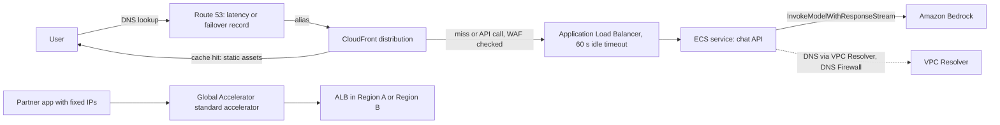

## 0. Before you start
- **Essential:** what DNS does (turns a name into an address); what HTTP is; what a load balancer is.
- **Helpful:** TCP vs UDP; TLS certificates; HTTP caching headers (`Cache-Control`).
- **Optional advanced:** anycast routing; DNS resolvers and forwarding rules.

## 1. Simple explanation
When a chat app has users around the world, four things matter: finding the app (DNS), reaching it quickly (fast network path), sharing the work (load balancing), and not asking the origin for things it already answered (caching). **Route 53** answers "where is the app?" and can steer users to the closest or healthiest Region. **Global Accelerator** gives users two fixed addresses and carries their traffic over AWS's own network. **CloudFront** serves cached content from locations near users and also fronts dynamic APIs. **Elastic Load Balancing** spreads requests across servers or containers inside a Region. For GenAI apps there is one extra trap: model answers stream slowly, and every layer has a **timeout**. If a timeout is shorter than your model's pause, users see errors.


```figure
flow global-delivery
```

## 2. Structured explanation
1. **CloudFront** ✅: CDN with edge locations; origins S3, HTTP servers, load balancers, API Gateway, MediaPackage; cache behaviors, cache policies and TTLs; signed URLs/cookies; origin access control for S3; Lambda@Edge triggers; response and keep-alive timeouts.
2. **Elastic Load Balancing** ✅: Application (HTTP/HTTPS), Network, Gateway load balancers (Classic is the previous generation); health checks; cross-zone balancing; integrates with ACM, WAF, Auto Scaling, Global Accelerator, Route 53.
3. **Global Accelerator** ✅: **standard** accelerators (two static anycast IPv4 addresses, health-based routing to ALB, NLB, EC2 or Elastic IP endpoints in one or more Regions) and **custom routing** accelerators; traffic dials and endpoint weights.
4. **Route 53** ✅: domain registration, DNS routing (routing policies, health checks), plus **VPC Resolver** (formerly Route 53 Resolver), **Resolver DNS Firewall**, Traffic Flow and Profiles.

## 3. Analogy
**An airport.** Route 53 is the departures board that tells you which gate (Region) to use. Global Accelerator is the dedicated express lane from the curb to the gate: you enter at the nearest door and never leave the airport's private corridors. CloudFront is the duty-free shop near every terminal that already stocks popular items. The load balancer is the gate agent who sends passengers to open seats on the plane.

*Where it breaks:* the duty-free shop cannot stock a unique answer for each passenger, so one-of-a-kind model replies are not cached; and every corridor has a door that closes if nobody walks through for a while (idle timeouts).

## 4. The seven questions

**WHAT?** Edge delivery (CloudFront), traffic distribution (ELB), network acceleration and fixed IPs (Global Accelerator), and DNS (Route 53).

**WHY?** Lower latency for global users, high availability with health-based failover, protection at the edge (WAF, TLS), lower origin load, and DNS that works inside and outside your VPCs.

**WHEN?**
| Need | Pick |
|---|---|
| Cache static front-end files and public documents globally | CloudFront ✅ |
| Add WAF, TLS and a global edge in front of a dynamic API | CloudFront in front of ALB or API Gateway ✅ |
| HTTP routing inside a Region to containers or Lambda | Application Load Balancer ✅ |
| TCP/UDP or very high throughput, static IPs per zone | Network Load Balancer ✅ (type description; details ❌) |
| Fixed global IPs, TCP/UDP, fast regional failover without DNS caching | Global Accelerator ✅ |
| Route users by latency, weights or health at the DNS layer | Route 53 routing policies ✅ |
| Resolve private names between a VPC and on-premises | Route 53 VPC Resolver endpoints and rules ✅ |
| Block agents from resolving unwanted domains | Resolver DNS Firewall ✅ |

**WHERE?** CloudFront, Route 53 and Global Accelerator are global services (Global Accelerator "is a global service that supports endpoints in multiple AWS Regions" ✅); ELB is Regional.

**HOW?** §5.

**WHAT IF?**
| Situation | Effect | Remedy |
|---|---|---|
| A model's first token takes 40 s and CloudFront response timeout is the 30 s default | Viewer gets HTTP 504 ✅ | Shorter first-token path, raise the timeout (quota request) ✅, stream earlier |
| A stream pauses longer than the response timeout between packets | CloudFront closes the connection ✅ | Send periodic data (heartbeat events) |
| POST chat requests go through CloudFront | POST responses are **not cached** ✅ | Cache only static assets and public GETs |
| Cache key includes every header and cookie | Cache hit ratio collapses ✅ | Include only values that change the response |
| ALB idle timeout is 60 s and a connection is quiet | Connection closed ✅ | Raise the attribute or send keep-alive data |
| Global Accelerator TCP connection idle more than 340 s | Closed; TCP keep-alives do not count ✅ | Send at least one byte of data |
| Endpoint becomes unhealthy | New connections go elsewhere; established connections continue until idle timeout ✅ | Short-lived connections, retries |
| Route 53 answer is cached by resolvers | Failover waits for TTL 🟡 | Low TTL or Global Accelerator |

**WHY NOT?** Do not cache responses that contain user-specific or personal answers at a shared edge. Do not put CloudFront in front of a WebSocket or streaming API without checking timeouts. Do not choose Global Accelerator just to cache (it does not cache) ✅ (it routes over the AWS network).

## 5. Technical depth

```figure
route53-routing
```


### 5.1 CloudFront ✅ (`Introduction.html`, `Expiration.html`, `controlling-the-cache-key.html`, `DownloadDistValuesCacheBehavior.html`, `DownloadDistValuesOrigin.html`)
- **Delivery:** requests go to the lowest-latency **edge location**; a hit is served immediately, a miss is fetched from the **origin** and cached. A **distribution** holds origins and cache behaviors; CloudFront gives it a domain name (custom domains possible); **standard** and **multi-tenant** (SaaS Manager) distribution types exist ✅.
- **Cost note** ✅: data transfer from an AWS origin (S3, ELB, API Gateway) **to CloudFront is free**; you pay for transfer from CloudFront to viewers and for requests (rates ❌).
- **Cache key and cache policy** ✅: the cache key identifies each cached object; a **cache policy** chooses which headers, cookies and query strings are in it and sets TTLs and compression; **fewer values in the key means more hits**; legacy settings: forwarding all headers means nothing is cached; forwarding cookies reduces cacheability (S3 ignores cookies).
- **TTLs** ✅: default **24 hours** (86,400 s) when no header, minimum 0 (or a set minimum), maximum default one year; `Cache-Control: max-age` or `s-maxage` or `Expires` from the origin decide per object within min and max (full table in the lab); `no-cache`/`no-store`/`private` are respected unless **minimum TTL > 0**; `stale-while-revalidate` and `stale-if-error` are supported; viewer `Cache-Control` or `Pragma` headers cannot force a refetch.
- **Methods** ✅: **GET and HEAD** responses are always cached, `OPTIONS` optionally; responses to other methods (`POST`, `PUT`, ...) **are not cached**; to forward them you choose "GET, HEAD, OPTIONS, PUT, POST, PATCH, DELETE" and must lock down the origin.
- **Origin timeouts** ✅: **response timeout** (default **30 s**) applies both to waiting for the first response and to the gap between packets; for GET/HEAD it retries per connection attempts (1–3, default 3, connection timeout 1–10 s, default 10), for POST/PUT/PATCH/DELETE/OPTIONS it **does not retry**; **response completion timeout** is a hard ceiling for the full response (must be at least the response timeout); **keep-alive timeout** default 5 s; quotas can be raised on request and origins must then be updated ✅.
- **Security** ✅: viewer protocol policy (HTTP and HTTPS, redirect, HTTPS only); S3 **origin access control** (recommended) so only the distribution can read the bucket; **signed URLs and signed cookies** with trusted signers for private content; field-level encryption; AWS WAF integration ([08/04](aip:08-security/04-cognito-and-aws-waf)); Lambda@Edge events (viewer request/response, origin request/response).
- **GenAI patterns** (closes the earlier open item "CloudFront caching for GenAI" ✅ for the documented mechanics; the pattern guidance is 🟡):
  1. Cache the web front end and public static knowledge pages with long TTLs.
  2. Serve private document downloads (citations) with signed URLs.
  3. Put CloudFront in front of the API for TLS, WAF and a global edge, with caching disabled for POST `/chat` (it would not be cached anyway).
  4. For GET endpoints that return identical answers for everyone (for example "list of available assistants"), add a short TTL and a minimal cache key.
  5. For streaming answers, set response timeout above your worst first-token delay and send regular events.
- **Not read** ❌: streaming/SSE behavior specifics, continuous deployment, Origin Shield details, Functions vs Lambda@Edge limits, prices.

### 5.2 Elastic Load Balancing ✅ (`what-is-load-balancing.html`, `application-load-balancers.html`)
- Distributes traffic to **targets** (EC2 instances, containers, IP addresses) across one or more AZs; **health checks** send traffic only to healthy targets; scales automatically; types: **Application, Network, Gateway**; Classic is previous-generation (migrate) ✅.
- **ALB structure:** listeners → rules → target groups → targets; must enable **at least two** AZ subnets; each subnet needs a `/27` or larger CIDR and at least eight free IPs to scale; security groups must allow listener and health-check ports in both directions ✅.
- **Attributes (defaults)** ✅: **idle timeout 60 s**; client keep-alive 3600 s; access logs off; deletion protection off; HTTP/2 on; `X-Forwarded-For` mode `append`; drop invalid header fields off; desync mitigation `defensive`; WAF fail-open off. Cross-zone balancing is always on at the ALB level.
- **Local Zone and Outposts** ✅: Lambda targets, mutual TLS and WAF are not available on Local Zone subnets; Outposts subnets lack Global Accelerator, sticky sessions, user authentication, WAF and more.
- **Integrations** ✅: ACM certificates, WAF (web ACLs), Auto Scaling, ECS, CloudWatch, Global Accelerator, Route 53 alias records; ALB authentication supports only IPv4 to reach an IdP or Cognito endpoint ✅.
- **Not read** ❌: Network and Gateway Load Balancer details, WebSocket and streaming behavior, Lambda targets, OIDC authentication setup, target group algorithms, prices.

### 5.3 Global Accelerator ✅ (`what-is-global-accelerator.html`, `introduction-how-it-works.html`)
- **Static IPs:** two static IPv4 (four with dual-stack), **anycast** from the AWS edge network; optional BYOIP; the addresses stay while the accelerator exists, **deleting it releases them** ✅.
- **Standard accelerator:** routes to **ALB, NLB, EC2 instances or Elastic IPs** in one or many Regions, choosing the optimal endpoint by location, health and weights; terminates TCP at the edge and opens a new connection to the endpoint; continuous **health checks**, instant failover for **new** connections ✅.
- **Traffic dial** (per endpoint group; percentage of traffic already directed to that group, the rest goes to other groups) and **endpoint weights** (per endpoint, default 128 of max 255) ✅ for blue/green, A/B testing and multi-Region rollout.
- **Custom routing accelerator:** maps a user to a specific EC2 instance and port in a VPC subnet; no health checks or failover; IPv4 only ✅.
- **Idle timeouts (not configurable)** ✅: **340 s TCP**, **30 s UDP**; you must send at least one byte (TCP keep-alives do not count); established connections stay on their endpoint until the timeout even if it turns unhealthy.
- Security groups and WAF rules keep working; ICMP cannot be blocked at the accelerator; it respects ARC zonal shift and VPC Block Public Access ✅.
- **GenAI angle** 🟡: fixed IPs for partner allow-lists, faster multi-Region failover for a Region-bound model or agent endpoint; it does not cache.

### 5.4 Route 53 ✅ (`Welcome.html`, `routing-policy.html`, `resolver.html`)
- **Three functions:** domain registration, DNS routing, health checking ✅.
- **Routing policies** ✅: **simple**, **failover** (active-passive), **geolocation** (user location), **geoproximity** (resource location with shifting), **latency** (best Region), **IP-based** (client IP ranges), **multivalue answer** (up to eight healthy records at random), **weighted** (proportions). Most also work in private hosted zones. Health checks send automated requests and can route away from unhealthy resources ✅.
- **Other features** ✅: **Traffic Flow**, **Profiles** (share DNS configuration across VPCs and accounts), **Resolver DNS Firewall** (domain lists and rules filtering **outbound** DNS from a VPC), **Route 53 Resolver on Outposts**.
- **VPC Resolver** ✅ (closes the earlier ❌ for Route 53 Resolver): previously named **Route 53 Resolver**, renamed when **Route 53 Global Resolver** was introduced; present by default in every VPC at the **VPC+2** address; answers VPC-local names, **private hosted zone** records and, recursively, public names; for hybrid DNS use **inbound endpoints** (on-premises → VPC), **outbound endpoints** (VPC → on-premises) and **forwarding rules** (one per domain, shareable across accounts) over VPN or Direct Connect.
- **GenAI angle** 🟡: latency or weighted records across Regional model gateways; failover record plus health check for a standby Region; private hosted zones for internal agent services; DNS Firewall to limit which domains an agent runtime can resolve; interface endpoints use private DNS so SDK calls resolve to endpoint addresses ([08/05](aip:08-security/05-vpc-privatelink-and-network-security)).


*Reading the arrows:* the user's DNS lookup is answered by Route 53 with the CloudFront name. CloudFront returns cached static assets directly and forwards API calls (after WAF) to the ALB, which spreads them over ECS tasks that stream from Bedrock; every hop has its own timeout. A partner that needs fixed IPs enters through Global Accelerator, which picks a healthy Regional ALB. The ECS tasks resolve names through the VPC Resolver, where DNS Firewall rules can filter outbound lookups.

## 6. Worked example
*Problem:* a global support assistant has a React front end, a streaming chat API on ECS behind an ALB in two Regions, public help articles, and an enterprise partner that needs two fixed IPs to allow-list. First tokens can take up to 35 seconds with long contexts.

| Step | Design | Why |
|---|---|---|
| 1 | Front end and help articles in S3 behind CloudFront with origin access control; long TTL and versioned file names | Caching static content ✅ |
| 2 | `/api/*` behavior forwards all methods to the ALB origin; caching not used; WAF attached; **origin response timeout raised above 35 s** (quota request) and the app sends an event every 10 s | Avoid 504 from the default 30 s ✅ |
| 3 | ALB idle timeout 120 s (attribute), HTTP/2 on, deletion protection on | Idle timeout default 60 s ✅ |
| 4 | Route 53 latency records (alias to CloudFront for users); health checks and failover to the second Region | Global routing ✅ |
| 5 | Global Accelerator with the two ALBs as endpoint groups for the partner; traffic dial 100/0 until a drill | Static IPs, fast failover ✅ |
| 6 | Resolver DNS Firewall on the VPC allows only approved domains | Contain agent egress ✅ |
| 7 | Signed URLs for private document citations | Private content ✅ |

## 7. Knowledge checkpoints
1. What is CloudFront's default TTL when the origin sends no headers?
2. What is the default origin response timeout, and what two waits does it cover?
3. What is the ALB idle timeout default?
4. What are the idle timeouts for TCP and UDP in Global Accelerator?
5. What was Route 53 Resolver renamed to?

## 7b. Practice questions (exam-style, original) — answers in §14

**Q1.** A streaming chat endpoint through CloudFront sometimes returns HTTP 504 when the model takes 45 seconds to start answering. What is the most direct cause?
A. The default origin response timeout (30 seconds) was exceeded
B. The CloudFront cache is full
C. Route 53 health checks failed
D. The ALB has too many listeners

**Q2.** (Select TWO) Which statements about CloudFront caching are correct?
A. Responses to GET and HEAD requests are cached
B. Responses to POST requests are not cached
C. Including every header in the cache key improves the hit ratio
D. Viewers can force a refresh with a `Cache-Control: no-cache` request header
E. The default TTL is 5 minutes

**Q3.** A partner needs two fixed global IP addresses to allow-list, with automatic failover between Regional ALBs. Which service?
A. AWS Global Accelerator
B. Amazon CloudFront signed URLs
C. Route 53 simple routing
D. A single Elastic IP

**Q4.** (Select TWO) Which are true of Global Accelerator?
A. It provides two static anycast IPv4 addresses by default
B. TCP connections idle for more than 340 seconds are closed
C. TCP keep-alive packets keep the connection open
D. It caches responses at the edge
E. Deleting the accelerator keeps its static IPs

**Q5.** A team wants to send 10% of DNS answers to a new Regional gateway and 90% to the current one. Which Route 53 routing policy?
A. Weighted
B. Geolocation
C. Multivalue answer
D. Simple

**Q6.** An ALB connection used for a long, quiet WebSocket-like exchange keeps being closed after one minute. Which setting should be reviewed first?
A. The load balancer idle timeout (default 60 seconds)
B. The target group name
C. The CloudFront price class
D. The KMS key policy

**Q7.** On-premises systems must resolve names in a VPC private hosted zone, and VPC workloads must resolve on-premises names. Which Route 53 features?
A. Resolver inbound endpoints, outbound endpoints and forwarding rules
B. Geoproximity routing
C. Weighted records only
D. CloudFront Functions

**Q8.** A security team wants to block an agent runtime from resolving unapproved domains. Which feature?
A. Route 53 Resolver DNS Firewall
B. S3 Transfer Acceleration
C. Elastic Load Balancing cross-zone balancing
D. CloudFront field-level encryption

## 7c. Mixed review for Quiz 16 (networking and content delivery) — answers in §14
1. Which load balancer types are current generation? 2. How does Global Accelerator's traffic dial differ from endpoint weights? 3. Which CloudFront setting caps the total time for a full origin response? 4. Which Route 53 policy returns up to eight healthy records? 5. Is data transfer from S3 to CloudFront billed?

## 8. Hands-on lab: TTL rules, cache-key hit ratio, streaming vs timeouts, traffic dials and weighted DNS (offline) + console steps

### 8.1 Objective
Apply the CloudFront TTL table, see how the cache key affects the hit ratio, test streaming patterns against CloudFront, ALB and Global Accelerator timeouts, compute traffic dial and weight splits, and model weighted and failover DNS answers.

### 8.2 Prerequisites
Python 3 (standard library). Optional AWS part: an S3 bucket or ALB, a domain name (optional), permissions for CloudFront, ELB, Global Accelerator and Route 53.

### 8.3 AWS services
Offline: none. Optional: CloudFront, S3, ELB, EC2 or ECS, Global Accelerator, Route 53, ACM.

### 8.4 IAM permissions
Offline: none. Real: permissions for the console workflows in each service (action lists ❌ not read); CloudFront access to an S3 bucket through an origin access control bucket policy ✅ (principle).

### 8.5 Region notes
CloudFront certificates for custom domains are issued in `us-east-1` 🟡 (standard behavior, not read ❌); ALBs and their targets must be in the same Region; Global Accelerator and CloudFront are global.

### 8.6 Architecture
§5.4 diagram.

### 8.7 Cost
Offline: none. Real: CloudFront transfer out and requests (origin-to-CloudFront transfer from AWS origins is free ✅), ALB hours and capacity units, Global Accelerator hourly fee and data transfer premium, Route 53 hosted zones and queries; prices ❌ not read. Delete distributions, load balancers and accelerators after the lab: an enabled Global Accelerator and ALB keep billing.

### 8.8 Code
**Simplification:** the TTL function follows the CloudFront expiration table ✅ for the cases listed; the streaming demo uses the documented defaults (CloudFront response timeout 30 s, ALB idle timeout 60 s, Global Accelerator TCP idle timeout 340 s) and made-up model gaps; DNS answers use a seeded random generator.

```python lab-run
import random

# ---------- 1. CloudFront TTL (from the expiration table): min_ttl, default_ttl, max_ttl, origin headers ----------
def cache_seconds(min_ttl, default_ttl, max_ttl, max_age=None, s_maxage=None, expires_in=None, no_store=False):
    if no_store:
        return min_ttl if min_ttl > 0 else 0
    ttl = s_maxage if s_maxage is not None else max_age if max_age is not None else expires_in
    if ttl is None:
        return max(min_ttl, default_ttl) if min_ttl > 0 else default_ttl
    return min(max(ttl, min_ttl), max_ttl)
print("1) CloudFront cache duration in seconds (min / default / max TTL)")
cases = [("no headers, min 0", dict(min_ttl=0, default_ttl=86400, max_ttl=31536000)),
         ("max-age=3600", dict(min_ttl=0, default_ttl=86400, max_ttl=31536000, max_age=3600)),
         ("max-age=3600, s-maxage=60", dict(min_ttl=0, default_ttl=86400, max_ttl=31536000, max_age=3600, s_maxage=60)),
         ("max-age=10 but min TTL 300", dict(min_ttl=300, default_ttl=86400, max_ttl=31536000, max_age=10)),
         ("max-age=9999999999, max TTL 1 day", dict(min_ttl=0, default_ttl=3600, max_ttl=86400, max_age=9999999999)),
         ("no-store, min 0", dict(min_ttl=0, default_ttl=86400, max_ttl=31536000, no_store=True)),
         ("no-store, min 60 (min wins)", dict(min_ttl=60, default_ttl=86400, max_ttl=31536000, no_store=True))]
for label, kwargs in cases:
    print(f"   {label:<36}{cache_seconds(**kwargs):>10}")

# ---------- 2. Cache key and hit ratio ----------
random.seed(3)
paths = [f"/help/article-{i}" for i in range(20)]
requests = []
for _ in range(2000):
    requests.append({"path": random.choice(paths), "lang": random.choice(["en", "de"]), "session": f"s{random.randint(1, 400)}", "utm": f"u{random.randint(1, 50)}"})
def hit_ratio(key_fn):
    seen, hits = set(), 0
    for r in requests:
        k = key_fn(r)
        hits += k in seen
        seen.add(k)
    return hits / len(requests)
print("2) hit ratio for 2,000 requests to 20 articles")
print(f"   key = path + language:             {hit_ratio(lambda r: (r['path'], r['lang'])):.1%}")
print(f"   key = path + language + utm param: {hit_ratio(lambda r: (r['path'], r['lang'], r['utm'])):.1%}")
print(f"   key = path + language + session:   {hit_ratio(lambda r: (r['path'], r['lang'], r['session'])):.1%}")

# ---------- 3. Streaming against timeouts ----------
CF_RESPONSE_TIMEOUT, ALB_IDLE, GA_TCP_IDLE = 30, 60, 340
def longest_silence(events):
    last, worst = 0, 0
    for t in events:
        worst = max(worst, t - last)
        last = t
    return worst
streams = {"first token at 12 s, steady tokens": [12 + i * 0.5 for i in range(40)],
           "first token at 40 s, steady tokens": [40 + i * 0.5 for i in range(40)],
           "first token at 40 s, heartbeat every 10 s": sorted([10, 20, 30] + [40 + i * 0.5 for i in range(40)]),
           "pause of 70 s mid-answer": [5, 6, 7, 77, 78, 79]}
print("3) longest silence versus documented defaults (CloudFront 30 s, ALB 60 s, Global Accelerator TCP 340 s)")
for name, events in streams.items():
    gap = longest_silence(events)
    verdict = [("CloudFront", gap > CF_RESPONSE_TIMEOUT), ("ALB", gap > ALB_IDLE), ("Global Accelerator", gap > GA_TCP_IDLE)]
    failing = [n for n, bad in verdict if bad] or ["none"]
    print(f"   {name:<44} longest silence {gap:>5.1f} s -> fails: {', '.join(failing)}")

# ---------- 4. Global Accelerator traffic dial and weights ----------
def dial_split(arrivals, dial_percent):
    accepted = arrivals * dial_percent // 100
    return accepted, arrivals - accepted
print("4) traffic dial: 100 requests directed to the nearest group")
for dial in (100, 50, 0):
    a, o = dial_split(100, dial)
    print(f"   dial {dial:>3}: accepted {a:>3}, sent to other groups {o:>3}")
def weights_split(weights, total=1000):
    s = sum(weights.values())
    return {k: round(total * w / s) for k, w in weights.items()}
print("   weights (default 128 each) :", weights_split({"endpoint-a": 128, "endpoint-b": 128}))
print("   weights 200 vs 56          :", weights_split({"endpoint-a": 200, "endpoint-b": 56}))

# ---------- 5. Route 53 weighted and failover answers ----------
random.seed(11)
def weighted(records, n=1000):
    names, w = zip(*records.items())
    picks = random.choices(names, weights=w, k=n)
    return {k: picks.count(k) for k in names}
print("5) weighted 90/10 over 1,000 DNS answers:", weighted({"current-gateway": 90, "new-gateway": 10}))
def failover(primary_healthy):
    return "primary-region" if primary_healthy else "secondary-region"
print("   failover, primary healthy:", failover(True), "| primary unhealthy:", failover(False))
print("   resolvers may cache the old answer until its TTL expires, so a low TTL speeds failover")
```

### 8.9 Captured output
Generated on 2026-10-26 by extracting the block above from this file and running it (Python 3). It models documented rules with made-up data; it is **not** CloudFront, ELB, Global Accelerator or Route 53 output.
```text lab-out
1) CloudFront cache duration in seconds (min / default / max TTL)
   no headers, min 0                        86400
   max-age=3600                              3600
   max-age=3600, s-maxage=60                   60
   max-age=10 but min TTL 300                 300
   max-age=9999999999, max TTL 1 day        86400
   no-store, min 0                              0
   no-store, min 60 (min wins)                 60
2) hit ratio for 2,000 requests to 20 articles
   key = path + language:             98.0%
   key = path + language + utm param: 37.9%
   key = path + language + session:   5.3%
3) longest silence versus documented defaults (CloudFront 30 s, ALB 60 s, Global Accelerator TCP 340 s)
   first token at 12 s, steady tokens           longest silence  12.0 s -> fails: none
   first token at 40 s, steady tokens           longest silence  40.0 s -> fails: CloudFront
   first token at 40 s, heartbeat every 10 s    longest silence  10.0 s -> fails: none
   pause of 70 s mid-answer                     longest silence  70.0 s -> fails: CloudFront, ALB
4) traffic dial: 100 requests directed to the nearest group
   dial 100: accepted 100, sent to other groups   0
   dial  50: accepted  50, sent to other groups  50
   dial   0: accepted   0, sent to other groups 100
   weights (default 128 each) : {'endpoint-a': 500, 'endpoint-b': 500}
   weights 200 vs 56          : {'endpoint-a': 781, 'endpoint-b': 219}
5) weighted 90/10 over 1,000 DNS answers: {'current-gateway': 889, 'new-gateway': 111}
   failover, primary healthy: primary-region | primary unhealthy: secondary-region
   resolvers may cache the old answer until its TTL expires, so a low TTL speeds failover
```

### 8.10 Explanation
- Part 1: follows the table: a minimum TTL above zero overrides `no-store` and short `max-age`; `s-maxage` beats `max-age` for the edge; the maximum caps everything ✅.
- Part 2: every extra value in the cache key splits the cache; the session id destroys the hit ratio ✅ (the page's "fewer values, more hits").
- Part 3: a 40 s first token fails the 30 s CloudFront default but not the ALB; heartbeats fix it; a 70 s pause fails the ALB too ✅ (defaults from the pages).
- Part 4: a dial of 50 accepts half of the traffic already directed to the group and sends the rest elsewhere; weights divide traffic by ratio ✅.
- Part 5: weighted answers follow the 90/10 proportions approximately; failover chooses by health ✅.

### 8.11 Optional AWS labs (lessons 288, 290, 292; shown, not run against AWS ❌)
**CloudFront (288):** create an S3 bucket with a small `index.html`; console → CloudFront → Create distribution → origin: the bucket → **Origin access control** (recommended) → default behavior, viewer protocol policy "Redirect HTTP to HTTPS" → create; copy the bucket policy the console offers; open `https://<distribution>.cloudfront.net/index.html`; check the `X-Cache` response header on repeated requests 🟡; set a different `Cache-Control` on the object and observe TTL behavior; **disable and delete** the distribution afterwards.
**ELB (290):** launch two small web instances (or an ECS service) in two AZs; console → EC2 → Load Balancers → Create → Application Load Balancer, internet-facing, two subnets, security group allowing HTTP; create a target group with a health check, register targets, add a listener; browse the DNS name and refresh; stop one target and watch it marked unhealthy; edit the **idle timeout** attribute; delete the load balancer, target group and instances ✅ (structure from the page).
**Global Accelerator (292):** console → Global Accelerator → Create accelerator (standard) → listener TCP 80 → endpoint group in a Region → add the ALB as endpoint → note the two static IPs; test with `curl http://<static-ip>/` 🟡; adjust the traffic dial; **delete** the accelerator (static IPs are lost on delete ✅).
**Route 53:** create a hosted zone (only if you own a domain), add weighted records and a health check; resolve with `dig`/`nslookup` repeatedly 🟡; delete the hosted zone (it bills monthly ❌ rate).

### 8.12 Common errors
| Error | Cause | Fix |
|---|---|---|
| CloudFront `504 Gateway Timeout` | Origin slower than the response timeout (default 30 s) ✅ | Speed up first byte, stream, request a higher timeout quota |
| CloudFront `502 Bad Gateway` | Origin certificate does not match the origin domain ✅ | Fix the certificate or origin domain |
| Stale content after an update | TTL not expired | Versioned file names; invalidation 🟡 |
| `403` from S3 through CloudFront | Bucket policy does not allow the distribution's OAC ✅ | Add the generated policy |
| ALB `5xx` during scaling | Subnet out of free IPs (need `/27` with 8 free) ✅ | Larger subnets |
| Connection reset after quiet period | Idle timeout (ALB 60 s, Global Accelerator 340 s) ✅ | Send data or raise ALB timeout |
| Failover is slow | DNS TTL and resolver caching 🟡 | Lower TTL, use Global Accelerator |

### 8.13 Security recommendations
Require HTTPS between viewers and CloudFront and use TLS to the origin ✅; lock S3 origins with origin access control; use signed URLs or cookies for private documents ✅; attach WAF at CloudFront or the ALB ([08/04](aip:08-security/04-cognito-and-aws-waf)); do not cache personalized answers at shared edges; keep ALB security groups tight and consider dropping invalid header fields ✅; restrict who can delete accelerators (static IPs are lost) ✅; use DNS Firewall for agent egress ✅; log access (ALB access logs are off by default ✅; CloudFront logging option ✅) without logging prompts or tokens.

## 9. What can go wrong?
| Failure | Why | Symptoms | Investigate | Fix | Prevent |
|---|---|---|---|---|---|
| **Streaming cut off** | Timeout shorter than model pause ✅ | 504 or reset mid-answer | Timeout settings at each hop | Raise timeouts, send heartbeats | Timeout budget per hop |
| **Cache serving wrong content** | Too small a cache key | One user's answer to another 🟡 | Cache policy | Add varying values to the key or disable caching | Review policies |
| **Poor hit ratio** | Too many key values ✅ | Origin overloaded | Hit-rate metrics | Reduce key values | Test |
| **Origin exposed** | S3 or ALB reachable directly | Bypass of WAF | Bucket and SG policy | OAC, restrict ALB to CloudFront 🟡 | Defense in depth |
| **ALB unhealthy** | Subnet IPs exhausted ✅ | `active_impaired` | Load balancer state ✅ | Bigger subnets | Plan CIDRs |
| **Accelerator deleted** | Static IPs lost ✅ | Partner outage | Change history | Recreate and re-allow-list | IAM guard |
| **DNS failover delayed** | Cached answers 🟡 | Slow recovery | TTL | Lower TTL | Drills |

## 10. Common misconceptions
1. **"CloudFront caches POST chat requests."** It does not ✅.
2. **"Global Accelerator is a cache."** It routes traffic over the AWS network ✅.
3. **"Fewer cache-key values reduces hits."** The opposite ✅.
4. **"The ALB idle timeout is 5 minutes."** Default 60 seconds ✅.
5. **"Route 53 Resolver and Route 53 are the same thing."** VPC Resolver is a separate feature (renamed from Route 53 Resolver) ✅.
6. **"Health checks drop existing Global Accelerator connections immediately."** Established connections continue until the idle timeout ✅.

## 11. Exam notes
- **Patterns:** "cache static content at the edge" → CloudFront; "fixed IPs, TCP/UDP, fast failover" → Global Accelerator; "HTTP path routing to containers" → ALB; "latency or weighted routing, health failover at DNS" → Route 53; "private DNS between VPC and on-premises" → Resolver endpoints and rules; "504 on slow streaming" → timeouts.
- **Keywords:** edge location, cache policy, TTL, origin access control, signed URL, response timeout, idle timeout, anycast, traffic dial, endpoint weight, alias record, hosted zone, inbound/outbound endpoint.
- **Traps:** expecting POST caching; forgetting per-hop timeouts; using DNS TTL as instant failover; calling Route 53 Resolver by its old name only (both names may appear).
- **Compare:** CloudFront vs Global Accelerator; Route 53 latency routing vs Global Accelerator; ALB vs NLB vs API Gateway; Route 53 DNS Firewall vs WAF vs Network Firewall.

## 12. Summary and revision cards
- CloudFront: edge cache, GET/HEAD cached, default TTL 24 h, response timeout 30 s. ELB: ALB idle timeout 60 s. Global Accelerator: two anycast IPs, idle 340 s TCP / 30 s UDP, dial and weights. Route 53: routing policies, health checks, VPC Resolver and DNS Firewall.

**Cards.** Q: CloudFront cached methods? A: GET and HEAD always, OPTIONS optional. · Q: GA weights default and max? A: 128 and 255. · Q: ALB default idle timeout? A: 60 s.

## 13. References
| Source | URL | Verified |
|---|---|---|
| What is Amazon CloudFront | https://docs.aws.amazon.com/AmazonCloudFront/latest/DeveloperGuide/Introduction.html | 2026-10-26 |
| CloudFront expiration, cache key, cache behavior, origin settings | https://docs.aws.amazon.com/AmazonCloudFront/latest/DeveloperGuide/Expiration.html · .../controlling-the-cache-key.html · .../DownloadDistValuesCacheBehavior.html · .../DownloadDistValuesOrigin.html | 2026-10-26 |
| What is Elastic Load Balancing / Application Load Balancers | https://docs.aws.amazon.com/elasticloadbalancing/latest/userguide/what-is-load-balancing.html · https://docs.aws.amazon.com/elasticloadbalancing/latest/application/application-load-balancers.html | 2026-10-26 |
| AWS Global Accelerator | https://docs.aws.amazon.com/global-accelerator/latest/dg/what-is-global-accelerator.html · .../introduction-how-it-works.html | 2026-10-26 |
| Amazon Route 53 | https://docs.aws.amazon.com/Route53/latest/DeveloperGuide/Welcome.html · .../routing-policy.html · .../resolver.html | 2026-10-26 |

**Unverified here:** all prices and quotas (including the maximum CloudFront response timeout); CloudFront streaming/SSE and WebSocket behavior, Origin Shield, invalidations, Functions; Network and Gateway Load Balancer details; ALB WebSocket support and authentication setup; Route 53 health check details and DNS Firewall rule syntax; ACM certificate Region for CloudFront (🟡).

## 14. Answers to checkpoints and practice questions
**Checkpoints.** 1) 24 hours (86,400 seconds) ✅. 2) 30 seconds; the wait for a response after forwarding a request and the wait between packets of a response ✅. 3) 60 seconds ✅. 4) 340 seconds (TCP) and 30 seconds (UDP) ✅. 5) Route 53 VPC Resolver ✅.

**Practice questions.**
- **Q1 → A.** ✅
- **Q2 → A, B.** C false (more values lower the hit ratio), D false (viewer headers cannot force a refresh), E false (24 hours) ✅.
- **Q3 → A.** ✅
- **Q4 → A, B.** C false, D false, E false (deleting releases them) ✅.
- **Q5 → A.** ✅
- **Q6 → A.** ✅
- **Q7 → A.** ✅
- **Q8 → A.** ✅

**Mixed review (§7c).** 1) Application, Network and Gateway ✅. 2) The traffic dial limits the share of traffic an endpoint group accepts; weights divide traffic among endpoints within a group ✅. 3) Response completion timeout ✅. 4) Multivalue answer routing ✅. 5) No: transfer from AWS origins to CloudFront is free ✅.
