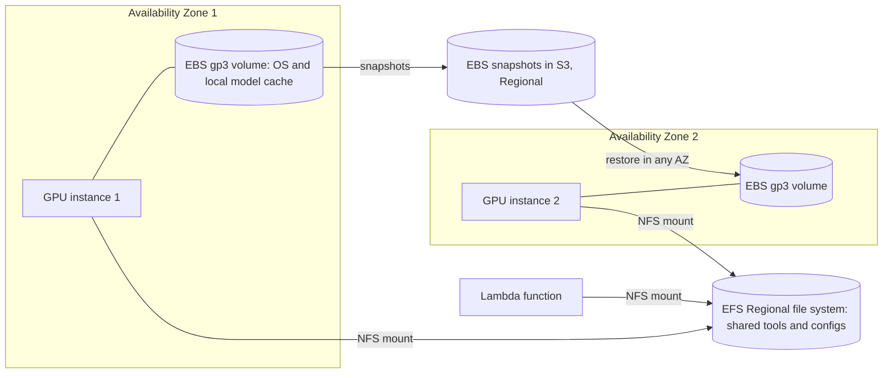

## 0. Before you start
- **Essential:** the difference between block, file and object storage in one sentence each; what an Availability Zone is.
- **Helpful:** IOPS (operations per second) versus throughput (bytes per second); NFS.
- **Optional advanced:** burst credits; snapshots and incremental backups.

## 1. Simple explanation
Most GenAI apps keep documents in S3 and call Bedrock, but sometimes code needs a *disk*. **EBS** is a virtual hard disk that you attach to one EC2 instance (fast, private to that server). **EFS** is a shared network folder that many servers, containers and even Lambda functions can mount at the same time. If you self-host a model, the weights (many gigabytes) must be loaded from somewhere quickly; if several workers need the same files, a shared folder avoids copying them to every disk. EBS is the right choice for one server's own disk and databases; EFS is the right choice for sharing.


```figure
flow ebs-efs
```

## 2. Structured explanation
1. **EBS** ✅: block storage volumes attached to EC2 instances; SSD types (gp3, gp2, io2 Block Express, io1) and HDD types (st1, sc1); **snapshots** (incremental, point-in-time) for backup and for copying data across accounts, Regions and Availability Zones; encryption with KMS; Elastic Volumes to resize or tune with no downtime.
2. **EFS** ✅: serverless, elastic **NFS** file storage (NFSv4.1 and 4.0), shared by many clients: EC2, ECS, EKS, **Lambda** and Fargate; Regional (multi-AZ) or One Zone; performance and throughput modes; **not supported on Windows** instances.
3. **Choosing** ✅/🟡: single-instance disk and databases → EBS; shared, growing, multi-AZ file access → EFS (§5.4).

## 3. Analogy
**EBS is a laptop's own hard drive; EFS is the team's shared network drive.** The laptop drive is fast and belongs to one machine at a time. The shared drive is slightly slower per file but everyone sees the same folders and it grows by itself.

*Where it breaks:* an EBS volume can be moved to another instance and is saved by snapshots (a laptop drive is not so portable), and one EBS type (io1/io2) can attach to several instances (Multi-Attach) ✅; and the shared drive is billed for what you store and use, not for a fixed size ✅.

## 4. The seven questions

**WHAT?** Block storage for one instance (EBS) and shared elastic file storage (EFS).

**WHY?** GenAI workloads running on your own compute need disks for model weights, caches, scratch files and shared tool data, with the right speed, durability and sharing model.

**WHEN?**
| Need | Pick |
|---|---|
| Boot volume, single-instance database, scratch space for one inference server | EBS ✅ |
| Very high IOPS or sub-millisecond latency | EBS io2 Block Express ✅ |
| Big sequential logs or data processing on a budget | EBS st1 or sc1 ✅ (not boot volumes) |
| Many containers, instances or Lambda functions share the same files | EFS ✅ |
| Shared model weights or tools across a fleet | EFS (or load from S3 to local disk at start) 🟡 |
| Windows file shares | Not EFS ✅ (use FSx for Windows File Server, not read ❌) |
| Documents for a knowledge base | S3 ([02/09](aip:02-data-management/09-amazon-s3-storage-lifecycle-replication-and-security)), not a disk |

**WHERE?** EBS volumes live in one Availability Zone with data replicated across servers inside it ✅; snapshots are Regional (replicated across the Region's AZs) ✅; EFS is Regional (multi-AZ) or One Zone ✅.

**HOW?** §5.

**WHAT IF?**
| Situation | Effect | Remedy |
|---|---|---|
| Instance in AZ-b needs a volume made in AZ-a | Volumes serve their own AZ 🟡 | Snapshot and restore in AZ-b ✅ |
| Nobody takes snapshots | **AWS does not back up EBS automatically** ✅ | Data Lifecycle Manager or AWS Backup ✅ |
| You delete one of several snapshots | Storage may not shrink (shared blocks) ✅ | Understand incremental chain |
| EFS uses Bursting and credits run out | Throughput drops to baseline ✅ | Elastic or Provisioned throughput |
| Workload spikes unpredictably | Elastic scales automatically ✅ | Monitor `MeteredIOBytes` and alert ✅ |
| One Zone EFS loses its AZ | Data may be lost ✅ | Use Regional for important data |
| Windows server wants EFS | Not supported ✅ | Different service |

**WHY NOT?** Do not store irreplaceable data on a single EBS volume without snapshots. Do not use Max I/O mode on EFS: AWS recommends General Purpose for all file systems ✅. Do not use EFS where S3 object storage is enough and cheaper 🟡.

## 5. Technical depth

### 5.1 EBS ✅ (`what-is-ebs.html`, `ebs-volume-types.html`, `ebs-snapshots.html`)
- **Features** ✅: multiple volume types; **Elastic Volumes** (grow or tune with no downtime); snapshots to restore or migrate across accounts, Regions and AZs; **encryption** of volumes and snapshots (on the servers hosting the instances, so data at rest and in transit between instance and volume are protected); durability **99.999%** for io2 Block Express and 99.8–99.9% for other types; **EBS Snapshots Archive** for retention of 90 days or more; Data Lifecycle Manager; Recycle Bin.
- **Volume types** ✅ (table, upper bounds):
  | Type | Class | Size | Max IOPS | Max throughput | Notes |
  |---|---|---|---|---|---|
  | gp3 | SSD general purpose | 1 GiB–64 TiB | 80,000 | 2,000 MiB/s | boot, dev/test, medium databases |
  | gp2 | SSD general purpose | 1 GiB–16 TiB | 16,000 | 250 MiB/s (128–250 by size) | older generation style |
  | io2 Block Express | SSD provisioned IOPS | 4 GiB–64 TiB | 256,000 | 4,000 MiB/s | sub-ms latency, **Multi-Attach** supported |
  | io1 | SSD provisioned IOPS | 4 GiB–16 TiB | 64,000 | 1,000 MiB/s | **Multi-Attach** supported |
  | st1 | HDD throughput optimized | 125 GiB–16 TiB | 500 | 500 MiB/s | big data, logs, **not boot** |
  | sc1 | HDD cold | 125 GiB–16 TiB | 250 | 250 MiB/s | infrequent access, lowest cost, **not boot** |
  Multi-Attach is not supported on gp3, gp2, st1 or sc1 ✅. Use EBS-optimized instances to reach provisioned IOPS ✅. Magnetic (`standard`) is previous generation ✅.
- **Snapshots** ✅: **incremental** (only changed blocks), stored in S3 buckets you cannot see, replicated across the Region's AZs so you can restore in any AZ; each snapshot restores a full volume; deleting a snapshot removes only blocks no other snapshot references; **AWS does not back up volumes automatically**; automate with Data Lifecycle Manager or AWS Backup; features: fast snapshot restore, snapshot lock, block public access (titles ✅).
- **GenAI angle** 🟡: a GPU instance's boot and data volume holding model files, vector index files for a self-hosted engine, or scratch caches; snapshots as a way to clone a "warm" model volume (Fast Snapshot Restore details ❌ not read).

### 5.2 EFS ✅ (`whatisefs.html`, `performance.html`)
- **What it is:** "serverless, fully elastic file storage" that scales to petabytes automatically; **NFSv4.1 and NFSv4.0**; accessible from EC2, ECS, EKS, **Lambda** and Fargate; strong consistency and file locking; POSIX permissions; **encryption at rest** (set at creation) and **in transit** (set at mount); access controlled by IAM and security groups; **no Windows-based EC2 support** ✅.
- **Types** ✅: **Regional** (recommended; multiple AZs, continuous availability when an AZ fails) and **One Zone** (one AZ; data can be lost if the AZ is lost).
- **Storage classes** ✅ (from the performance page): **Standard** (SSD, first-byte latency as low as 1 ms reads and 2.7 ms writes) and **Infrequent Access** and **Archive** (first-byte latency of tens of milliseconds). Lifecycle transition rules, One Zone-IA and pricing ❌ not read (the storage-classes page returned only its title).
- **Performance mode** ✅: **General Purpose** (default, lowest per-operation latency; the only mode for One Zone) and **Max I/O** (previous generation, higher latency, not for One Zone or Elastic throughput); AWS recommends General Purpose for all file systems; monitor `PercentIOLimit`.
- **Throughput modes** ✅:
  | Mode | Use when | Behavior |
  |---|---|---|
  | **Elastic** (recommended) | spiky or unpredictable workloads, or average-to-peak ratio of **5% or less** | scales automatically; pay for data and metadata read or written; no burst credits |
  | **Provisioned** | you know your needs, or average-to-peak of 5% or more | you pay for provisioned throughput above included baseline; after a switch to Provisioned or an increase, **24-hour** limits on switching back or decreasing |
  | **Bursting** | throughput should scale with stored data | baseline **50 KiB/s per GiB** (50 MiB/s per TiB) of Standard data; credits accrue below baseline; burst up to 100 MiB/s per TiB (minimum 100 MiB/s) while credits last; 1 MiB/s minimum metered |
- **Numbers (General Purpose, Regional, Elastic)** ✅: first-byte latency about 1 ms read and 2.7 ms write; very high IOPS and tens of GiB/s per file system (ranges per Region, quotas apply); per-client combined throughput **1,500 MiB/s** with amazon-efs-utils or CSI driver version 2.0+, otherwise **500 MiB/s** ✅.
- **Billing note** ✅: IOPS are not billed separately; each NFS request counts as 4 KB of throughput or its real size, whichever is larger.
- **GenAI angle** 🟡: shared tool or model directories for ECS tasks and EKS pods, Lambda functions loading large libraries or small model files from a mounted path, shared checkpoint folders.

### 5.3 Quick model-loading comparison (upper bounds from the pages)
Loading a 140 GB model file at the **maximum** documented rate: gp3 2,000 MiB/s, gp2 250, io2 Block Express 4,000, st1 500, EFS per client 1,500 (or 500). Real speeds are lower and depend on the instance, I/O size and network ❌; the lab computes the best-case seconds only to show why volume type and mode matter.

### 5.4 EBS vs EFS (lesson 298)
| Question | EBS | EFS |
|---|---|---|
| Access model | Block device attached to an instance (Multi-Attach only on io1/io2) ✅ | Shared NFS file system, many clients at once ✅ |
| Scope | One Availability Zone ✅ | Regional (multi-AZ) or One Zone ✅ |
| Capacity | Provisioned size (resize with Elastic Volumes) ✅ | Automatically grows and shrinks ✅ |
| OS | Linux and Windows 🟡 | Linux only (no Windows EC2) ✅ |
| Boot volume | Yes for SSD types ✅ | No 🟡 |
| Backup | Snapshots (not automatic) ✅ | EFS backups through AWS Backup 🟡 (not read ❌) |
| Typical GenAI fit | One inference server's disk, database data | Shared files for many workers or Lambda |


*Reading the arrows:* each instance has its own EBS volume in its own Availability Zone. Both instances and a Lambda function mount the same EFS file system for shared files. EBS snapshots go to Regional storage and can be restored as a new volume in another AZ.

## 6. Worked example
*Problem:* an engineering team self-hosts an open model on two GPU instances in two AZs, behind a load balancer. Each instance needs a fast local disk for the weights; a Lambda function and the instances share a small folder of prompt templates and tool definitions; the team wants backups and encryption.

| Step | Design | Why |
|---|---|---|
| 1 | Each instance: encrypted gp3 volume sized for OS plus weights, IOPS and throughput tuned with Elastic Volumes | Fast local disk, no downtime to tune ✅ |
| 2 | Snapshots daily through Data Lifecycle Manager; copy to a second Region | AWS does not back up volumes ✅ |
| 3 | Weights are pulled from S3 at instance start (or restored from a snapshot) | Avoid sharing multi-GB weights over NFS 🟡 |
| 4 | EFS Regional, General Purpose, Elastic throughput, encrypted, mounted by instances and Lambda (access points optional ❌) | Shared small files, multi-AZ ✅ |
| 5 | Alarm on EFS `MeteredIOBytes` and `PercentIOLimit` | Governance of Elastic usage ✅ |
| 6 | KMS keys per environment, least-privilege IAM | [08/03](aip:08-security/03-kms-secrets-manager-macie-and-bedrock-data-protection) |

## 7. Knowledge checkpoints
1. Which EBS volume types support Multi-Attach?
2. Does AWS back up EBS volumes automatically?
3. Which EFS throughput mode is recommended for spiky workloads?
4. Which EFS performance mode do AWS docs recommend for all file systems?
5. Can EFS be used with Windows-based EC2 instances?

## 7b. Practice questions (exam-style, original) — answers in §14

**Q1.** A single inference server needs a fast boot and data disk. Which storage fits best?
A. An EBS gp3 volume
B. An EFS file system only
C. S3 Glacier
D. Amazon Neptune

**Q2.** (Select TWO) Which statements about EBS snapshots are correct?
A. They are incremental
B. AWS does not take them automatically
C. They can only be restored in the original Availability Zone
D. They are accessible in the S3 console as ordinary objects
E. Deleting any snapshot always reduces billed storage

**Q3.** Many ECS tasks and a Lambda function must read the same files with automatic capacity growth. Which?
A. Amazon EFS
B. An EBS io2 volume attached to one instance
C. An instance store volume
D. A local disk on each task

**Q4.** (Select TWO) Which are true of EFS?
A. It supports NFSv4.1 and NFSv4.0
B. It can be mounted from Lambda, ECS, EKS and EC2
C. It supports Windows-based EC2 instances
D. It requires you to provision capacity in advance
E. It is a block device

**Q5.** An EFS workload is spiky and the average throughput is about 3% of the peak. Which throughput mode?
A. Elastic
B. Provisioned
C. Bursting
D. Max I/O

**Q6.** Which EBS volume type is **not** supported as a boot volume?
A. st1 (Throughput Optimized HDD)
B. gp3
C. io2 Block Express
D. gp2

**Q7.** A volume must deliver average latency under 500 microseconds and more than 80,000 IOPS. Which?
A. io2 Block Express
B. gp2
C. sc1
D. st1

**Q8.** Which statement about EFS One Zone is correct?
A. Data lives in one Availability Zone and might be lost if that zone is lost
B. It replicates across three Regions
C. It supports Windows
D. It always has the highest durability of all types

## 7c. Mixed review for Quiz 17 (storage) — answers in §14
1. What is the baseline throughput rate of Bursting mode per GiB stored? 2. Which EBS type has 99.999% durability? 3. Name one service that automates EBS snapshot creation. 4. What is the per-client maximum EFS throughput with a current client? 5. Which service is better for a knowledge base's source documents: EBS, EFS or S3?

## 8. Hands-on lab: model-load time bounds, burst credits, incremental snapshots and an EBS-vs-EFS chooser (offline) + console steps

### 8.1 Objective
Compute best-case loading times from documented maximum rates, reproduce the EFS burst-credit examples from the page, simulate incremental snapshots (including why deleting one may not shrink storage), and encode the EBS-vs-EFS decision rules.

### 8.2 Prerequisites
Python 3 (standard library). Optional AWS part: an EC2 instance, EBS volumes and an EFS file system in a VPC.

### 8.3 AWS services
Offline: none. Optional: EC2, EBS, EFS, KMS, CloudWatch.

### 8.4 IAM permissions
Offline: none. Real: EC2 permissions to create, attach and snapshot volumes; EFS permissions to create file systems and mount targets; KMS use for encryption (action lists ❌ not read).

### 8.5 Region notes
EBS volumes and EC2 instances must be in the same Availability Zone 🟡; EFS mount targets live in each AZ's subnet 🟡 (not read ❌); throughput quotas differ by Region ✅.

### 8.6 Architecture
§5.4 diagram.

### 8.7 Cost
Offline: none. Real: EBS charges for provisioned size (and IOPS and throughput above baseline for some types) and snapshot data ✅ (rates ❌); EFS charges for stored data by class and for Elastic throughput or provisioned throughput ✅ (rates ❌). Delete volumes, snapshots and file systems afterwards.

### 8.8 Code
**Simplification:** loading times use the **documented maximum** rates, which real systems rarely reach; the burst-credit math reproduces the page's 100 GiB and 1 TiB examples; snapshots are modeled as sets of block ids; the chooser is a teaching rule set.

```python lab-run
# ---------- 1. Best-case time to read a 140 GB model file (documented maximum rates) ----------
SIZE_MIB = 140 * 1024
RATES = {"EBS gp2 (250 MiB/s)": 250, "EBS st1 (500 MiB/s)": 500, "EBS gp3 (2,000 MiB/s)": 2000, "EBS io2 Block Express (4,000 MiB/s)": 4000,
         "EFS client, other versions (500 MiB/s)": 500, "EFS client v2.0+, Elastic (1,500 MiB/s)": 1500}
print("1) best-case seconds to read 140 GB (upper bounds, not typical speeds)")
for name, rate in RATES.items():
    print(f"   {name:<42}{SIZE_MIB / rate:>8.1f} s")

# ---------- 2. EFS Bursting: baseline 50 KiB/s per GiB, burst 100 KiB/s per GiB (minimum 100 MiB/s); the page treats 1 TiB as about 1,000 GiB ----------
def bursting(gib_standard):
    baseline_mibps = max(1.0, gib_standard * 0.05)
    burst_mibps = max(100.0, gib_standard * 0.1)
    return baseline_mibps, burst_mibps
print("2) EFS Bursting examples")
for gib in (100, 1000, 10000):
    base, burst = bursting(gib)
    credits_per_day = base * 86400
    minutes_at_burst = credits_per_day / burst / 60
    print(f"   {gib:>6} GiB: baseline {base:>6.1f} MiB/s, burst {burst:>7.1f} MiB/s, one idle day earns {credits_per_day:>9,.0f} MiB = {minutes_at_burst:>6.0f} minutes of burst")
print("   (the page: 100 GiB earns 432,000 MiB per idle day = 72 minutes at 100 MiB/s; files over 1 TiB can burst about 12 hours a day)")

# ---------- 3. Incremental snapshots ----------
volume = {block: f"v1-{block}" for block in range(10)}
snapshots = {}
def take(name):
    snapshots[name] = dict(volume)
def stored_blocks():
    unique = set()
    for snap in snapshots.values():
        unique |= set(snap.items())
    return len(unique)
take("snap-1")
for block in (2, 3):
    volume[block] = f"v2-{block}"
take("snap-2")
volume[3] = "v3-3"
take("snap-3")
print("3) incremental snapshots of a 10-block volume")
print("   unique blocks stored with snap-1, snap-2, snap-3:", stored_blocks(), "(a full copy would be 30)")
del snapshots["snap-2"]
print("   after deleting snap-2:", stored_blocks(), "(block v2-2 is still used by snap-3; only v2-3 was exclusive to snap-2)")
restored = dict(snapshots["snap-3"])
print("   restoring snap-3 gives a full volume with", len(restored), "blocks, e.g. block 3 =", restored[3])

# ---------- 4. A small chooser (lesson 298) ----------
def choose(shared_clients, needs_boot, os_name, multi_az_access, avg_to_peak=None):
    reasons = []
    if os_name == "windows" and shared_clients:
        return "not EFS (no Windows support); consider a Windows file service", ["EFS is not supported on Windows-based EC2 instances"]
    if needs_boot:
        return "EBS (SSD type)", ["boot volumes are supported only on SSD EBS types"]
    if shared_clients and multi_az_access:
        reasons.append("many clients and multi-AZ access need a shared Regional file system")
        mode = "Elastic" if avg_to_peak is not None and avg_to_peak <= 5 else "Provisioned"
        reasons.append(f"throughput mode {mode} (average-to-peak {avg_to_peak}%: 5% or less favors Elastic)")
        return "EFS Regional", reasons
    return "EBS", ["single instance, one AZ, block device"]
print("4) chooser")
for args in [(False, True, "linux", False), (True, False, "linux", True, 3), (True, False, "linux", True, 40), (True, False, "windows", True), (False, False, "linux", False)]:
    result, why = choose(*args)
    print(f"   {args} -> {result}; {'; '.join(why)}")
```

### 8.9 Captured output
Generated on 2026-10-26 by extracting the block above from this file and running it (Python 3). It models documented rates and rules with made-up data; it is **not** EBS or EFS output.
```text lab-out
1) best-case seconds to read 140 GB (upper bounds, not typical speeds)
   EBS gp2 (250 MiB/s)                          573.4 s
   EBS st1 (500 MiB/s)                          286.7 s
   EBS gp3 (2,000 MiB/s)                         71.7 s
   EBS io2 Block Express (4,000 MiB/s)           35.8 s
   EFS client, other versions (500 MiB/s)       286.7 s
   EFS client v2.0+, Elastic (1,500 MiB/s)       95.6 s
2) EFS Bursting examples
      100 GiB: baseline    5.0 MiB/s, burst   100.0 MiB/s, one idle day earns   432,000 MiB =     72 minutes of burst
     1000 GiB: baseline   50.0 MiB/s, burst   100.0 MiB/s, one idle day earns 4,320,000 MiB =    720 minutes of burst
    10000 GiB: baseline  500.0 MiB/s, burst  1000.0 MiB/s, one idle day earns 43,200,000 MiB =    720 minutes of burst
   (the page: 100 GiB earns 432,000 MiB per idle day = 72 minutes at 100 MiB/s; files over 1 TiB can burst about 12 hours a day)
3) incremental snapshots of a 10-block volume
   unique blocks stored with snap-1, snap-2, snap-3: 13 (a full copy would be 30)
   after deleting snap-2: 12 (block v2-2 is still used by snap-3; only v2-3 was exclusive to snap-2)
   restoring snap-3 gives a full volume with 10 blocks, e.g. block 3 = v3-3
4) chooser
   (False, True, 'linux', False) -> EBS (SSD type); boot volumes are supported only on SSD EBS types
   (True, False, 'linux', True, 3) -> EFS Regional; many clients and multi-AZ access need a shared Regional file system; throughput mode Elastic (average-to-peak 3%: 5% or less favors Elastic)
   (True, False, 'linux', True, 40) -> EFS Regional; many clients and multi-AZ access need a shared Regional file system; throughput mode Provisioned (average-to-peak 40%: 5% or less favors Elastic)
   (True, False, 'windows', True) -> not EFS (no Windows support); consider a Windows file service; EFS is not supported on Windows-based EC2 instances
   (False, False, 'linux', False) -> EBS; single instance, one AZ, block device
```

### 8.10 Explanation
- Part 1: the same file takes a few tens of seconds on the fastest documented volume and minutes on slow ones, which is why volume type and EFS mode matter for model loading ✅ (best case only).
- Part 2: reproduces the page's 432,000 MiB and 72-minute example for 100 GiB and the roughly 12-hours-a-day result for 1 TiB and larger ✅.
- Part 3: incremental storage stores only changed blocks; deleting a snapshot frees only blocks no other snapshot uses ✅.
- Part 4: the chooser mirrors §5.4 and the 5% average-to-peak guidance ✅.

### 8.11 Optional AWS labs (lessons 295, 297; shown, not run against AWS ❌)
**EBS (295):** console → EC2 → Volumes → Create volume (gp3, same AZ as your instance, encrypted) → Attach to the instance → on Linux run `lsblk`, create a file system (`mkfs`), mount it, write a file 🟡 → create a **snapshot** → create a new volume from the snapshot in another AZ and attach it → modify the volume's size or performance with **Modify volume** (Elastic Volumes ✅) → **delete** volumes and snapshots.
**EFS (297):** console → EFS → Create file system (Regional, defaults: General Purpose, Elastic ✅) → create mount targets in each AZ's subnet → security group allowing NFS (port 2049 🟡) from your instances → on two instances in different AZs install the EFS mount helper (`amazon-efs-utils` ✅ named on the page) and mount → write a file on one, read it on the other → optionally mount from a Lambda function → delete the file system.

### 8.12 Common errors
| Error | Cause | Fix |
|---|---|---|
| Cannot attach a volume | Different AZ from the instance 🟡 | Create or restore it in the instance's AZ |
| Disk not visible in the OS | Not formatted or mounted 🟡 | `mkfs`, mount, `/etc/fstab` |
| Throughput below expectation | Not EBS-optimized instance, small I/O, instance limits ✅ | Use EBS-optimized instances, tune |
| EFS mount hangs | Security group or mount target missing 🟡 | Allow NFS from the client, create mount targets |
| EFS slow after heavy use | Bursting credits exhausted ✅ | Elastic or Provisioned |
| Large unexpected EFS bill | Elastic usage unmonitored ✅ | `MeteredIOBytes` alarm |
| Windows instance cannot mount EFS | Not supported ✅ | Use a Windows-compatible service |

### 8.13 Security recommendations
Encrypt EBS volumes, snapshots and EFS (at rest at creation, in transit at mount) ✅ with KMS ([08/03](aip:08-security/03-kms-secrets-manager-macie-and-bedrock-data-protection)); use snapshot lock and block public access for snapshots ✅ (titles); never share snapshots publicly; restrict EFS access with IAM and security groups ✅ and POSIX permissions ✅; keep secrets off shared file systems ([08/03](aip:08-security/03-kms-secrets-manager-macie-and-bedrock-data-protection)); do not put customer documents on disks when S3 with access controls fits.

## 9. What can go wrong?
| Failure | Why | Symptoms | Investigate | Fix | Prevent |
|---|---|---|---|---|---|
| **Data loss on a single volume** | No snapshots ✅ | Unrecoverable data | Backup status | Restore from snapshot | DLM or AWS Backup ✅ |
| **Slow model load** | Slow volume type or low limits ✅ | Long cold starts | Volume metrics | Faster type, more throughput | Size for load time |
| **EFS credits exhausted** | Bursting mode ✅ | Throughput collapse | Burst credit metrics | Switch mode | Choose Elastic |
| **One Zone EFS loss** | AZ failure ✅ | Data gone | Architecture | Regional + backups | Use Regional |
| **AZ mismatch** | Volume and instance in different AZs 🟡 | Attach fails | Console | Restore in right AZ | Plan AZs |
| **Cost drift** | Unused volumes, snapshots | Bill creep | Cost Explorer | Delete unattached volumes | Tags, lifecycle |
| **Shared files tampered** | Wide EFS access | Bad prompts or tools loaded | Access logs | Tighten IAM, POSIX | Read-only mounts where possible 🟡 |

## 10. Common misconceptions
1. **"EBS is backed up automatically."** It is not ✅.
2. **"EFS needs capacity planning."** It grows and shrinks automatically ✅.
3. **"EBS volumes are shared across AZs."** They are per AZ; snapshots are Regional ✅.
4. **"Max I/O is the fastest EFS mode."** It has higher latency; use General Purpose ✅.
5. **"EFS works on Windows."** Not for Windows-based EC2 ✅.
6. **"Deleting a snapshot always saves money."** Shared blocks stay ✅.

## 11. Exam notes
- **Patterns:** "block storage for one EC2 instance" → EBS; "shared file system for many instances/containers/Lambda" → EFS; "highest IOPS, lowest latency" → io2 Block Express; "cheap throughput for logs" → st1/sc1; "backup of volumes" → snapshots via DLM or AWS Backup; "spiky throughput" → EFS Elastic.
- **Keywords:** block, NFS, Multi-Attach, Elastic Volumes, snapshot, incremental, One Zone, Regional, General Purpose, Elastic, Provisioned, Bursting, burst credits.
- **Traps:** assuming auto backups; using HDD types as boot; picking Max I/O; mixing up EFS and S3 for documents.
- **Compare:** EBS vs EFS vs S3 vs instance store ([02/09](aip:02-data-management/09-amazon-s3-storage-lifecycle-replication-and-security) for S3); FSx (not read ❌).

## 12. Summary and revision cards
- EBS: per-AZ block volumes (gp3, io2 Block Express...), incremental snapshots, no automatic backups. EFS: elastic NFS shared across clients (Regional or One Zone), General Purpose + Elastic by default, no Windows.

**Cards.** Q: EBS durability for io2 Block Express? A: 99.999%. · Q: EFS Bursting baseline? A: 50 KiB/s per GiB. · Q: EFS per-client max with a current client? A: 1,500 MiB/s.

## 13. References
| Source | URL | Verified |
|---|---|---|
| What is Amazon EBS | https://docs.aws.amazon.com/ebs/latest/userguide/what-is-ebs.html | 2026-10-26 |
| EBS volume types | https://docs.aws.amazon.com/ebs/latest/userguide/ebs-volume-types.html | 2026-10-26 |
| EBS snapshots | https://docs.aws.amazon.com/ebs/latest/userguide/ebs-snapshots.html | 2026-10-26 |
| What is Amazon EFS | https://docs.aws.amazon.com/efs/latest/ug/whatisefs.html | 2026-10-26 |
| EFS performance specifications | https://docs.aws.amazon.com/efs/latest/ug/performance.html | 2026-10-26 |

**Unverified here:** all prices and quotas; EFS storage-class and lifecycle pages (the fetch returned only a title), EFS backups and access points; EBS Fast Snapshot Restore, Multi-Attach usage details and AZ attachment rule text (🟡 standard behavior); FSx services; Lambda with EFS configuration steps; the EC2 instance store.

## 14. Answers to checkpoints and practice questions
**Checkpoints.** 1) io2 Block Express and io1 ✅. 2) No ✅. 3) Elastic ✅. 4) General Purpose ✅. 5) No ✅.

**Practice questions.**
- **Q1 → A.** ✅
- **Q2 → A, B.** C false (restore in any AZ in the Region), D false, E false ✅.
- **Q3 → A.** ✅
- **Q4 → A, B.** C, D, E false ✅.
- **Q5 → A.** ✅ (5% or less average-to-peak).
- **Q6 → A.** ✅ HDD types are not boot volumes.
- **Q7 → A.** ✅
- **Q8 → A.** ✅

**Mixed review (§7c).** 1) 50 KiB/s per GiB of Standard storage ✅. 2) io2 Block Express ✅. 3) Amazon Data Lifecycle Manager or AWS Backup ✅. 4) 1,500 MiB/s with amazon-efs-utils or the CSI driver version 2.0 or later (500 MiB/s otherwise) ✅. 5) S3 ✅ (🟡 design guidance from [02/09](aip:02-data-management/09-amazon-s3-storage-lifecycle-replication-and-security)).
